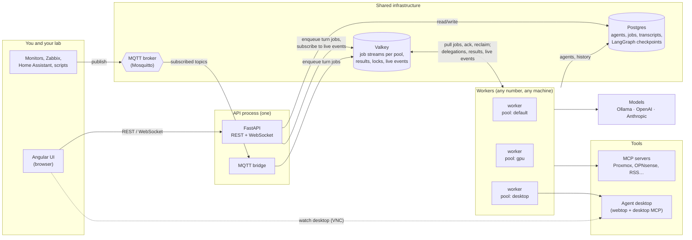

# Agent HQ

A self-hosted multi-agent system. You add model providers (your Ollama servers, OpenAI, Anthropic, any OpenAI-compatible server, your ChatGPT Plus/Pro plan, or your SuperGrok plan) and create agents in the web UI, giving each one instructions, a provider and one of its models, tools, delegation rights and a **worker pool** that decides which machines run it. Supervisors delegate to other agents; delegated work always reports back to the conversation it came from. Standing goals on a Kanban board keep agents working an outcome, one next action at a time, until it's done. Jobs survive crashes and restarts, and MQTT events from your homelab can wake agents on their own. Requests and alerts reach your phone on Telegram or Discord, where you can decide them, answer agents and chat with them. Bring several agents into one chat with @mentions (a huddle) and they answer in turn, each seeing what the others said.

- **Backend:** FastAPI, LangGraph (conversation graph + checkpointing), PydanticAI (agents, typed results, MCP tools)
- **Frontend:** Angular 22 (signals, standalone components)
- **Shared infrastructure:**
  - **Postgres:** the source of truth: agents, jobs, transcripts and LangGraph checkpoints.
  - **Valkey** (or Redis): job delivery through Streams, plus results, locks, live UI events and the worker registry.
  - **MQTT:** incoming events from monitors, devices, Zabbix, Home Assistant and so on.
- **Tools:** any MCP server, registered in the UI
- **Desktops:** one `linuxserver/webtop` container each, created from the UI and dedicated to an agent or shared, driven by a small MCP server and viewable in the UI

Nothing about specific agents or models is in the code. Providers, names, roles, instructions, models, tools, pools, delegation rights and event subscriptions are all database rows, so renaming or re-tasking an agent takes effect on its next job.

**Agents get better with use, under your control:**
- **Skills:** written-down procedures agents follow, propose and improve, in the Agent Skills (SKILL.md) format so you can import others' and export your own.
- **The learning loop:** your 👍/👎 and corrections, and agents looking back at their work.
- **Your profile:** what every agent always knows about you.
- **A knowledge library:** your documents, runbooks, Obsidian vault and NAS shares, searchable with citations.
- **Evals:** they show whether a change actually helps before it's applied.

What they learn waits for your approval unless you say otherwise.

## How it works



**Every piece of work is a job.** Your messages, MQTT events, webhooks, schedules and delegations all become jobs, written to Postgres and queued on a Valkey stream for the assignee's worker pool. Workers on any machine pull jobs, run them and acknowledge them only when they finish, so a job a crashed worker leaves behind is picked up by another. Delegated work always reports back to the conversation it came from. See [Architecture](docs/architecture.md).

## What it can do

**Agents and how they work together** ([Working with agents](docs/agents.md))
- **Delegation:** supervisors hand tasks to other agents, in the foreground or the background, and get structured results back.
- **Huddles:** several agents in one chat, addressed with @mentions (or @huddle for everyone).
- **Next actions:** big requests are broken into steps and worked one at a time, resuming after an interruption.
- **Standing goals:** a Kanban board per agent (Backlog, Ready, In progress, Done) with WIP limits. You approve proposed goals and confirm done claims. With a team, an agent works a goal's actions in parallel with other agents or sub-agents.
- **Scheduled tasks:** plain-language or cron schedules, each run in its own conversation.
- **Sub-agents:** off, ask or allowed per agent, with limits and a usage ledger. Agents that may not spawn can request it, and duplicates of an existing agent are refused.

**Models** ([Models](docs/models.md))
- Ollama, OpenAI, Anthropic and any OpenAI-compatible server, plus your ChatGPT or SuperGrok plan by sign-in instead of an API key.
- A model per agent, thinking on/off and a thinking level set in the UI.
- Context windows read from the server, with older turns summarised and long tool runs trimmed to fit.
- Local-first helpers: web pages read as text, vision as a tool, and a fallback model.

**Tools** ([Tools](docs/tools.md))
- Any MCP server, registered in the UI, or installed from the MCP server catalog as a package server.
- Bundled servers: a web reader (feeds, pages, SearXNG search) and an MQTT publisher. Homelab tool servers for Proxmox, TrueNAS, MikroTik, Zabbix and more are in [Lab tools](docs/labtools.md).
- Tool approvals per tool: Allow, Ask me or Block, with approval cards in the chat, the Requests inbox and your phone.

**Desktops and workbenches** ([Desktops and workbenches](docs/desktops-and-workbenches.md))
- Desktops (a browser the agent drives visually) and workbenches (an agent's own Python environment, network off by default), created in the UI and dedicated or shared.
- Scripts with tools: many tool calls in one step, each still going through approvals and tracing.
- Take control of an agent's desktop yourself, for example to sign in to a site, then hand it back.

**Memory and knowledge** ([Memory and knowledge](docs/memory-and-knowledge.md))
- Long-term memory with keyword and embedding search.
- Scratch pads for interim research, kept outside the context window.
- File attachments in both directions, with images through a vision tool.
- A knowledge library: uploads, web pages, Git repos, your Obsidian vault and NAS shares, searchable with citations. Agents can propose additions for your approval.

**Learning** ([Learning](docs/learning.md))
- Skills in the Agent Skills (SKILL.md) format: written, proposed and improved by agents, importable and exportable, with upkeep for stale ones.
- The learning loop: ratings, corrections and reflections, plus your profile.
- Evals that test a change before it's applied.

**Notifications** ([Notifications](docs/notifications.md))
- Requests and alerts on Telegram, Discord and MQTT, with routing rules. Decide requests and chat with agents from your phone.

**Operations**
- Sign-in with 2FA, API tokens and an audit log, behind HTTPS ([Deployment](docs/deployment.md)).
- Inbound webhooks and MQTT events wake agents ([Architecture](docs/architecture.md), [Lab alerts](docs/lab-alerts.md)).
- Tracing to Arize Phoenix or any OpenTelemetry backend ([Observability](docs/architecture.md#observability)).
- Automatic deploys on every push with a test gate ([Auto-deploy](docs/auto-deploy.md)).

## Quick start

On one Docker host:

```bash
cd deploy/infra && cp .env.example .env    # set the passwords
docker compose up -d                       # Postgres and Valkey (MQTT is optional)
cd ../.. && cp .env.example .env           # point AHQ_* at your infra
docker compose --profile images build      # desktop and workbench images
docker compose up -d --build
```

Set up HTTPS before the last step (see [Deployment](docs/deployment.md#sign-in-and-https)). On the first visit you'll create your account with a one-time setup code that the `hq` service prints to its log. Then add a model provider under **Settings → Model providers** and create your agents, or import the example crew from `examples/agents.example.json`.

To run it from source for development instead, see [Getting started](docs/getting-started.md).

## Documentation

| Guide | What's in it |
|---|---|
| [Getting started](docs/getting-started.md) | Running from source on one machine, the example crew |
| [Deployment](docs/deployment.md) | Docker deploy, more machines and workers, upgrades, sign-in and HTTPS |
| [Auto-deploy](docs/auto-deploy.md) | Deploying on every push with Gitea Actions, behind the test suite |
| [Architecture](docs/architecture.md) | Jobs, workers and pools, delegation, crash recovery, stopping work, MQTT events, webhooks, observability |
| [Working with agents](docs/agents.md) | Huddles, next actions, scheduled tasks, standing goals and teams, sub-agents, deleting agents, avatars |
| [Models](docs/models.md) | Providers and plans, thinking levels, long conversations, local-first models |
| [Tools](docs/tools.md) | Adding tools, the MCP catalog, package servers, web reader, MQTT publisher, tool approvals |
| [Lab tools](docs/labtools.md) | The homelab MCP servers and how to set them up |
| [Lab alerts](docs/lab-alerts.md) | Sending alerts from your systems to agents through webhooks |
| [Desktops and workbenches](docs/desktops-and-workbenches.md) | Workbenches, scripts with tools, desktops, taking control |
| [Memory and knowledge](docs/memory-and-knowledge.md) | Long-term memory, scratch pads, attachments, the knowledge library |
| [Learning](docs/learning.md) | Skills, the learning loop, your profile, evals |
| [Notifications](docs/notifications.md) | Telegram, Discord and MQTT channels |
| [Schema migrations](docs/schema-migrations.md) | How the database schema is upgraded |
| [Development](docs/development.md) | Running the tests, the code layout |
| [Example homelab crew](docs/examples/homelab-crew.md) | A worked example of a lab crew |

## License

Agent HQ is released under the [MIT License](LICENSE). Copyright (c) 2026 Michael J. Smith.

Icons are from [Lucide](https://lucide.dev) (ISC License).
