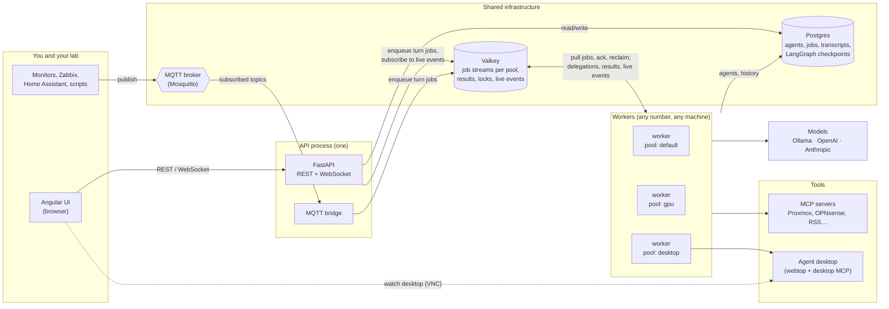
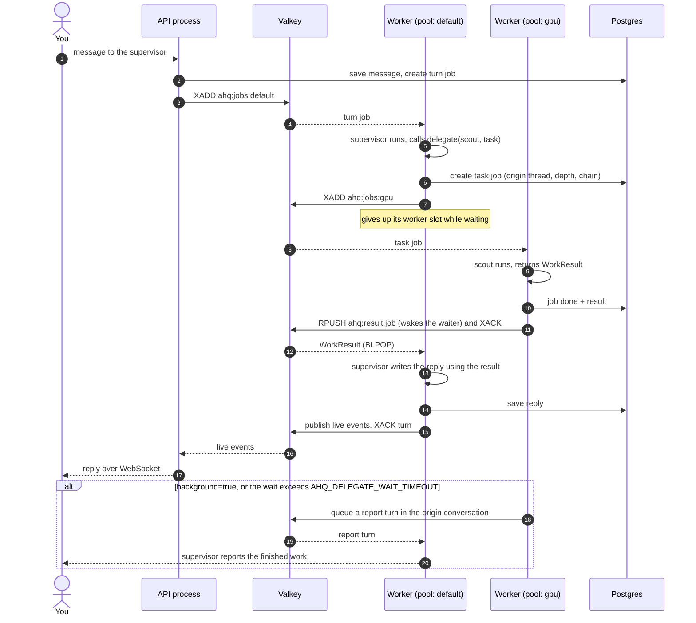
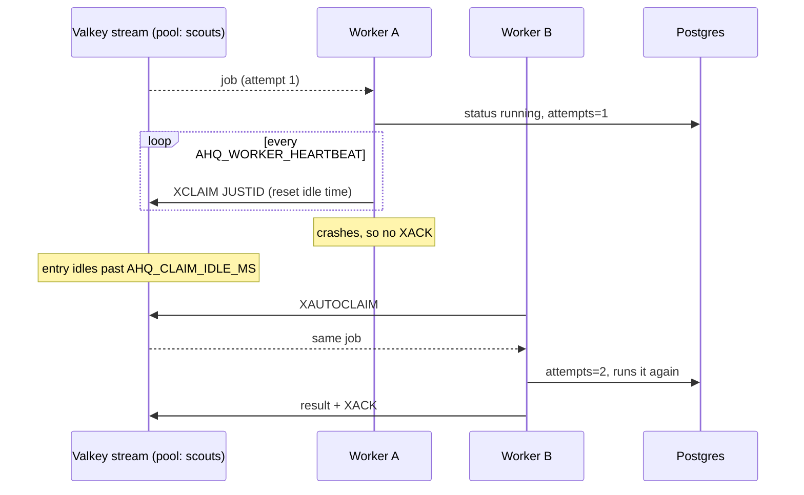
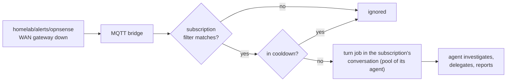

# Agent HQ

A self-hosted multi-agent system. You create agents in the web UI and give each one instructions, a model, tools, delegation rights and a **worker pool** that decides which machines run it. Supervisors delegate to other agents; delegated work always reports back to the conversation it came from. Jobs survive crashes and restarts, and MQTT events from your homelab can wake agents on their own.

- **Backend:** FastAPI, LangGraph (conversation graph + checkpointing), PydanticAI (agents, typed results, MCP tools)
- **Frontend:** Angular 22 (signals, standalone components)
- **Shared infrastructure:**
  - **Postgres:** the source of truth: agents, jobs, transcripts and LangGraph checkpoints.
  - **Valkey** (or Redis): job delivery through Streams, plus results, locks, live UI events and the worker registry.
  - **MQTT:** incoming events from monitors, devices, Zabbix, Home Assistant and so on.
- **Tools:** any MCP server, registered in the UI
- **Desktops:** one `linuxserver/webtop` container per agent, driven by a small MCP server and viewable in the UI

Nothing about specific agents is in the code. Names, roles, instructions, models, tools, pools, delegation rights and event subscriptions are all database rows, so renaming or re-tasking an agent takes effect on its next job.

## Architecture



**Every piece of work is a job.** A *turn* job runs one turn of a conversation with the thread's owner agent; your messages, MQTT events and background reports all become turn jobs. A *task* job is a delegation, and the assignee returns a structured `WorkResult` (`status`, `summary`, `details`). Each job is written to Postgres, then its ID is added to the Valkey stream for the assignee's pool (`ahq:jobs:<pool>`).

**Workers pull, run, then acknowledge.** A worker serves one or more pools. It reads with a consumer group, so each job goes to exactly one worker, and it acknowledges the job only after it finishes. While a job runs, the worker refreshes the entry on a heartbeat. If a worker dies, its unacknowledged entries go idle, and another worker on that pool reclaims and reruns them, up to `AHQ_MAX_ATTEMPTS` times. After that the job is marked failed and reported.

**Any worker can run any turn.** Agent definitions and job context are in Postgres, and conversation history is in the shared LangGraph checkpointer. A Valkey lock makes sure two turns of the same conversation never run at once, even on different machines.

**Pools place agents on machines.** Set an agent's pool to `desktop` and only workers started with `--pools desktop` run it, for example the worker on the host next to its desktop container.

### Delegation and report-back



How the delegation guarantees hold up:
- **Wait mode (default)** returns the delegate's `WorkResult` as the `delegate` tool's return value. The supervisor always has the result in hand when it answers you. While it waits, it releases its worker slot, so even a single-slot worker can't deadlock.
- **Background mode,** and waits that exceed `AHQ_DELEGATE_WAIT_TIMEOUT`, queue a **report turn** in the conversation the work came from. The conversation's owner agent is woken there to tell you the outcome.
- **Failures are results too.** Model errors, exceptions and jobs abandoned after repeated worker crashes all produce a `failed` WorkResult, which is reported the same way.
- **Guards:** an agent can only delegate to agents on its list, a chain can't loop back to an agent already in it, and nesting depth is capped (`AHQ_MAX_DELEGATION_DEPTH`).

### Crash recovery



A rerun starts the job from the beginning. Tools that change systems should therefore be safe to repeat, or should go behind an approval step (see *Next steps*).

### MQTT events



Subscriptions are managed on the **Events** page:
- **Topic filter:** MQTT wildcards, where `+` matches one level and `#` matches the rest.
- **Agent:** the agent that handles matching events.
- **Conversation:** where that agent reports. Leave it empty to get a dedicated events thread.
- **Prompt template:** what the agent is told, with `{topic}` and `{payload}` filled in.
- **Cooldown:** stops an alert storm from turning into hundreds of model calls.

The page can also send a test event without a broker. The bridge runs in the API process; run only one API process with `AHQ_MQTT_URL` set, or each event is handled twice.

## Quick start (single machine, dev)

You need Postgres, Valkey and (optionally) MQTT. The simplest route is the infra compose file:

```bash
cd deploy/infra
cp .env.example .env                      # set the passwords
docker compose run --rm mosquitto mosquitto_passwd -c /mosquitto/config/passwd agent-hq
docker compose up -d
```

Backend (one shell for the API, one for a worker):

```bash
cd backend
python -m venv .venv && . .venv/bin/activate      # Windows: .venv\Scripts\activate
pip install -e ".[dev]"
cp ../.env.example ../.env                         # point AHQ_* at your infra; export it
uvicorn app.main:app --reload --port 8000          # API + UI + MQTT bridge
python -m app.worker --pools default               # a worker (any number, any machine)
```

To run a worker inside the API process instead of separately, set `AHQ_EMBED_WORKER=1`.

Frontend:

```bash
cd frontend
npm install
npx ng serve        # http://localhost:4200, proxies /api and /ws to :8000
```

To try the example crew, go to **Agents → Import** and pick `examples/agents.example.json`. It contains the agents, their pools, a desktop tool server and an alerts subscription, all as data. Edit the models and URLs to match your setup.

Without `AHQ_DB_URL`, the system falls back to SQLite files in `AHQ_DATA_DIR`. That's fine for a single machine, but use Postgres as soon as workers run anywhere else.

## Tests

```bash
cd backend && pytest
```

The tests use scripted fake models (no LLM needed), a real `valkey-server` or `redis-server` started on a free port, an in-process MQTT broker, and a throwaway Postgres cluster when Postgres is installed. They cover:
- delegation in wait and background modes
- single-slot workers (no deadlock)
- pinning agents to pools
- **a worker crashing mid-job and another reclaiming it**
- failure reporting
- conversation history persisting across turns
- renaming agents
- a real stdio MCP server
- MQTT matching, cooldowns and a real broker end to end
- the Postgres database and checkpointer with two workers
- import and export

## Deploy (Docker)

1. **Infrastructure,** once, on one host: `deploy/infra/docker-compose.yml` (Postgres 17, Valkey 8, Mosquitto 2).
2. **Application:** `cp .env.example .env`, fill in the URLs and keys, then `docker compose up -d --build`. This starts:
   - `hq`: API, UI and MQTT bridge on port 8000
   - `worker`: pool `default`
   - `worker-desktop` and `desktop-1`: pool `desktop`, plus an example agent desktop
3. **More machines:** copy `docker-compose.yml` and `.env` to another host and keep only the worker services you want there, with `--pools` set to whatever runs on that machine (`gpu`, `desktop`, `lab-east`…). Workers show up on the **System** page with their pools and load, and each pool's queue depth appears next to them.

Valkey settings that matter (already set in the infra compose file):
- `appendonly yes`: queued jobs survive a Valkey restart.
- `maxmemory-policy noeviction`: Valkey never quietly discards stream entries.
- `requirepass`: a password, which goes in `AHQ_REDIS_URL` as `redis://:password@host:6379/0`.

### Agent desktops

To add another desktop, copy the `desktop-1` block in `docker-compose.yml` (`desktop-2`, host port `3002:3000`, its own `/config` volume). Then, in the UI:
1. Register `http://desktop-2:8765/mcp` as an HTTP tool server.
2. Tick it on the agent that owns the desktop.
3. Set that agent's pool to one served by a worker that can reach the desktop's network.

Agents that use desktop tools need a vision-capable model.

## Adding tools

Register MCP servers on the **Tools** page:
- **HTTP:** a URL like `http://perceptor:8811/mcp`
- **stdio:** a command plus arguments, which is launched **on whichever worker runs the agent**, so it must be installed there

Click **Test connection** to list the server's tools (this connects from the API host), then tick the server on any agent. Tool names are prefixed with the server name by default (`proxmox_list_vms`) so they never collide.

## Model specs

| Spec | Goes to |
|---|---|
| `ollama:gpt-oss:20b` | `AHQ_OLLAMA_BASE_URL` |
| `openai:gpt-4.1` | OpenAI (`OPENAI_API_KEY`) |
| `anthropic:<model>` | Anthropic (`pip install ".[anthropic]"`, `ANTHROPIC_API_KEY`) |
| `test` | PydanticAI's built-in test model (no LLM, for UI checks) |

## Observability

Set `OTEL_EXPORTER_OTLP_ENDPOINT` to your OpenTelemetry Collector. The API process traces as `agent-hq` and workers as `agent-hq-worker`, so every agent run, model call and tool call shows up in Phoenix. The live activity panel in each chat shows the same information, plus queueing, retries and which worker ran each job.

## Layout

```
backend/app/
  models.py          AgentDef, ToolServer, Thread, Message, Job, Subscription tables
  runtime.py         builds agents from rows; turns; delegation; report-back
  worker.py          stream consumer: concurrency, heartbeats, reclaiming, registry
  broker.py          all Valkey access: streams, results, pub/sub, locks, cooldowns
  mqtt_bridge.py     MQTT subscriptions -> turn jobs
  llm.py             model spec -> PydanticAI model
  api/               REST + WebSocket (/ws/threads/{id})
  telemetry.py       OTLP -> your Collector -> Phoenix
frontend/src/app/    chat, agents, tools, events and system pages
desktop/             webtop image + desktop MCP server (screenshot/click/type/key/scroll/open_url)
deploy/infra/        Postgres, Valkey and Mosquitto compose file
examples/            example crew (agents, pools, tools, subscriptions) as importable JSON
```

## Next steps worth building

- **Approvals:** mark tools as needing approval (PydanticAI `requires_approval` / LangGraph interrupts) and show approve/deny cards in chat before anything changes a system. This also makes reruns after a crash safe.
- **Schedules:** a `Schedule` table (cron + agent + prompt + conversation). A scheduled run is just a turn job, so it reports back the same way.
- **Outbound MQTT:** a small MCP server that lets agents publish status or commands back to the lab.
- **Schema migrations:** add Alembic once you have data you want to keep through schema changes.
- **Auth:** put the UI behind your reverse proxy or step-ca mTLS before exposing it beyond the LAN.
