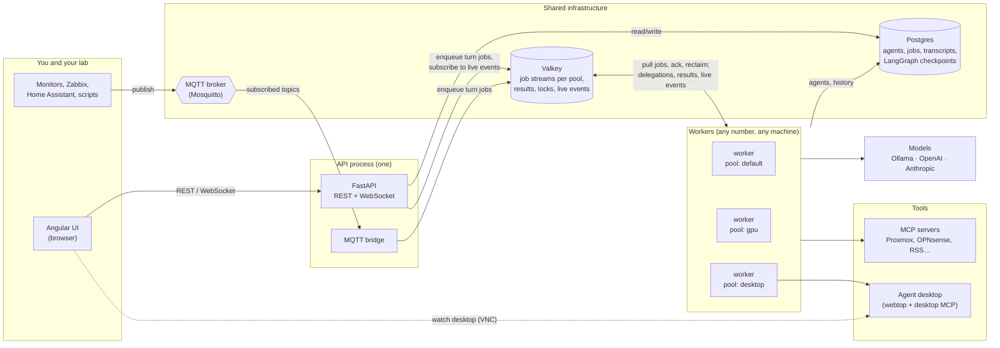
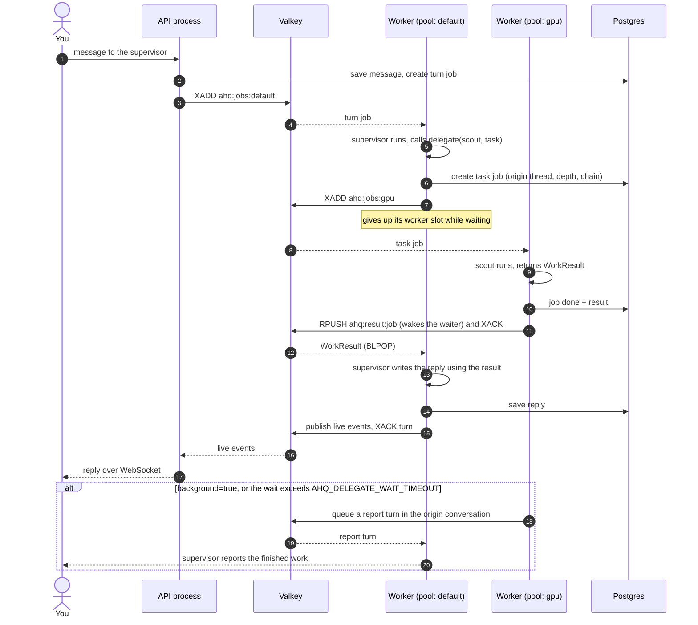
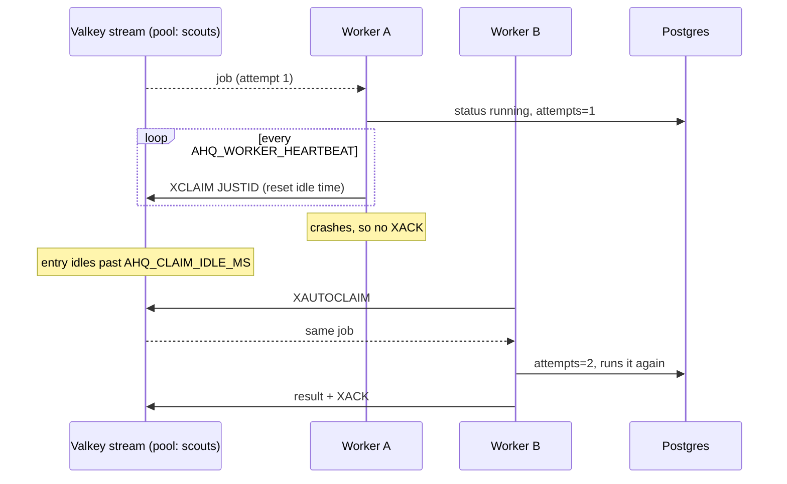
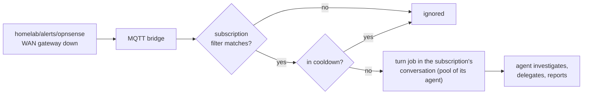
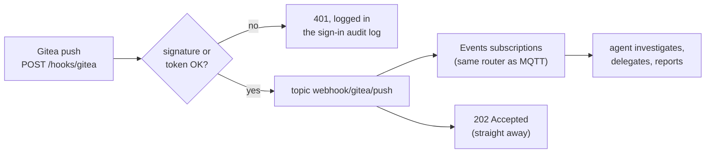
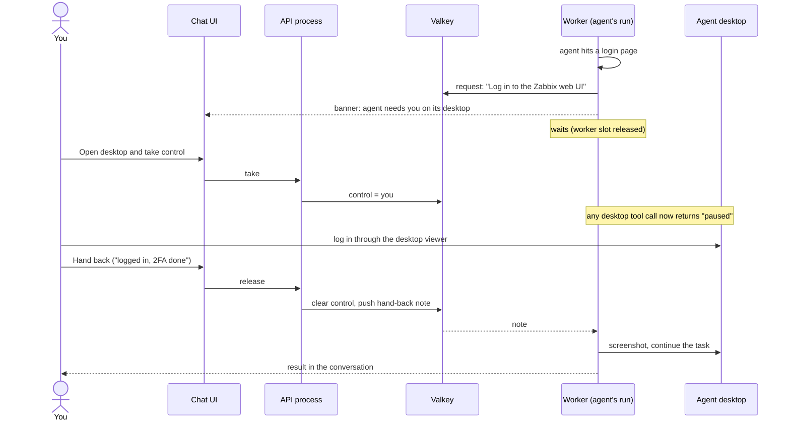
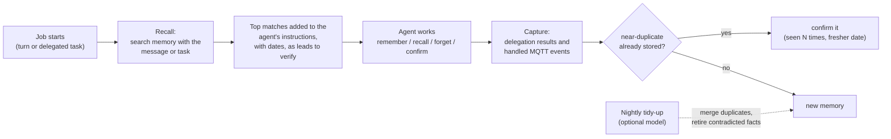
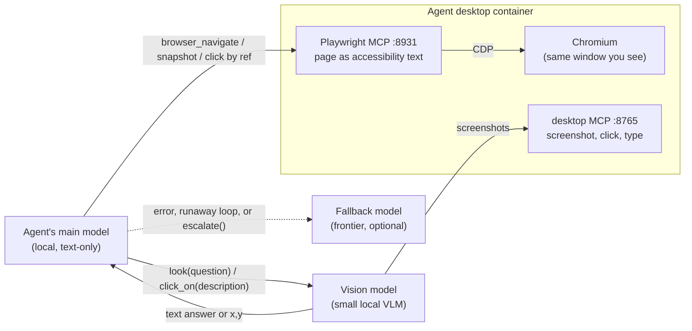

# Agent HQ

A self-hosted multi-agent system. You add model providers (your Ollama servers, OpenAI, Anthropic, any OpenAI-compatible server, your ChatGPT Plus/Pro plan, or your SuperGrok plan) and create agents in the web UI, giving each one instructions, a provider and one of its models, tools, delegation rights and a **worker pool** that decides which machines run it. Supervisors delegate to other agents; delegated work always reports back to the conversation it came from. Jobs survive crashes and restarts, and MQTT events from your homelab can wake agents on their own.

- **Backend:** FastAPI, LangGraph (conversation graph + checkpointing), PydanticAI (agents, typed results, MCP tools)
- **Frontend:** Angular 22 (signals, standalone components)
- **Shared infrastructure:**
  - **Postgres:** the source of truth: agents, jobs, transcripts and LangGraph checkpoints.
  - **Valkey** (or Redis): job delivery through Streams, plus results, locks, live UI events and the worker registry.
  - **MQTT:** incoming events from monitors, devices, Zabbix, Home Assistant and so on.
- **Tools:** any MCP server, registered in the UI
- **Desktops:** one `linuxserver/webtop` container per agent, driven by a small MCP server and viewable in the UI

Nothing about specific agents or models is in the code. Providers, names, roles, instructions, models, tools, pools, delegation rights and event subscriptions are all database rows, so renaming or re-tasking an agent takes effect on its next job.

**Agents get better with use, under your control:**
- **Skills:** written-down procedures agents follow, propose and improve.
- **The learning loop:** your 👍/👎 and corrections, and agents looking back at their work.
- **Your profile:** what every agent always knows about you.
- **A knowledge library:** your documents, runbooks and Obsidian vault, searchable with citations.
- **Evals:** they show whether a change actually helps before it's applied.

What they learn waits for your approval unless you say otherwise.

## Architecture



**Every piece of work is a job.** A *turn* job runs one turn of a conversation with the thread's owner agent; your messages, MQTT events and background reports all become turn jobs. A *task* job is a delegation, and the assignee returns a structured `WorkResult` (`status`, `summary`, `details`). Each job is written to Postgres, then its ID is added to the Valkey stream for the assignee's pool (`ahq:jobs:<pool>`).

**Workers pull, run, then acknowledge.** A worker serves one or more pools. It reads with a consumer group, so each job goes to exactly one worker, and it acknowledges the job only after it finishes. While a job runs, the worker refreshes the entry on a heartbeat. If a worker dies, its unacknowledged entries go idle, and another worker on that pool reclaims and reruns them, up to `AHQ_MAX_ATTEMPTS` times. After that the job is marked failed and reported.

**Any worker can run any turn.** Agent definitions and job context are in Postgres, and conversation history is in the shared LangGraph checkpointer. A Valkey lock makes sure two turns of the same conversation never run at once, even on different machines.

**Pools place agents on machines.** Set an agent's pool to `desktop` and only workers started with `--pools desktop` run it, for example the worker on the host next to its desktop container.

### Delegation and report-back



How the delegation guarantees hold up:
- **Wait mode (default)** returns the delegate's `WorkResult` as the `delegate` tool's return value. The supervisor always has the result in hand when it answers you. While it waits, it releases its worker slot, so even a single-slot worker can't deadlock.
- **Background mode,** and waits that exceed `AHQ_DELEGATE_WAIT_TIMEOUT`, queue a **report turn** in the conversation the work came from. The conversation's owner agent is woken there to tell you the outcome.
- **Failures are results too.** Model errors, exceptions and jobs abandoned after repeated worker crashes all produce a `failed` WorkResult, which is reported the same way.
- **Guards:** an agent can only delegate to agents on its list, a chain can't loop back to an agent already in it, and nesting depth is capped (`AHQ_MAX_DELEGATION_DEPTH`).

### Crash recovery



A rerun starts the job from the beginning. Tools that change systems should therefore be safe to repeat, or should go behind an approval step (see *Next steps*).

### Stopping a conversation's work

While anything in a conversation is still running, a **Stop** button sits next to Send. It stops the turn and every task delegated from it (background ones included), on whichever workers they run (`POST /api/threads/{id}/stop`).
- **How:** Stop sets `ahq:stop:<job_id>` in Valkey for each queued or running job. Queued jobs are marked stopped at once and never start. A running job's worker checks for the flag every `AHQ_STOP_POLL` seconds (default 1), cancels the run and acks the job, so it is not retried like a crashed one.
- **What you see:** the delegation cards say *stopped*, the conversation gets a "Stopped by you." line, and nobody reports back afterwards. Stopped jobs are saved as `failed` with the error "Stopped by you."; they count against neither skills nor the learning loop.
- **Caveats:** a tool call already sent to a system can't be called back; Stop only keeps the agent from carrying on. The conversation's model history keeps only finished turns, so the next message starts from what was there before the stopped turn.

### MQTT events



Subscriptions are managed on the **Settings → Events** page:
- **Topic filter:** MQTT wildcards, where `+` matches one level and `#` matches the rest.
- **Agent:** the agent that handles matching events.
- **Conversation:** where that agent reports. Leave it empty to get a dedicated events thread.
- **Prompt template:** what the agent is told. `{topic}`, `{payload}` (the whole body), `{event}` (the last topic level), `{source}` and `{hook}` are filled in, and so are JSON fields of the payload: `{payload.repository.full_name}`, `{payload.commits.0.message}`. A field that isn't in the payload becomes empty and is flagged in the delivery log; lists and objects come out as compact JSON. This works for MQTT JSON payloads too.
- **Cooldown:** stops an alert storm from turning into hundreds of model calls.

Under **Try it**, the editor previews the prompt a template produces for a topic and payload you enter, or for a recent webhook delivery that matches the filter, and can send it as a test event without a broker. It reports what happened per subscription (queued, or skipped for cooldown) and any missing fields. The bridge runs in the API process; run only one API process with `AHQ_MQTT_URL` set, or each event is handled twice.

MQTT works in the other direction too. Agent HQ publishes your notifications (sub-agent requests and decisions, tool approvals) to `AHQ_MQTT_NOTIFY_TOPIC`, and agents can publish their own status and commands through the [MQTT publisher](#mqtt-publisher-agents-publish-back-to-the-lab).

### Inbound webhooks

Anything on your LAN that can send an HTTP POST can wake an agent too: Gitea, Proxmox notifications, Uptime Kuma, Grafana, Zabbix, Home Assistant, or a one-line `curl` in a cron job. A delivery becomes an event on the topic `webhook/<source>/<event>` and goes through the same router as MQTT, so the subscriptions, cooldowns, prompt templates and report conversations above apply unchanged. Webhooks work without an MQTT broker.



Create hooks on the **Settings → Events** page, under **Webhooks**:
- **Name:** becomes the URL, `https://<site>/hooks/<name>`, served by Caddy like the rest of the UI.
- **Source:** the second topic level (empty = the name).
- **How the sender proves itself.** `/hooks/*` is outside the sign-in, so each hook checks its sender:
  - **Gitea signature:** `X-Gitea-Signature`, the HMAC-SHA256 of the body keyed with the hook's secret. In Gitea, add a webhook of type *Gitea* with the URL, content type `application/json`, and the secret in *Secret*.
  - **Secret token:** in an `X-Webhook-Token` header, an `Authorization: Bearer` header, or `?token=` for senders that can't set headers.
- **Event header / event field:** where the last topic level comes from. Gitea hooks use `X-Gitea-Event` (`push`, `issues`, `pull_request`…) by default. Otherwise name a header, or a dotted JSON path such as `heartbeat.status_text`; with neither it is `event`. Values are lowercased and made topic-safe.

- **Delivery ID header:** for the duplicate check. Gitea hooks use `X-Gitea-Delivery` by default. A repeat of the same ID within `AHQ_WEBHOOK_DEDUPE_SECONDS` (24 hours) is answered `202` with `"duplicate": true` and runs nothing, so a sender's retries don't wake an agent twice. If Gitea's own redeliver button reuses the ID, use **Replay** in Agent HQ instead.

The secret is shown once, when the hook is created or rotated. **New subscription for it** pre-fills a subscription with the filter `webhook/<source>/#`. Filters can be broader, e.g. `webhook/+/alert` for alerts from any source.

```bash
curl -X POST -H "X-Webhook-Token: $AHQ_HOOK_SECRET" -H "X-Event: done" \
     --data-binary @report.txt https://shockwave.home.arpa/hooks/nightly-scan
```

Replies: `202` with `{"delivery": ..., "status": ..., "topic": ..., "queued_jobs": [...]}` (an empty list if no subscription matched or it is in cooldown); `401` for a missing or wrong signature or token; `404` for an unknown or disabled hook (the two look the same); `413` for a body over `AHQ_WEBHOOK_MAX_BODY` (1 MB). At most `AHQ_WEBHOOK_MAX_PAYLOAD` characters of the body (8000) reach the prompt. The default prompt tells the agent the body is data from another system, not instructions; your tool approvals still decide what it may do next.

**Delivery log.** The hook editor lists its recent deliveries with their status: *accepted*, *no match*, *cooldown*, *duplicate*, *rejected* (bad signature or token) or *too large*. Opening one shows the matched subscriptions with the prompt each agent got and any missing fields, the body, the headers (without `Authorization`, tokens, signatures or cookies), and a link to the conversation. Rejected and too-large deliveries keep only their time, address, size and reason, never the body. The newest `AHQ_WEBHOOK_KEEP_DELIVERIES` (200) per hook are kept.

**Send test and Replay.** *Send a test delivery* routes an event name and body as the hook would, without a signature since you're signed in. *Replay* sends a logged delivery through again as a new row linked to the original. Both skip the duplicate check and, unless you tick *Respect cooldowns*, the cooldown. *Use as test delivery* copies a logged body into the test form to edit.

**Safety.** Webhooks are meant for the LAN. Don't expose `/hooks/*` to the internet. Each delivery passes these checks in order:

1. **Address.** The sender must be in the hook's **Accept from** networks, or, if that's empty, in `AHQ_WEBHOOK_NETWORKS` (private and loopback ranges, i.e. your LAN). Otherwise it gets `403`, logged as *blocked address*. The address is the first `X-Forwarded-For` hop, which Caddy sets, so keep the API's own port off the network (`AHQ_HTTP_BIND`); otherwise a sender could claim any address.
2. **Rate.** Each hook accepts **Requests per minute** (60 for new hooks, `AHQ_WEBHOOK_RATE_PER_MINUTE`; 0 = no limit). After that it answers `429`, and only the first refusal each minute is logged.
3. **Size, then signature or token**, as above.
4. **Duplicate check**, then routing.

**Webhook turns ask before changing things.** A webhook body carries text other people wrote: an issue title, a commit message, an alert from a device. It can try to give your agents instructions ("ignore previous instructions and restart…"). The default prompt marks the body as data, but the real safety net is your tools. With **Ask before tools that change things** on (the default), turns a hook starts, the work they delegate, and the report-backs that follow ask before any tool not marked read-only (`readOnlyHint`), even where your rules say *allow*. The approval card says it's asking because a webhook started the work. Your *block* rules still win, read-only tools (listing VMs, reading pages, searching) still just run, and "approve, don't ask again" works as usual. Turn it off only for hooks whose senders you trust completely.

**Secrets at rest.** Set `AHQ_SECRET_KEY` (any long random string) and hook secrets are encrypted in the database. Existing ones are encrypted at the next start. Keep the key safe and don't change it: if it changes, hooks answer `503` and their log says the secret can't be read; rotate their secrets to fix it. Without a key, secrets are stored as they are, and the Events page says so.

**Tracing.** Each delivery is a `webhook <name>` span in Phoenix, with its topic, status and body. The turns it starts, and everything they delegate, continue that trace.

**Cleanup.** Deliveries older than `AHQ_WEBHOOK_KEEP_DAYS` (7) are removed hourly, on top of the per-hook limit.

### Lab tools: MCP servers for your homelab

`labtools/` is one image of MCP servers for common homelab systems: MikroTik, SNMP switches, Technitium DNS, Kea DHCP, Proxmox VE, TrueNAS SCALE, Zabbix, Prometheus/Alertmanager, Graylog, allow-listed SSH restarts, and ping/port probes. Run as many instances as you like. Each picks its **integrations** (`LABTOOLS_INTEGRATIONS`), **read or write access** (`LABTOOLS_ACCESS`) and **its own credentials**, so you decide which agents can see what and which can change anything.

Read tools are marked read-only. Write tools are typed and narrow, ask you first, and respect guards from the inventory: protected interfaces, SSH allow-lists, bounded silences, no node actions. [docs/labtools.md](docs/labtools.md) covers integrations, configuration and credentials. [docs/lab-alerts.md](docs/lab-alerts.md) covers getting each system's alerts into webhooks. [docs/examples/homelab-crew.md](docs/examples/homelab-crew.md) is a worked example: two read-only watchers and a fixer.

Two tool-server settings help with any MCP server, yours or someone else's (Settings → Tools):
- **Shown** per tool: untick tools agents never need. Hidden tools aren't listed to the model at all, which matters for small local models; a *blocked* tool is still listed, it just can't run.
- **Only reads**: every tool of the server counts as read-only, as if it carried `readOnlyHint`, so webhook-started work doesn't ask before using it. Only tick it for servers you know can't change anything, e.g. `gitea-mcp -r`.

## Quick start (single machine, dev)

You need Postgres, Valkey and (optionally) MQTT. The simplest route is the infra compose file, which always starts Postgres and Valkey:

```bash
cd deploy/infra
cp .env.example .env                      # set the passwords
docker compose up -d
```

MQTT is up to you:
- **Use your home lab's broker:** give Agent HQ its own user with read access to the topics you'll subscribe to, and set `AHQ_MQTT_URL` to that broker. Nothing else to run.
- **Run the bundled Mosquitto** (handy for dev and testing): it's behind the `mqtt` compose profile.

  ```bash
  docker compose --profile mqtt run --rm mosquitto mosquitto_passwd -c /mosquitto/config/passwd agent-hq
  docker compose --profile mqtt up -d       # or set COMPOSE_PROFILES=mqtt in .env
  ```
- **No MQTT at all:** leave `AHQ_MQTT_URL` empty. Everything except event-triggered agents still works.

Backend (one shell for the API, one for a worker):

```bash
cd backend
python -m venv .venv && . .venv/bin/activate      # Windows: .venv\Scripts\activate
pip install -e ".[dev]"
cp ../.env.example ../.env                         # point AHQ_* at your infra; export it
uvicorn app.main:app --reload --port 8000          # API + UI + MQTT bridge
python -m app.worker --pools default               # a worker (any number, any machine)
```

To run a worker inside the API process instead of separately, set `AHQ_EMBED_WORKER=1`.

Frontend:

```bash
cd frontend
npm install
npx ng serve        # http://localhost:4200, proxies /api and /ws to :8000
```

On the first visit you'll be asked to create your account with a one-time setup code, which the API process prints to its console (see *Sign-in and HTTPS*).

The UI keeps your conversations in the left sidebar; everything else (agents, model providers, memory, tools, events and system status) is under **Settings** at the bottom of the sidebar. Start on the **Settings → Model providers** page and add your Ollama server (or another provider), then create agents and pick a model for each.

To try the example crew, go to **Settings → Agents → Import** and pick `examples/agents.example.json`. It contains two providers (an Ollama server and OpenAI), the agents with their models and pools, a desktop tool server and an alerts subscription, all as data. Then fix the Ollama URL on the **Settings → Model providers** page and choose models that your server actually has.

Without `AHQ_DB_URL`, the system falls back to SQLite files in `AHQ_DATA_DIR`. That's fine for a single machine, but use Postgres as soon as workers run anywhere else.

## Tests

```bash
cd backend && pytest
cd labtools && pip install -r requirements-dev.txt && pytest   # the lab tool servers
```

The tests use scripted fake models (no LLM needed), a real `valkey-server` or `redis-server` started on a free port, an in-process MQTT broker, and a throwaway Postgres cluster when Postgres is installed. They cover:
- delegation in wait and background modes
- single-slot workers (no deadlock)
- pinning agents to pools
- **a worker crashing mid-job and another reclaiming it**
- failure reporting
- conversation history persisting across turns
- renaming agents
- a real stdio MCP server
- MQTT matching, cooldowns and a real broker end to end
- the Postgres database and checkpointer with two workers
- long-term memory: keyword and embedding search, scopes, retire/restore/supersede, recall added to instructions, capturing delegations and events without duplicates, agent memory tools, tidy-up with and without a model, re-embedding, and the same search on Postgres + pgvector (via PGlite)
- tracing: one trace across two workers for a turn and its delegation, background reports joining that trace, session IDs and Phoenix span types on every span, and no screenshot data in spans
- avatars: animated GIF served untouched plus a still first frame, validation, keeping them through agent edits and export/import
- local-first models: a real Chromium driven through Playwright MCP over CDP; vision tools on rendered screenshots (with and without zoom, both coordinate formats, and a not-found case); falling back on errors, runaway loops and escalation
- desktop handoff: tools pausing while you have control, an agent asking you to take over and resuming with your note, and the wait timing out
- model providers: listing models for each kind, write-only keys, and two agents on two Ollama models answering through a worker
- thinking levels: the unified setting for OpenAI/Anthropic, `reasoning_effort` for Ollama only when the model can think, the fallback using its own provider, the support hint, an agent run receiving its level, API validation, and export
- MQTT publisher: status and allow-listed publishes reaching a real broker; refusing wildcards, system, reserved and off-list topics, oversized payloads and bursts; and an agent publishing only after you approve
- web reader: feeds (and finding a site's feed), readable pages without clutter, paging of long pages, redirects, robots.txt, SearXNG search, refusing LAN addresses unless allowed, and an agent reading a feed through Agent HQ
- scheduler: every cadence and its description, bad cadences explained, time zones across a DST change, firing into the schedule's own conversation exactly once (two checkers at once), catching up once after downtime, skipping while a run is still going, run now, and disabled agents
- ChatGPT plan providers: the full sign-in by pasted callback (PKCE, state, single use, declined consent), tokens never returned or exported, model listing, an agent turn on the plan through the Responses API (`store: false`, `stream: true`, no unsupported fields), and two workers refreshing at once without ever reusing a refresh token
- Grok plan providers: the device sign-in (pending, slow down, declined, a subscription xAI refuses), tokens never returned or exported, switching kind dropping the sign-in, model listing without image and video models, an agent turn on the plan with its thinking sent as `reasoning_effort`, and two workers refreshing at once without ever reusing a refresh token
- Postgres upgrades: enum values a newer version adds (such as a new provider kind) are added to an older database's enum type on startup
- import and export
- sign-in: setup code, passwords, 2FA, sessions, lockout, API tokens, the audit log, and cross-site refusal
- sub-agents: off/ask/allowed, limits, refusing duplicates of existing agents, requests and grants, provider slots and the usage ledger
- workbenches and tool approvals: allow/ask/block per tool, waiting for a decision, "don't ask again", timeouts, and a real workbench over MCP
- skills: matching, loading, outcomes, versions and rollback, proposals in propose/auto/off modes, diffs and stale warnings
- the learning loop: rating replies, corrections, reflections that propose skills and save lessons, the daily cap, and Run now
- your profile: in every agent's instructions (or not, per agent), the word cap, and suggestions you approve
- the knowledge library: Obsidian notes (frontmatter, tags, links), chunking at headings, uploads, web pages, Git sources that only re-read changed files, access per collection, recall and tools, runbooks turned into skill proposals, and the same search on Postgres + pgvector
- long conversations: cutting only between turns, summarising older turns (and folding an old summary into a new one), dropping them when the summary fails, compaction in a real conversation, trimming tool results within a turn, the warning when instructions don't fit, and reading the window from Ollama (loaded model, Modelfile, or the default)
- evals: cases from replies and feedback, replaying recorded tool calls, read-only tools running for real only when allowed, Ask/Block tools never running, the judge, and skill changes tested without and with (Auto-mode changes held when they make things worse)

## Deploy (Docker)

1. **Infrastructure,** once, on one host: `deploy/infra/docker-compose.yml` (Postgres 17 with pgvector, Valkey 8, and optionally Mosquitto 2 via the `mqtt` profile). Keeping Postgres and Valkey together on a host dedicated to Agent HQ while sharing your lab's existing MQTT broker works well: the first two hold Agent HQ's state, and MQTT is how the rest of the lab talks to it.
2. **Application:** `cp .env.example .env`, fill in the URLs and keys, set up HTTPS (next section), then `docker compose up -d --build`. This starts:
   - `caddy`: HTTPS on 443 (certificate from your step-ca), with http:// redirected
   - `hq`: API, UI and MQTT bridge (plain HTTP on 8000, for this host only). Its `hq-data` volume holds the knowledge library's uploads and Git clones. It also reads your step-ca root from `deploy/caddy/root_ca.crt` (`AHQ_EXTRA_CA_FILE`), so Git and web sources on your HTTPS hosts (your Gitea) are trusted.
   - `worker`: pool `default`
   - `worker-desktop` and `desktop-1`: pool `desktop`, plus an example agent desktop
   - `workbench-1` and `egress`: an example agent workbench and its allowlisting proxy (see Workbenches)
3. **More machines:** copy `docker-compose.yml` and `.env` to another host and keep only the worker services you want there, with `--pools` set to whatever runs on that machine (`gpu`, `desktop`, `lab-east`…). Workers show up on the **Settings → System** page with their pools and load, and each pool's queue depth appears next to them.
4. **More workers on one host:** `docker compose up -d --scale worker=3`.

**Worker names.** In Docker, each worker is named `<service>-<host>-<last 4 of its container ID>`, for example `worker-shockwave-7090` and `worker-shockwave-1c2e`. You can tell which machine and which replica it is, and scaled replicas never share a name. The host name comes from the host's `/etc/hostname`, which the compose file mounts read-only. Where that file doesn't exist (Docker Desktop), set `AHQ_HOST_NAME` in `.env`. Set `AHQ_WORKER_NAME` for a fixed name, as `worker-desktop` does, but only on a service you won't scale. A recreated container (after `up --build`) gets a new ID and so a new suffix. Its old entry drops off the System page once its heartbeat stops, and any job it left unfinished is picked up as usual.

Valkey settings that matter (already set in the infra compose file):
- `appendonly yes`: queued jobs survive a Valkey restart.
- `maxmemory-policy noeviction`: Valkey never quietly discards stream entries.
- `requirepass`: a password, which goes in `AHQ_REDIS_URL` as `redis://:password@host:6379/0`.

### Sign-in and HTTPS

The UI and API need a sign-in. Agents and workers are unaffected, since they talk to Valkey and Postgres directly.

**Your account**
- **First run:** with no account yet, the API process logs a one-time setup code. Find it with `docker compose logs hq | grep "setup code"`. The first visit to the UI asks for it, so nobody else on your network can claim the instance before you do.
- **Passwords** are stored as Argon2id hashes and need at least 10 characters.
- **Two-factor sign-in** is optional. Turn it on under **Settings → Security** by scanning the QR code with any authenticator app.
- **Sessions** use an HttpOnly cookie that is marked Secure over HTTPS. A session ends after `AHQ_SESSION_IDLE_DAYS` without use (default 7) and after `AHQ_SESSION_MAX_DAYS` in any case (default 30). **Settings → Security** lists your signed-in browsers and can sign any of them out. Changing your password signs out every other browser.
- **Locked out?** `docker compose exec hq python -m app.auth set-password <username>`. The same tool can also `reset-2fa <username>`, `sign-out-all` and `unlock`.

**Protections**
- **Lockout:** 5 failed sign-ins from one address, or 10 for one username, within 15 minutes lock further attempts for 15 minutes.
- **Cross-site requests:** writes and WebSockets that use the cookie are refused when they come from another site.
- **Sign-in log:** **Settings → Security** shows sign-ins, failures, lockouts, sign-outs, and every password, 2FA, session and token change.

**API tokens** are for scripts, Home Assistant or curl. Create one under **Settings → Security**, then send `Authorization: Bearer ahq_…`. A token is shown once and stored only as a hash. It can expire, and you can revoke it. It can use the API but can't change your password, 2FA or tokens.

```bash
curl -H "Authorization: Bearer $AHQ_TOKEN" https://shockwave.home.arpa/api/agents
```

**HTTPS with your step-ca.** The `caddy` service terminates TLS and gets its certificate from step-ca over ACME, renewing it automatically (step-ca certificates last 24 hours by default). One-time setup:
1. **On the CA,** add an ACME provisioner if you don't have one: `step ca provisioner add acme --type ACME`, then restart step-ca.
2. **Copy the root certificate** into the repo: `step ca root deploy/caddy/root_ca.crt`. It's git-ignored.
3. **In `.env`:** set `AHQ_SITE=shockwave.home.arpa` and `ACME_CA=https://<your-ca>/acme/acme/directory`. The provisioner name is part of that path.
4. **Network:** step-ca must be able to reach Shockwave on port 80 for the ACME challenge, and `AHQ_SITE` must resolve to Shockwave in your DNS.
5. **Browsers:** your step-ca root needs to be trusted on the machines you browse from. If you already use step-ca certificates elsewhere, it is.

Plain HTTP on port 8000 is published for Shockwave itself only (`127.0.0.1`). While you're getting HTTPS working, set `AHQ_HTTP_BIND=8000` in `.env` to reach it from your LAN, then remove the setting. If you set `AHQ_PUBLIC_URL`, change it to the https address.

**Desktop viewers are behind the same sign-in.** Their ports are no longer published. Instead, Caddy serves each one at `https://<site>/desktops/desktop-N/` and checks your Agent HQ session first (`forward_auth` to `/api/auth/verify`). Each desktop's `SUBFOLDER` must match its path. On the agent, set **Desktop viewer URL** to `/desktops/desktop-1/`.

### Workbenches: an agent's own Python environment

A workbench is a small container per agent that gives it somewhere to write and run code. It's like a desktop, but for scripts instead of a browser. The `workbench-1` service in `docker-compose.yml` exposes an MCP server on `:8770` with these tools:

| Tool | What it does | Approval suggested |
|---|---|---|
| `run_python` | runs Python in the workbench's own virtual environment | ask |
| `run_shell` | runs a bash command in the workspace | ask |
| `pip_install` | installs packages into the venv (they persist) | ask |
| `run_script` | runs a saved script by name, with JSON arguments | ask |
| `save_script`, `list_scripts` | saves a working script as a named, reusable tool | allow |
| `read_file`, `write_file`, `list_files` | files in the workspace | allow |

**Storage.** Everything lives in the `workbench-1` volume, mounted at `/work`:
- the agent's files
- the venv at `/work/.venv`, so installed packages survive restarts and rebuilds
- saved scripts in `/work/scripts`

**Limits.**
- **Runs:** each run has a timeout (default 120 seconds), and the run and any processes it started are killed when it's reached. Output is capped at 20,000 characters.
- **Container:** it runs as an unprivileged user with a read-only root filesystem and no Linux capabilities, capped at 2 CPUs, 2 GB of memory and 512 processes.

**The network is off by default.** The workbench is only on the internal `workbench` network, which has no route to the internet or your LAN. Its one way out is the `egress` proxy, which allows only the hosts in `deploy/egress/allowlist`. That's PyPI by default, so `pip_install` works.
- **Allow another host:** add it to the allowlist, then run `docker compose restart egress`.
- **Full network access for one workbench (internet and LAN):** add `default` to its `networks:`.

**Set one up:**
1. Run `docker compose up -d --build workbench-1 egress`.
2. Register `http://workbench-1:8770/mcp` as an HTTP tool server under **Settings → Tools**.
3. Tick it on the agent that owns it.
4. Its code tools already ask for approval (see the table above). Change that per tool under the server's **Approvals**.

For another agent, copy the `workbench-1` block as `workbench-2`, with its own volume.

### Skills: know-how agents write down and improve

A **skill** is a short, named procedure. It has a title, a line saying *when to use it*, the steps in markdown (including what to check and the pitfalls), the tools it relies on, and optionally the name of a saved workbench script that does the mechanical part. A skill is either shared by every agent or belongs to one agent. You can write and edit skills under **Settings → Skills**. Every change is a new version, with who made it and why, and you can restore any earlier version.

**How agents use them:**
- **Listing:** on each run, an agent's instructions list up to 8 skills that fit the task, each with its name and *when to use* line.
  - **How they're matched:** by meaning when an embedding model is set (Settings → Memory), and by keywords otherwise.
  - **Small collections:** with 12 or fewer skills, all of them are listed.
- **Loading:** the agent calls `load_skill` to read a skill's full procedure and follows it. `list_skills` searches the rest.
- **Tracking:** each time a skill is loaded, the outcome of that job (done, partial or failed) is recorded. **Settings → Skills** shows each skill's uses and success rate.

**How agents learn.** When an agent works out how to do something that will come up again, or finds that a skill it used was wrong or incomplete, it calls `propose_skill`. A proposal is either a new skill, or a revision to an existing one with a diff against the current version. What happens next depends on the agent's **Learning** setting (Settings → Agents):
- **Propose to me** (the default for every agent):
  - **Where it shows up:** in the conversation, in the **Requests** inbox (with the sidebar badge), and on MQTT as a `skill_proposal` notification.
  - **Your options:** approve it, edit it first, or reject it, with an optional note.
  - **Revisions** show a diff against the current version, with a warning if the skill changed after the agent wrote its proposal.
- **Save automatically:** the change is saved at once and you're told. You can review it or roll it back on the Skills page. If there are test cases for that agent or skill (see Evals), the change is tested first. It's applied only if it doesn't lower the pass rate; otherwise it waits for you.
- **Off:** the agent uses skills but can't propose them.

Skills can come from three places besides your own writing: an agent's `propose_skill` call, a reflection after a job (see the learning loop), or a document in the knowledge library ("Propose skills" turns a runbook's procedures into proposals). Each proposal records where it came from. Sub-agents use their parent's skills but don't propose any. Skills never grant tools: every call a skill leads to still goes through your tool approvals.

### The learning loop: ratings, corrections and reflections

**Rate replies.** Every agent reply has 👍 and 👎 buttons. A 👎 opens a box for *what it should have done*, which is the most useful thing an agent can learn from. Ratings show on each skill's stats.

**Corrections count too.** A reply such as "No, use the TrueNAS datastore" or "from now on, failures first" is recognised as a correction of the job the agent just did.

**Reflection.** After a job that's worth a look, the agent rereads the conversation, its tool calls, how the job ended and what you said about it. A job is worth a look when:
- you rated it 👎, or 👍 on work that took several steps;
- you corrected it;
- it failed or only partly worked;
- or it made 4+ tool calls.

It then may do three things:
- **propose skills,** new or improved, through the same path as `propose_skill`, so your learning mode applies;
- **save lessons** to its memory, and post "noted for next time: …" in the conversation;
- **suggest a line for your profile** when you stated a standing rule.

**Settings → Learning** controls all of this and keeps a log of every reflection: why it ran, what it concluded, and links to what it proposed. Each reflection has **Run now** and **Cancel**.
- **Reasons to reflect:** you choose which ones count, or reflect after every job, or never.
- **Waiting:** a reflection waits 10 minutes after a job so your follow-ups are included, and 2 minutes after a rating.
- **Daily limit:** 30 by default.
- **Model:** each agent's own, unless you pick a reflection model; a stronger one writes better skills for small local agents.
- **Who never reflects:** agents whose learning is Off, and sub-agents.

**Requests** has a sub-menu like Settings: **Tool approvals**, **Skill proposals**, **Profile updates**, **Knowledge** (documents agents suggest) and **Sub-agent requests**. Each has its own count, and the sidebar badge shows the total.

### The current date and time

Models have no clock: left alone, they take "now" to be about when their training data ends, so "this weekend" can turn into a date months off. Every agent's instructions therefore end with the current date and time in your time zone, which you set with `AHQ_TIMEZONE` (an IANA name such as `America/New_York`; falls back to `TZ`, then UTC). The line goes last because it changes every minute, and providers that cache prompts reuse everything before the first change. Delegated agents and sub-agents get it the same way.

### Your profile

**Settings → Profile** holds what every agent should always know about you: who you are, how you like things done, your environment. Memory comes up when it matches a task; the profile goes into every agent's instructions, every time.
- **Size:** keep it short. Anything past the word limit (600 by default) is cut, so it doesn't crowd small models.
- **Opting out:** an agent can opt out under Settings → Agents → Learning ("Knows your profile").
- **Suggestions:** reflections suggest additions when you state a standing preference. Suggestions show up in the conversation, in **Requests → Profile updates**, and on MQTT as a `profile_proposal` notification. Nothing changes your profile without your approval, and you can reword a suggestion first.

### Tool approvals

For every tool on every tool server, you choose under **Settings → Tools → (server) → Approvals**:
- **Allow:** the call runs.
- **Ask me:** the call waits for your OK.
- **Block:** the call is refused, and the agent is told it isn't allowed.

A rule on `*` covers every tool on that server that doesn't have its own rule. A server can suggest a mode for each tool in the tool's MCP metadata (`{"agent_hq/approval": "ask"}`); the workbench does this for the tools that run code. Your rules always win. A tool with no rule and no suggestion is allowed, so your existing tool servers behave exactly as before.

**When a call needs your OK:**
- **Where it shows up:** in the conversation, as a card showing exactly what the agent wants to run, with code and commands shown as code. It also appears in the **Requests** inbox (with the sidebar badge) and on MQTT as a `tool_approval` notification.
- **Your options:** approve it; approve it and don't ask again for that tool, from that agent, in that conversation, for an hour; or deny it, optionally with a note the agent sees.
- **While it waits:** the agent's worker slot is freed for other work.
- **If you don't decide** within `AHQ_APPROVAL_TIMEOUT_MINUTES` (default 30), the call isn't made, and the agent is told it's waiting for approval.
- **Sub-agents** follow the same rules as everyone else.
- **Work started by a webhook** asks before any tool not marked read-only, even where the rule says allow (see [Inbound webhooks](#inbound-webhooks)).

The same table has a **Safe in tests** column. It decides which tools may run for real in an eval when a test case has no recording for the call. Tools the server marks read-only (`readOnlyHint`) start ticked. Only tools set to Allow ever run in a test.

### Agent desktops

To add another desktop, copy the `desktop-1` block in `docker-compose.yml`. Name it `desktop-2`, set `SUBFOLDER: /desktops/desktop-2/`, and give it its own `/config` volume. It needs no published port, and Caddy routes any `desktop-<number>` without changes. Then, in the UI:
1. Register `http://desktop-2:8765/mcp` as an HTTP tool server, and tick **Controls an agent desktop** on it.
2. Tick it on the agent that owns the desktop, and set that agent's **Desktop viewer URL** to `/desktops/desktop-2/`.
3. Set that agent's pool to one served by a worker that can reach the desktop's network.

Agents that use desktop tools need a vision-capable model. Anyone who can open a viewer can use whatever sessions the agent's browser is logged in to. That's why viewers are reachable only through Caddy, signed in to Agent HQ. For local development without Caddy, give the desktop `ports: ["3000:3000"]` and `SUBFOLDER: /`.

### Taking control of a desktop

You can drive an agent's desktop yourself: to log in to a site, solve a CAPTCHA or enter an MFA code. That way the agent works with an authenticated session and never sees your password.



- **When the agent asks.** Agents with a desktop get an `ask_user_to_take_over(reason)` tool and are told to use it, never to ask for passwords in chat. The request appears as a banner in the conversation. The agent waits for up to `AHQ_HANDOFF_TIMEOUT` seconds (30 minutes by default), giving up its worker slot while it waits. When you hand back, it continues with your note.
- **When you step in on your own.** **Take control** on the desktop panel pauses the agent at any time. While you have control, every call to that desktop's tools, screenshots included, is refused. So the agent neither fights you for the mouse nor sends what you're typing to its model provider. If the agent ran into the paused desktop mid-task, **Hand back** wakes it in that conversation to carry on.
- **A forgotten takeover can't block an agent forever.** Control expires after 24 hours.

Credentials typed into chat are stored in the transcript, the conversation history and possibly your traces. Logging in yourself on the desktop keeps them out of all three.

## Adding tools

Register MCP servers on the **Settings → Tools** page:
- **HTTP:** a URL like `http://perceptor:8811/mcp`
- **stdio:** a command plus arguments, which is launched **on whichever worker runs the agent**, so it must be installed there

Click **Test connection** to list the server's tools (this connects from the API host), then tick the server on any agent. Tool names are prefixed with the server name by default (`proxmox_list_vms`) so they never collide.

The worker image is a slim Python image without `npx` or `uvx`, so published servers you'd normally start with those commands are easier to run as their own container and register over HTTP, the way the web reader below does.

### Web reader: feeds, pages and search

The `web-reader` service (in `docker-compose.yml`, code in `webreader/`) gives agents text-only web tools. It's much faster and cheaper than driving a browser, and works fine with small local models:

| Tool | What it returns |
|---|---|
| `read_feed(url, limit)` | The newest items of an RSS or Atom feed: title, link, date, short summary. A site's address works too if its page links to a feed. |
| `fetch_page(url, offset)` | A page's readable content as Markdown (the article or documentation, without menus, ads or scripts). Long pages come back in parts: call again with `next_offset`. |
| `search_web(query, limit, time_range, categories)` | Results from **your own SearXNG**: titles, links, snippets. Only offered when `SEARXNG_URL` is set. |

Register it under **Settings → Tools**: HTTP, `http://web-reader:8800/mcp`, untick **Prefix tool names**, leave **Controls an agent desktop** unticked. Then tick it on your researcher. A good split is for the researcher to use feeds, pages and search first, and delegate to the desktop agent only for pages that need a login, JavaScript, or actually looking at them (charts, dashboards).

**Behaviour:**
- `fetch_page` honours `robots.txt` (`WEBREADER_RESPECT_ROBOTS=false` to turn that off) and returns at most `WEBREADER_MAX_CHARS` (12,000) characters per call.
- Downloads are capped at 5 MB, and redirects are followed hop by hop.
- **LAN addresses are refused by default.** Agents read untrusted web content, and a page could try to talk one into probing your network. To let agents read specific internal sites, list them in `WEBREADER_ALLOW_HOSTS` (for example `wiki.home.arpa`).

**Search with SearXNG.** `deploy/searxng/` runs a private SearXNG on any host:

```bash
cd deploy/searxng
cp .env.example .env          # set SEARXNG_SECRET: openssl rand -hex 32
docker compose up -d
curl 'http://localhost:8888/search?q=proxmox&format=json'   # JSON back = ready (403 = JSON not enabled)
```

Its `config/settings.yml` turns on JSON output, which the web reader needs, and turns off the bot limiter, which would otherwise throttle your own agents on a private instance. Then set `SEARXNG_URL=http://<that-host>:8888` in Agent HQ's `.env` and run `docker compose up -d web-reader`. Agents see `search_web` the next time they start a job.

### MQTT publisher: agents publish back to the lab

The `mqtt-publisher` service (in `docker-compose.yml`, code in `mqttpublisher/`) lets agents publish to your MQTT broker: their status for a dashboard such as Home Assistant, or commands to anything in the lab that listens on MQTT.

| Tool | What it does | Approval by default |
|---|---|---|
| `list_publish_topics()` | Shows the agent where it may publish, and the size and rate limits. | Allow (read-only) |
| `publish_status(name, state, detail, data, retain)` | Publishes JSON `{"agent", "state", "detail", "data", "at"}` to `agent-hq/agents/<name>/status`, retained so subscribers see the latest state straight away. | Allow |
| `publish(topic, payload, qos, retain)` | Publishes to one topic on the allow-list. Text is sent as-is; objects and lists are sent as JSON. Not retained unless asked. | **Ask** |

**Setup:**
1. On your broker, create a user for the publisher with **write access only to the topics you'll allow**. The broker then enforces the same limits as the publisher.
2. In `.env`, set `MQTT_PUBLISH_URL=mqtt://agent-hq-pub:<password>@<broker>:1883` (`mqtts://` for TLS; for a step-ca certificate, mount your root certificate and set `MQTT_PUBLISH_CA_FILE`). Set `MQTT_PUBLISH_ALLOW` to the topic filters `publish` may use, for example `agent-hq/agents/#,homelab/cmd/#`.
3. Run `docker compose up -d mqtt-publisher`.
4. Under **Settings → Tools**, register HTTP `http://mqtt-publisher:8810/mcp`, untick **Prefix tool names**, and leave **Controls an agent desktop** unticked. Then tick it on the agents that should publish.

**Safeguards:**
- Topics with wildcards, broker system topics (`$SYS/…`) and anything matching `MQTT_PUBLISH_DENY` (default `agent-hq/notifications/#`, so agents can't fake your notifications) are refused.
- Payloads are capped at `MQTT_PUBLISH_MAX_BYTES` (16 KB), and the server sends at most `MQTT_PUBLISH_RATE_PER_MINUTE` (30) messages a minute across all agents.
- `publish` asks for your approval by default, with the usual card in the conversation and the Requests inbox. Once you trust an agent with a topic, set the tool to **Allow** under **Settings → Tools → (server) → Approvals**, or approve with "don't ask again" (an hour, for that agent in that conversation).
- **Watch for loops.** If an Events subscription matches a topic agents publish to, every publish wakes an agent again (the cooldown limits the damage). Keep publish topics outside your subscription filters.
- The agent passes its own name to `publish_status`; the server can't verify it, so status topics are informational and should not be used for access decisions.

## Model providers

Providers live on the **Settings → Model providers** page; nothing about servers or model names is hardcoded. Add a provider once, and its models become choices in every agent's **Model** picker. Different agents can use different models from the same provider: one on `qwen3:14b`, another on `gpt-oss:20b`.

| Kind | Base URL | Model list comes from | API key |
|---|---|---|---|
| **Ollama** | `http://host:11434` (with or without `/v1`) | `GET /api/tags`, with size and quantization | usually none |
| **OpenAI** | optional override | `GET /v1/models` | stored, or `OPENAI_API_KEY` on the workers |
| **OpenAI-compatible** (vLLM, LM Studio, LiteLLM, llama.cpp server…) | required, the server's `/v1` URL | `GET /v1/models` | only if the server needs one |
| **Anthropic** | optional override | `GET /v1/models` | stored, or `ANTHROPIC_API_KEY` on the workers |
| **ChatGPT plan** (Plus/Pro) | none | `GET /v1/models` on your plan | none: **Sign in with ChatGPT** instead |
| **Grok plan** (SuperGrok / X Premium+) | none | `GET /v1/models` on api.x.ai (chat models only) | none: **Sign in with xAI** instead |

You can register several providers of the same kind, for example two Ollama servers on different GPUs.

- **Picking a model:** the agent editor lists the provider's current models. You can still type a name the provider doesn't list yet, such as a model you're about to pull.
- **API keys are write-only.** They're stored in the database and used by the workers, but the API never returns them and exports never include them. To keep keys out of the database entirely, leave the field blank and set the provider's usual environment variable on the workers instead.
- **Disabling and deleting:** disabling a provider stops its agents with a clear error in their conversations. A provider can't be deleted while agents still use it.
- **Advanced:** with the provider set to *Custom model spec*, the Model field takes a raw PydanticAI spec such as `openai:gpt-4.1`, or `test` for a no-LLM test model.

Agents that use desktop tools need a vision-capable model.

### Thinking levels

Each agent has two settings under its model (Settings → Agents): **Thinking** (*Model default*, *Off* or *On*) and, when thinking is on, a **Reasoning level** (*Provider default*, *Minimal*, *Low*, *Medium*, *High*, *Extra high* or *Max*). The level box is greyed out for models that only turn thinking on or off, such as Qwen on Ollama. Both are stored as the agent's one `thinking` value (`""`, `off`, `on`, or the level). It controls how much the model reasons before it answers. It's sent to the model as a request setting, not written into the instructions: telling a model to "think hard" in its prompt doesn't change how much it actually reasons. Use the instructions to say *what* the agent should be careful about, and this setting for *how much* it thinks.

- **OpenAI, the ChatGPT plan, the Grok plan and Anthropic** get PydanticAI's unified `thinking` setting, which it turns into each provider's own (reasoning effort, thinking budgets, adaptive thinking). Levels a model doesn't offer use the closest one it does.
- **Ollama** gets `reasoning_effort` on its OpenAI-compatible endpoint (`none` for Off), because PydanticAI doesn't translate the setting for Ollama. It's only sent to models whose `/api/show` lists the `thinking` capability, so a model that can't think isn't sent a setting it would reject. gpt-oss always thinks a little (Off gives it its lowest effort); Qwen3-style models only do on and off, so every level just turns thinking on.
- **OpenAI-compatible servers** get the unified setting too, but PydanticAI only acts on it for model names it recognises; for others the setting is ignored and the model keeps its default.
- The editor checks the chosen model and says under the settings whether thinking reaches it and whether it takes levels.
- The **fallback model** uses the same level, translated for its own provider, and **sub-agents** inherit the level of the agent that created them. *Model default* sends nothing at all.

Higher levels help on hard, multi-step tasks but are slower, and on local models they cost GPU time; a supervisor that mostly routes work is usually fine on Low or Off.

### Your ChatGPT plan instead of an API key

A **ChatGPT plan** provider runs agents on your ChatGPT Plus or Pro subscription, using OpenAI's [Sign in with ChatGPT](https://developers.openai.com/siwc/token-sharing-open-source) for open-source and self-hosted apps. There's no API key and no per-token bill: requests count against your plan's usage instead.

**Signing in.** On the **Settings → Model providers** page, add a provider of kind *ChatGPT plan*, save it, and choose **Sign in with ChatGPT**. Then:
1. Approve Agent HQ in the OpenAI tab that opens, including permission to use your plan.
2. OpenAI only ever redirects to `http://127.0.0.1:1455/auth/callback`, which is the computer running your browser, not the server running Agent HQ. So that tab ends on a "can't connect" page. That's expected.
3. Copy the whole address from that tab's address bar, paste it into Agent HQ, and choose **Finish sign-in**.

The server started the sign-in and holds its PKCE verifier, so the pasted address is only useful to this Agent HQ, and only once, within 15 minutes.

**How it works:**
- The tokens are stored on the provider in the database, so every worker on every machine uses the one sign-in. Like API keys, they're never returned by the API or included in exports.
- Access tokens last an hour and are refreshed automatically. OpenAI's refresh tokens are single-use, so refreshes are serialized across all workers with a Valkey lock: two workers never spend the same refresh token, which could get the sign-in revoked.
- **Disconnect** forgets the tokens. To revoke access entirely, also disconnect Agent HQ in your ChatGPT settings, where you can also cap how much of your plan it may use.

**Things to know:**
- **Limits:** on Plus, a five-hour usage window is shared with every app connected to your plan, and there's a weekly allowance. Give agents on this provider a **fallback model** on your Ollama server: when the plan is exhausted, the request fails and the agent switches to its fallback.
- **Not supported here:** embeddings (use Ollama for memory), and settings like temperature or max output tokens, which OpenAI doesn't accept on plan usage. PydanticAI drops those automatically.
- **Eligibility:** OpenAI offers this self-serve to open-source apps and personal projects that run locally or self-hosted, which is what Agent HQ is. A paid or hosted service would need OpenAI's approval first.

### Your Grok plan instead of an API key

A **Grok plan** provider runs agents on your SuperGrok subscription (or X Premium+, on an X account linked to your xAI account). xAI lets agent tools such as Hermes Agent, OpenCode, Kilo Code and Warp sign in to your xAI account and call the regular API at `https://api.x.ai/v1` on your subscription, with no API key and no per-token bill. Agent HQ does this itself: there's no proxy or extra service to run.

**Signing in.** On the **Settings → Model providers** page, add a provider of kind *Grok plan*, save it, and choose **Sign in with xAI**. A tab opens on xAI's site showing a short code, which Agent HQ shows too. Sign in with the account that has your subscription, check the codes match, and approve. The Models page notices by itself and finishes the sign-in: nothing to copy or paste. The code is good for about ten minutes.

This is OAuth's device flow, so it works even though Agent HQ runs on a different machine from your browser. Agent HQ asks xAI at most once per the interval xAI sets while it waits, however often the page checks.

**How it works:**
- The tokens are stored on the provider in the database, so every worker on every machine uses the one sign-in. Like API keys, they're never returned by the API or included in exports.
- Access tokens last about six hours and are refreshed half an hour early. xAI rotates the refresh token on every refresh, so refreshes are serialized across all workers with a Valkey lock, as for the ChatGPT plan.
- Requests go through the OpenAI-compatible Chat Completions API with Grok's model profile, so each agent's thinking level becomes the `reasoning_effort` that model accepts (Grok 4.3 can turn thinking off; Grok 4.5 and later always think a little).
- **Disconnect** forgets the tokens. To revoke access entirely, also remove the app from your xAI account.

**Things to know:**
- **The client ID.** xAI only accepts these sign-ins from apps it has allowlisted, and doesn't let apps register their own. Like the other tools, Agent HQ uses the public client ID of xAI's Grok CLI (a public identifier, not a secret), so xAI's approval page may call it *Grok CLI* or *Grok Build*. Set `AHQ_GROK_CLIENT_ID` on the server and workers to use a different one. Because it borrows that client ID, xAI could change or withdraw it at any time.
- **Limits:** usage comes out of your subscription's allowance, shared with Grok Build and every other app you've signed in. Give agents on this provider a **fallback model** on your Ollama server.
- **Refused accounts:** xAI has been seen to refuse OAuth API access for some subscription tiers (HTTP 403) even while the subscription is active. Agent HQ says so plainly. If it happens, use an xAI API key on an *OpenAI-compatible* provider with base URL `https://api.x.ai/v1` instead.
- **Not supported here:** embeddings (use Ollama for memory), and image, video and voice models, which are left out of the model list.

## Long-term memory

Agents remember across conversations: how your lab is set up, what went wrong before and what fixed it, and how you like things done. Memory lives in your Postgres (pgvector for meaning-based search, plus Postgres full-text search) and uses an embedding model from your providers. A small model such as `nomic-embed-text` on Ollama runs fine on CPU.



- **Recall is automatic.** Before every job, the runtime searches memory with the incoming message or task and gives the agent the best matches, with their dates. Small local models don't have to remember to look things up. Search blends meaning (embeddings), exact keywords (identifiers like `pve1` or an IP address count) and recency.
- **Capture is automatic, and doesn't need an extra model call.** Delegation results and handled MQTT events are already concise summaries, so they're stored as **incident** memories as they happen. If a near-duplicate already exists, it's confirmed (fresher date, higher count) rather than stored twice.
- **Agents have tools:** `remember` (with *team* or *agent* scope, and optionally which memory it replaces), `recall`, `forget` and `confirm`.
- **Nothing is silently overwritten.** Outdated memories are *retired*, with a reason and a pointer to whatever replaced them, so history stays searchable ("show retired"), and a retired memory can be restored.
- **Tidy-up** (on demand, or nightly at a set hour) merges duplicates. With a *tidy-up model* configured, it also merges related memories and retires ones a newer memory contradicts.
- **Scopes:** *team* (every agent), *agent* (only one agent), or *conversation* (only one thread). Each agent has a **Long-term memory** switch.

On the **Settings → Memory** page you can:
- search, add and edit memories;
- confirm, retire, restore or delete them;
- choose the embedding model;
- tune recall (how many memories per job, and a minimum match score);
- turn automatic capture on or off;
- set up the tidy-up.

Changing the embedding model re-embeds existing memories in the background.

- **On Postgres:** the infrastructure compose file uses the `pgvector/pgvector:pg17` image, and Agent HQ enables the extension, adds the vector column and creates the full-text index on startup.
- **On SQLite (single-machine dev):** search runs in Python instead. It's fine for thousands of memories.

## Long conversations

Every model call has to fit the agent's **context window**, and Ollama silently drops whatever doesn't. Agent HQ works out each agent's window and fits the conversation into it.

**The window comes from, in order:**
1. the agent's own **Context window** setting (Settings → Agents);
2. what the provider reports: for Ollama, the loaded model's context (`/api/ps`), else a Modelfile's `num_ctx` (`/api/show`); for vLLM-style servers, `max_model_len`;
3. a default: 4,096 for Ollama (the smallest it picks), 128K for cloud models.

The agent editor shows the window it's using, where the number came from, how many tokens the agent's instructions take, and how much room that leaves for the conversation.

**Ollama's window is set on the Ollama server, not per request.** The OpenAI-compatible endpoint Agent HQ uses can't change it. Set `OLLAMA_CONTEXT_LENGTH` on the server, or bake `num_ctx` into a Modelfile; otherwise Ollama picks 4K, 32K or 256K depending on GPU memory. Then set the same number on the agent if Agent HQ can't read it.

**What happens as a conversation grows:**
- **Compaction, between turns.** When the history, the agent's instructions and the new message would take more than 75% of the window, the older turns are summarised and replaced by the summary, and the recent turns stay word for word.
  - **Who writes the summary:** the agent's own model, unless you pick a summary model.
  - **Contents:** what you want, decisions and results, open work, and facts found with tools, with exact hostnames, IDs and paths.
  - **In the conversation:** a note says what was summarised, with the summary itself one click away.
  - **If the summary can't be written,** the older turns are dropped instead, and the agent is told.
- **Trimming, within a turn.** During a long run of tool calls, older tool results are shortened, harder as the run nears the window.
- **A warning,** once a day per conversation, when an agent's instructions alone don't fit its window. The instructions include its prompt, your profile, skills, memories, knowledge excerpts and tools. When that happens, Ollama is already cutting them.

The thresholds, the summary length, the room kept for tools and the reply, and the default windows are under **Settings → System → Long conversations**.

## File attachments

Attach files in the chat: the 📎 button, drag and drop onto the conversation, or paste (a pasted screenshot becomes `pasted-<time>.png`). They upload as soon as you pick them, show as chips above the message box (✕ removes one), and go with your message when you send it. A message can be just files.

**Code in replies:** every code block an agent writes has a bar with its language and **Copy** / **Save** buttons. Save downloads the code as a file, named the way the reply names it ("save it as `dungeon_rpg.py`"), or from a `# file: x.py` first line, else `snippet.<ext>` from the language.

**Storage:** files live in the database (Postgres `bytea`), like avatars, so a worker on any machine reads the same bytes; no shared folder needed. Text is pulled out once, on upload: PDF, Word, PowerPoint, Excel, HTML and EPUB through `markitdown`, plus Markdown, CSV, JSON, logs and code as they are. Limits: `AHQ_ATTACHMENT_MAX_BYTES` (25 MB) per file and `AHQ_ATTACHMENT_MAX_FILES` (10) per message.

**What the agent gets:** the turn starts with a manifest: each file's ID (`att_…`), name, kind and size, and the first lines of each document. Its tools:

| Tool | What it does |
|---|---|
| `read_attachment` | A document's text, in pages (`next_offset` to continue) |
| `look_at_attachment` | A question about an image, answered by the agent's **vision model** (the same one that looks at its desktop) |
| `list_attachments` | Every file in the conversation, the user's and the agents' |
| `attachment_to_workbench` | Copies a file to the agent's workbench (`inbox/<name>` by default) so scripts can work on it |
| `create_file` | Gives you a file it wrote (a report, CSV, JSON, a script) |
| `send_from_workbench` | Gives you a file from its workbench (a chart a script made, an export) |
| `attachment_to_desktop` | Copies a file onto the agent's desktop, into `~/Uploads`, and returns its path there, so it can upload it to a website |
| `list_desktop_files` | The newest files the desktop downloaded (`~/Downloads` and the browser's download folder) |
| `send_from_desktop` | Gives you a file from the desktop, e.g. an invoice the browser downloaded |

The reading tools only appear once a conversation has files; `create_file` is always there. The workbench tools appear for agents with a workbench, and the desktop tools for agents with a desktop.

**Uploading to a website:** the agent copies the file to its desktop, clicks the page's upload button or file field, then calls Playwright MCP's `browser_file_upload` with the path while the file chooser waits, so there's no dialog to click through. Playwright MCP only reads files inside its working folder; the desktop image starts it in `/config` (the desktop's home), which covers `~/Uploads`. Without the browser tools, the agent types the path into the file dialog. The file is also there for you in `~/Uploads` when you take over the desktop.

**Getting downloads back:** pages the browser downloads land in `~/Downloads` or the Playwright MCP output folder (`/tmp/playwright-mcp`). `list_desktop_files` shows the newest of both, and `send_from_desktop` puts one in the chat. Desktop files can only be read from the desktop's home folder and that output folder.

**Images, two ways** (Settings → Agents, under *Vision model*):
- **Vision tool (the default):** the agent's own model never sees pixels. It asks its vision model with `look_at_attachment`, as it does with its desktop, so a text-only model on Ollama can still "see" a photo.
- **Model sees images:** for an agent on a multimodal model (qwen3-vl, gpt-4.1, Claude…), image attachments go straight into its turn. They're taken out of the saved history afterwards (a placeholder stays), so a conversation doesn't carry megabytes of pictures; it can look again with `look_at_attachment`.

With neither, the agent can read documents but tells you it can't view images.

**Delegation:** every agent working in a conversation can read its files, so a supervisor passes your file on by ID: `delegate(agent_name=…, task=…, attachment_ids=["att_…"])`. The delegate gets the manifest with its task; the file shows on the delegation card. Files a delegate makes appear on its card and are listed in its result, so the supervisor can use them too.

**Files agents send back** appear under their reply, or on the delegation card for a delegate's files: images as thumbnails, everything else as a download.

**After updating:** rebuild the workbench and desktop images. The file transfers use hidden `ahq_*` tools in them.

**Safety:** downloads are served with `Content-Security-Policy: sandbox` and `nosniff`, and only real images (PNG, JPEG, GIF, WebP, BMP, checked by decoding them) open in the browser. An uploaded HTML or SVG file always downloads; it never runs on Agent HQ's origin. Workbench and desktop transfers go through internal `ahq_put_file` / `ahq_get_file` (and, on desktops, `ahq_list_files`) tools on those servers. Agents never see them; they use the tools in the table above. Agents on cloud models send the attachments they read to that provider.

**API:** `POST /api/threads/{id}/attachments` (multipart `files`), then `POST /api/threads/{id}/messages` with `{"content": "…", "attachment_ids": ["…"]}`. `GET /api/attachments/{id}` returns the file (`?download=1` forces a download), `GET /api/attachments/{id}/text` its text, `GET /api/threads/{id}/attachments` the list. `DELETE /api/attachments/{id}` removes a file that hasn't been sent.

## Knowledge library

**Settings → Knowledge** makes your own documents and notes searchable by agents, with citations. Documents live in **collections**, and each collection says which agents may read it (none ticked means every agent; sub-agents read what their parent can).

**Sources:**
- **Obsidian vault (Git):**
  - **Sync:** push the vault to your Gitea with the Obsidian Git community plugin, set to auto commit and push every 10 minutes or so, with `.obsidian/` in `.gitignore`. Agent HQ clones the repo read-only and checks for changes on a schedule (every 15 minutes by default). Only notes that changed are re-read, and deleted notes leave the library.
  - **Notes are read the Obsidian way:** frontmatter titles, aliases and tags, inline `#tags`, `[[wikilinks]]` (kept as links, shown as text), `%%comments%%` dropped.
  - **Citations** open the note in Obsidian (`obsidian://`).
  - **Skipped folders:** `.obsidian`, `.trash` and `.git` always; add your own excludes (`Journal/**`).
  - **Access:** use a dedicated Gitea user with **Read** access to just that repo, and a token with *repository: Read*. Tokens are never sent back to the browser, and errors are shown with the token redacted.
- **Git repository:** the same for any repo of runbooks or docs. Citations link to the file in Gitea.
- **Web page:** fetched, turned into text, and re-checked on a schedule if you like.
- **Uploaded files:** PDF, Word, PowerPoint, Excel, HTML, Markdown and text (converted with `markitdown`). A scanned PDF needs OCR first.

**How it's indexed:** documents are cut into sections at their headings and embedded with the embedding model from Settings → Memory. Search is hybrid (meaning plus keywords, with full-text search on Postgres); without an embedding model it matches keywords only.

**What agents get:**
- matching excerpts automatically, like memories (per collection, with a threshold);
- `search_knowledge` and `read_document` tools;
- instructions to say which document and section they used.

**The page itself** also has:
- a test search, run as any agent, showing scores and what would come up by itself;
- a document viewer that shows each document's sections;
- **Propose skills,** which turns a runbook's procedures into skill proposals.

Agents on cloud models send the excerpts they read to that provider. Keep private collections to agents on local models.

### Documents agents suggest

Agents can suggest additions to the library: a runbook they worked out, research findings, a summary of a long investigation. **Nothing goes in until you approve it.**

**Where suggestions go:**
- **Agent Findings,** a collection made for this and open to every agent. Suggestions go here unless an agent is asked to use another collection.
- **Your own collections** only take suggestions when you allow it in the collection's settings. Under *Agents may suggest documents*, pick **No** (the default), **Any agent that can read it**, or **These agents**. An agent can also only suggest for collections it can read.

**How they're made:**
- An agent calls `suggest_knowledge` with a title, a reason, and either Markdown text or a file from the conversation (`attachment_id`). `knowledge_targets` lists the collections it may use.
- A reflection can also suggest one document after a job that produced reference material: not a procedure (that's a skill), not a short fact (that's a lesson).
- Agents get these tools when their learning mode isn't **off**. **Settings → Knowledge → Agents may suggest documents** turns them off for everyone.

**Deciding:** a card appears in the conversation and in **Requests → Knowledge**, plus a `knowledge_proposal` MQTT notice with a link. You can approve or reject from either place:
- **Edit** the title and text first.
- **Move** it to any collection. Yours to choose, whatever the agent was allowed.
- **Replace** a near-copy. If the document looks like one already in that collection, the card says so; when that one also came from an agent, you can replace it instead of adding a second.
- **Reject** with a note. The agent is told your note if it suggests the same thing again.

**Limits:** at most 5 suggestions waiting per agent, and at most 60,000 characters each.

**What's stored:** approved documents go into the collection's **Suggested by agents** source. Each is tagged with the agent's name (`agent/scarlett`), and its citation links back to the conversation it came from. You can delete them like uploads.

**Kept separate from your own sources:** suggestions are never written to your Obsidian vault or Git sources.

## Evals

**Settings → Evals** shows whether agents, and the skills they learn, actually get better. A **test case** is three things:
- a request for an agent;
- the checks its answer must pass: a rubric graded by the judge, the reply contains or doesn't contain some text, calls or doesn't call a tool, loads a skill;
- the tool results recorded from the job it came from.

**Replay, so tests never touch your lab:**
- **Recorded calls:** a call that matches the recording gets the recorded result.
- **Calls with no recording:** they run for real only if the tool is set to Allow *and* ticked **Safe in tests** (Settings → Tools). Anything else is told "not available in a test run", and the result shows it.
- **Ask and Block tools** never run in a test, and no approval requests are raised.
- **Agent HQ's own tools:** the read-only ones (skills, knowledge search, memory recall) run normally. Ones that would change something (memories, delegation, proposals) are stubbed.

Full tool results are kept for 14 days so you can turn any recent reply into a test.

**Where cases come from:**
- a 👎 with a note, or a correction, drafts one, and you click **Keep**;
- the flask button under any reply ("Make this a test");
- writing one yourself.

Feedback never changes a test you've kept: a later note starts a fresh draft.

**When they run:**
- **On skill changes:** when an agent proposes one, the cases for that agent and skill run without and with the change, and the proposal card shows both pass rates.
- **In Auto learning mode:** a change that lowers the pass rate isn't applied; it waits in Requests for you.
- **Anytime:** **Run now** on a case, or **Run all**.

**The judge** is any provider and model you pick, switchable any time: a strong local model, your ChatGPT plan, or any OpenAI-compatible service. Pick one that isn't grading its own work.

## Scheduled tasks

The **Scheduler** (above Settings in the sidebar) gives agents tasks to run on a schedule: every N hours, daily, on chosen days of the week, monthly, or any cron expression.

- **Time zone:** each schedule has its own (your browser's by default), and daylight-saving changes are handled: "every day at 7:00 AM" stays at 7:00 AM local time.
- **Where results go:** each schedule has its own conversation, "Scheduled: <name>", which appears in the sidebar like any chat.
- **What a run is:** it posts a short "Scheduled run" note, then gives the agent the task as a turn, exactly as if you'd typed it. Delegation, tools and memory all work as usual, and so do the delegation threads.
- **Editor:** shows the cadence in plain English and the next three run times as you change it. It also lists recent runs with their status (queued, running, done, failed, skipped), and has **Run now** (doesn't move the schedule) and **Open conversation**.

**Reliability:**
- **Which process runs it:** the API process checks for due schedules every 20 seconds. Each run is claimed with a Valkey lock, so it fires exactly once even if you run several API processes.
- **After an outage:** if Agent HQ was down when a run was due, it runs **once** when it comes back, not once per missed slot, and the note says it ran late.
- **Overlapping runs:** with **Skip a run if the previous one is still going** on (the default), a run is skipped rather than piling up behind a slow one.
- **Disabled agent:** if a schedule's agent is disabled, its runs are recorded as skipped.
- **Turning it off:** set `AHQ_SCHEDULER=0` to stop an API process from running schedules.

Monthly schedules can be set for days 1 to 28 only, so they happen every month. For "the last day of the month" or anything else unusual, use a custom cron expression.

## Sub-agents

Agents can create temporary **sub-agents** for parts of their own task (say, reading twelve feeds in parallel). It's off for every agent until you turn it on, per agent, under **Settings → Agents → Sub-agents**:

- **Off** (the default): the agent has no sub-agent tools at all.
- **Ask me first:** the agent gets `request_subagents`. It sends you a request, like a staffing request: which sub-agents, what each is for, why it needs them, why none of your existing agents fits, which model and tools each needs, and how long. You decide; it can only create them after you approve, and only within what you approve.
- **Allowed within limits:** the agent may create sub-agents itself, within the limits set on it.

**Limits, all enforced in code:**
- **Per agent:** how many at once, per task and per day, minutes each, and model requests each. Also which models sub-agents may use (empty = the agent's own model) and which of its tool servers they may have.
- **Team-wide** (**Settings → Sub-agents**): running at once and created per day across all agents, open requests per agent, and how long an unanswered request stays open.
- **Enforcement:** every spawn is checked under a Valkey lock, so several workers can't race past a limit. A sub-agent's run stops at its request limit (PydanticAI `UsageLimits`) and its time limit, and the sub-agent retires as soon as it reports back. Anything left over (a crashed worker, say) is retired by a sweep when it expires.
- **No nesting:** sub-agents can't delegate or create sub-agents of their own.
- **No desktops:** sub-agents are never given a desktop tool server, since two agents can't drive one desktop.

**No duplicates of agents you've defined.** If an existing agent is meant for the work, the agent should delegate to it instead. This is enforced three ways:
- **A rule** in the agent's instructions, which names your agents.
- **A required explanation:** `why_not_existing_agents` must be filled in.
- **A refusal check:** a sub-agent whose role reuses an agent's name is always refused. With an embedding model set (Settings → Memory), the role and task are also compared with every agent's description, and anything above the similarity setting (Settings → Sub-agents, default 0.78) is refused. The refusal tells the agent which agent to delegate to.

On requests, near misses show up as warnings for you, and approving them is your call.

**Requests.** A request appears in three places:
- **In the conversation:** an approval card with the agent's reasoning and the system's own estimate. The estimate covers, for each sub-agent: the model and its size (from the provider's model list), whether it runs on your hardware or a cloud plan, free provider slots, and the usage ledger's averages for that model. It also gives the total model-minutes and the expected wall time.
- **In the Requests inbox:** under **Requests → Sub-agent requests**, with a badge for pending requests.
- **On MQTT**, if `AHQ_MQTT_URL` is set (see below).

You can approve as asked or change the terms first: the number of sub-agents, how many at once, minutes, model requests, models, tools, and how long the approval lasts. You can also deny it, with or without a note.

An approval is a grant for that agent in that conversation, and it expires. Your decision wakes the conversation:
- **If the conversation is the agent's own,** it carries on with (or without) the sub-agents.
- **If the agent asked while working on a task delegated to it,** the conversation's owner is told and delegates the task again.

**MQTT notifications.** New requests and your decisions are published as JSON to `AHQ_MQTT_NOTIFY_TOPIC` (default `agent-hq/notifications`) on the broker in `AHQ_MQTT_URL`, using a client ID of their own. You can turn this off under Settings → Sub-agents. Set `AHQ_PUBLIC_URL` (for example `http://shockwave:8000`) to include a link to the request.

```json
{"type": "subagent_request", "request_id": "…", "agent": "Duke", "why": "…",
 "subagents": [{"role": "Feed reader", "purpose": "…", "label": "qwen3:14b @ Einstein Ollama", "est_minutes": 5}],
 "total_minutes": 5, "hours": 2, "link": "http://shockwave:8000/requests?id=…", "at": "…"}
{"type": "subagent_decision", "request_id": "…", "agent": "Duke", "status": "approved", "grant": {…}, "note": "…"}
```

**In the chat,** a sub-agent's work shows as a crumb marked *sub-agent*, with its role and model. Expand it for the task, the reason it was created, and its report. Sub-agents never appear in your agent lists, the New chat menu, teams or exports.

### Provider slots and the usage ledger

- **Slots:** each model provider has **Max concurrent requests** (Settings → Model providers; 0 = no limit). It caps how many model calls run against that provider at once, across every worker, so a burst of agents and sub-agents queues instead of swamping a GPU box. Slots are leases in Valkey that are renewed while a call runs, so a crashed worker can't hold one for more than 90 seconds.
- **The ledger:** every agent run (chat turn, delegated task or sub-agent task) is recorded with its model, model requests, tokens and wall-clock time. **Settings → Usage** totals these by agent (sub-agent runs count under the agent that created them), by model and by day. Request estimates use the same numbers.
- **Daily budgets** aren't built yet, on purpose: watch the real numbers here first.

## Avatars

Each agent can also have **pronouns** (he/him, she/her, they/them…). Teammates see them in the roster and with delegated results, so a supervisor refers to them correctly.

Give each agent a face on the **Settings → Agents** page: **Upload avatar** accepts a GIF (animated is fine), PNG, JPEG or WebP image up to 3 MB (`AHQ_AVATAR_MAX_BYTES`). Avatars appear in the agent list, the conversation list, the chat header, next to each reply, and on desktop-help banners. Agents without one get their initials on a colour derived from their name.

- **Storage:** images are kept in the database, so every machine serves the same ones, and they're included in agent export and import.
- **Animation:** how animated GIFs behave is a per-browser setting on the **Settings → System** page:
  - *Always animate*
  - *Only while the agent is working*
  - *Never*: shows the first frame; hovering plays the animation.

  Browsers set to reduce motion default to *Never*.
- **Working indicator:** an agent that's currently working also gets a highlighted ring around its avatar.

## Local-first models

Three features let local models do most of the work, so frontier models are only used when needed.



### 1. Read web pages as text (Playwright MCP)

Each desktop container now runs a Chromium window (kept on the desktop, with its profile in `/config/agent-browser`) and a [Playwright MCP](https://playwright.dev/mcp/snapshots) server attached to it over the DevTools Protocol. Agents read pages as an accessibility snapshot, a text tree in which every element has a ref, and click or type by ref. That brings some big advantages:
- Any text model can browse; no vision model is involved.
- Clicks are exact rather than guessed coordinates.
- It costs far fewer tokens than screenshots.
- It works in the same browser you see, so a login you do through take-control stays in place for the agent.

Register it as an HTTP tool server at `http://desktop-1:8931/mcp`, tick **Controls an agent desktop**, and untick *Prefix tool names*, since its tools are already called `browser_*`. Agents should call `browser_snapshot` after navigating to read the page.

### 2. Vision as a tool (per-agent vision model)

Set a **Vision model** on an agent, for example `qwen3-vl:8b` from your Ollama provider. The agent's main model then never sees screenshots, so its context stays small and it can be a text-only model. Instead it gets three tools:
- `look(question)`: a text answer about what's on screen, such as "CPU peaked at 87% at 14:20".
- `locate(description)`: the x/y position of something described in words.
- `click_on(description)`: locate it, then click.

The vision model does the looking. Screenshot tools on that agent's desktop servers are hidden from the main model.

Two settings tune it for the vision model you pick:
- **Coordinates:** *0–1000 scale* for the Qwen-VL family and Holo models; *pixels* for UI-TARS.
- **Zoom in to double-check clicks:** after a first guess, the area around it is cropped, enlarged and checked again. That takes one more vision call, but small local models land much more accurately with it.

Good local choices are `qwen3-vl:4b` or `qwen3-vl:8b` (in Ollama) for reading screens and graphs, and Holo2 or UI-TARS-1.5 for precise clicking. The last two are served through vLLM or llama.cpp as an *OpenAI-compatible* provider. With 16 GB of VRAM, keep in mind that the main model and the vision model each need to load; a 14B text model plus a 4B vision model fit more comfortably than gpt-oss:20b plus an 8B.

### 3. Fallback model

Set a **Fallback model** on an agent, for example `gpt-4.1` from OpenAI. The turn is rerun on it when any of these happens:
- the main model errors, for instance because the Ollama server is down;
- it runs away, hitting the per-run request limit while looping on tool calls;
- it calls `escalate(reason)` itself. Agents with a fallback are told to do this when a task is beyond them.

The switch shows up in the conversation and the live activity panel. The fallback can't escalate again. A rerun starts the turn over, so any tool calls the main model made before failing may happen again.

## Observability

Set `OTEL_EXPORTER_OTLP_ENDPOINT` to your OpenTelemetry Collector, for example `http://perceptor:4318`; it uses OTLP over HTTP, so the Collector needs its HTTP receiver. You can also point it straight at Phoenix (`http://phoenix-host:6006`). Agent HQ's traces are shaped for [Arize Phoenix](https://arize.com/docs/phoenix):

- **Phoenix's native span types.** The OpenInference span processor reshapes PydanticAI's spans into the agent, LLM and tool spans Phoenix understands, with inputs, outputs and token counts.
- **One trace per conversation turn, across machines.** Each job carries the W3C `traceparent` of whatever queued it, through Valkey to the worker. A turn, its delegations on other workers and any background report all form one tree: `turn` → `invoke_agent` → `execute_tool delegate` → `task` → `invoke_agent` → `chat`.
- **Sessions.** Every span inside a job has `session.id` set to the conversation ID, so Phoenix's **View Session** shows a whole conversation, every turn included. Job spans also carry agent, job ID, pool, worker and attempt, as attributes and as metadata.
- **No screenshots in traces.** Images sent to vision models are never recorded. `AHQ_TRACE_CONTENT=0` also leaves prompts and replies out.
- **No HTTP noise.** FastAPI's own request tracing is turned off, so the UI's background polling doesn't bury agent traces.
- **No MCP protocol noise.** The MCP Python SDK and FastMCP add their own spans for every tool listing and call (`MCP send tools/call …`, `server/discover`, `tools/list`). These have no OpenInference kind, so Phoenix shows them as *unknown*, and they repeat what the `execute_tool` span already shows: the tool's name, arguments and result. They're left out by default. Set `AHQ_TRACE_MCP=1` to keep them, labelled as tool or chain spans, when you're debugging an MCP server.

- **Its own Phoenix project.** Traces go to a Phoenix project named after `OTEL_SERVICE_NAME` (`agent-hq` by default) rather than `default`. Set `PHOENIX_PROJECT_NAME` to choose a different one. The project is a resource attribute (`openinference.project.name`), so it passes through a Collector unchanged.

The API process reports as `agent-hq` and workers as `agent-hq-worker`, both in the same project. The chat page's live activity panel shows the same activity in real time.

## Layout

```
backend/app/
  models.py          all the tables: providers, agents, tools, threads, messages, jobs, skills,
                     reflections, feedback, profile suggestions, knowledge, eval cases and runs…
  runtime.py         builds agents from rows; turns; delegation; report-back; Stop
  clock.py           the current date and time every agent is told (AHQ_TIMEZONE)
  worker.py          stream consumer: concurrency, heartbeats, reclaiming, registry
  broker.py          all Valkey access: job streams, results, live-event log, locks, cooldowns, stop flags
  mqtt_bridge.py     MQTT subscriptions -> turn jobs (also routes webhook events)
  webhooks.py        inbound webhooks: sender checks (Gitea HMAC, token), allowed networks, rate
                     limits, secrets encrypted at rest, event topics
  vision.py          look / locate / click_on via a per-agent vision model; questions about attached images
  attachments.py     chat attachments: storage, text, manifests, images to models, workbench transfer
  memory.py          long-term memory: storage, embeddings, hybrid search, capture, tidy-up
  auth.py            sign-in: accounts, sessions, API tokens, TOTP, lockout, audit log, CLI
  approvals.py       tool approvals: allow / ask / block per tool, decisions, timeouts
  skills.py          skills: matching, loading, outcomes, versions, proposals
  learning.py        the learning loop: ratings, corrections, reflections, skills from documents
  profile.py         your profile: in every agent's instructions; suggestions you approve
  knowledge.py       knowledge library: sources (upload, web, Git/Obsidian), chunking, hybrid search, recall
  knowledge_proposals.py  documents agents suggest: where they may, near-duplicates, approving into a collection
  evals.py           evals: cases, replayed tool calls, the judge, testing skill changes
  context.py         long conversations: context windows, compaction, trimming, overflow warnings
  thinking.py        thinking levels: per-agent setting -> model settings per provider, support check
  scheduler.py       scheduled tasks: cadence -> cron, time zones, firing due runs exactly once
  subagents.py       sub-agents: modes, limits, duplicate check, grants, estimates, ledger, MQTT notices
  slots.py           provider slots: cross-worker limit on concurrent model requests (Valkey leases)
  api/avatars.py     agent avatar upload / serve (animated GIF + still first frame)
  api/desktop.py     take control of an agent's desktop / hand it back
  api/webhooks.py    webhook management (/api/webhooks) and deliveries (POST /hooks/<name>)
  llm.py             model providers: build an agent's model; list a provider's models
  chatgpt.py         ChatGPT plan providers: Sign in with ChatGPT, stored tokens, cross-worker refresh lock
  grok.py            Grok plan providers: Sign in with xAI (device flow), stored tokens, cross-worker refresh lock
  api/               REST + WebSocket (/ws/threads/{id})
  telemetry.py       OTLP -> your Collector -> Phoenix
frontend/src/app/    app shell (sidebar of conversations), chat, and the Settings pages
                     (agents, model providers, sub-agents, usage, memory, skills, knowledge, learning,
                     evals, profile, tools, events, system, security), the Requests inbox (tool
                     approvals, skill proposals, profile updates, sub-agent requests) and the
                     Scheduler; icons from Lucide (ISC)
desktop/             webtop image: Chromium + Playwright MCP (:8931) + desktop MCP (:8765)
webreader/           text-only web tools as an MCP server (:8800): feeds, readable pages, SearXNG search
labtools/            lab tools image: integrations composed per instance (:8820; docs/labtools.md)
docs/                labtools.md, lab-alerts.md (senders -> webhooks), examples/homelab-crew.md
deploy/lab/          compose overlay example, inventory and per-instance credentials templates,
                     Zabbix media type script, SSH key folder
mqttpublisher/       outbound MQTT as an MCP server (:8810): agent status and allow-listed publishes
deploy/infra/        Postgres + Valkey compose file (Mosquitto optional, "mqtt" profile)
deploy/caddy/        HTTPS (step-ca ACME) and sign-in-protected desktop viewers
deploy/egress/       the workbenches' allowlisting egress proxy (PyPI by default)
workbench/           an agent's workbench: Python venv, files, shell, saved scripts (MCP)
deploy/searxng/      a private SearXNG for the web reader's search (JSON on, limiter off)
examples/            example crew (providers, agents, pools, tools, subscriptions) as importable JSON; homelab-crew.json (a worked example)
```

## Next steps worth building

- **Schema migrations:** new columns on existing tables are added automatically at startup; add Alembic once you need renames or data changes.
- **Daily budgets for sub-agents:** per-agent model-minutes or tokens per day, once the Usage page shows what's normal.
- **More notification channels:** Telegram or Discord for requests and alerts, alongside MQTT.
- **Nightly eval runs and model-change runs:** run every active case on a schedule, or when an agent's model changes, once you've seen what a run costs.
- **OCR for scanned PDFs** in the knowledge library and in chat attachments.
