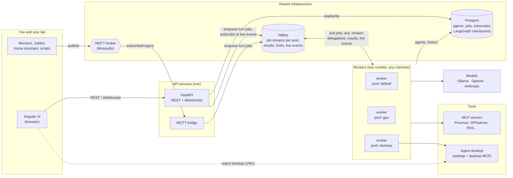
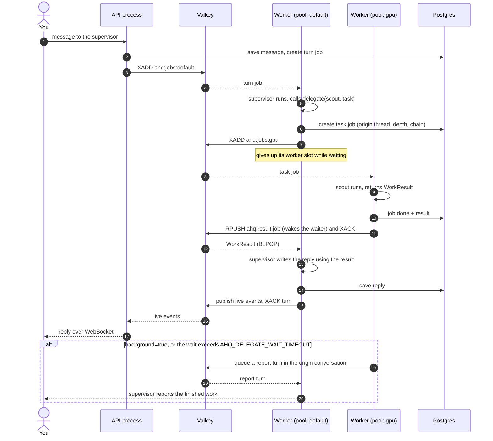
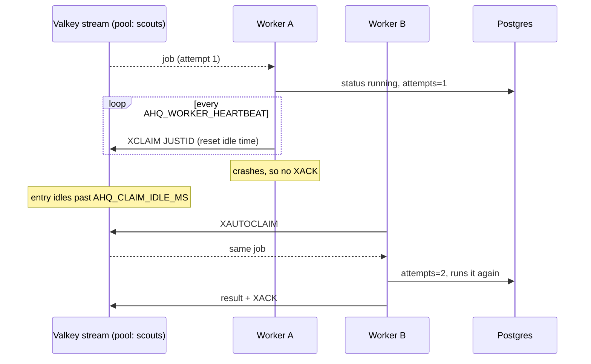
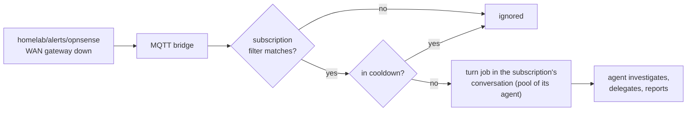
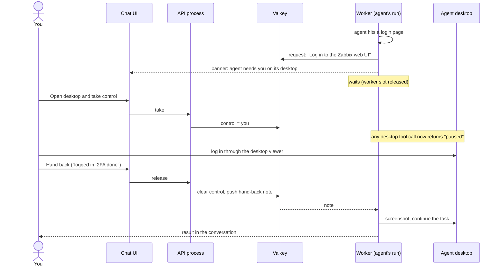
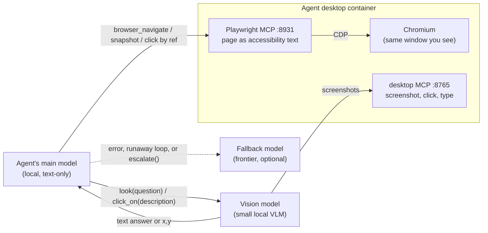

# Agent HQ

A self-hosted multi-agent system. You add model providers (your Ollama servers, OpenAI, Anthropic, any OpenAI-compatible server) and create agents in the web UI, giving each one instructions, a provider and one of its models, tools, delegation rights and a **worker pool** that decides which machines run it. Supervisors delegate to other agents; delegated work always reports back to the conversation it came from. Jobs survive crashes and restarts, and MQTT events from your homelab can wake agents on their own.

- **Backend:** FastAPI, LangGraph (conversation graph + checkpointing), PydanticAI (agents, typed results, MCP tools)
- **Frontend:** Angular 22 (signals, standalone components)
- **Shared infrastructure:**
  - **Postgres:** the source of truth: agents, jobs, transcripts and LangGraph checkpoints.
  - **Valkey** (or Redis): job delivery through Streams, plus results, locks, live UI events and the worker registry.
  - **MQTT:** incoming events from monitors, devices, Zabbix, Home Assistant and so on.
- **Tools:** any MCP server, registered in the UI
- **Desktops:** one `linuxserver/webtop` container per agent, driven by a small MCP server and viewable in the UI

Nothing about specific agents or models is in the code. Providers, names, roles, instructions, models, tools, pools, delegation rights and event subscriptions are all database rows, so renaming or re-tasking an agent takes effect on its next job.

## Architecture



**Every piece of work is a job.** A *turn* job runs one turn of a conversation with the thread's owner agent; your messages, MQTT events and background reports all become turn jobs. A *task* job is a delegation, and the assignee returns a structured `WorkResult` (`status`, `summary`, `details`). Each job is written to Postgres, then its ID is added to the Valkey stream for the assignee's pool (`ahq:jobs:<pool>`).

**Workers pull, run, then acknowledge.** A worker serves one or more pools. It reads with a consumer group, so each job goes to exactly one worker, and it acknowledges the job only after it finishes. While a job runs, the worker refreshes the entry on a heartbeat. If a worker dies, its unacknowledged entries go idle, and another worker on that pool reclaims and reruns them, up to `AHQ_MAX_ATTEMPTS` times. After that the job is marked failed and reported.

**Any worker can run any turn.** Agent definitions and job context are in Postgres, and conversation history is in the shared LangGraph checkpointer. A Valkey lock makes sure two turns of the same conversation never run at once, even on different machines.

**Pools place agents on machines.** Set an agent's pool to `desktop` and only workers started with `--pools desktop` run it, for example the worker on the host next to its desktop container.

### Delegation and report-back



How the delegation guarantees hold up:
- **Wait mode (default)** returns the delegate's `WorkResult` as the `delegate` tool's return value. The supervisor always has the result in hand when it answers you. While it waits, it releases its worker slot, so even a single-slot worker can't deadlock.
- **Background mode,** and waits that exceed `AHQ_DELEGATE_WAIT_TIMEOUT`, queue a **report turn** in the conversation the work came from. The conversation's owner agent is woken there to tell you the outcome.
- **Failures are results too.** Model errors, exceptions and jobs abandoned after repeated worker crashes all produce a `failed` WorkResult, which is reported the same way.
- **Guards:** an agent can only delegate to agents on its list, a chain can't loop back to an agent already in it, and nesting depth is capped (`AHQ_MAX_DELEGATION_DEPTH`).

### Crash recovery



A rerun starts the job from the beginning. Tools that change systems should therefore be safe to repeat, or should go behind an approval step (see *Next steps*).

### MQTT events



Subscriptions are managed on the **Events** page:
- **Topic filter:** MQTT wildcards, where `+` matches one level and `#` matches the rest.
- **Agent:** the agent that handles matching events.
- **Conversation:** where that agent reports. Leave it empty to get a dedicated events thread.
- **Prompt template:** what the agent is told, with `{topic}` and `{payload}` filled in.
- **Cooldown:** stops an alert storm from turning into hundreds of model calls.

The page can also send a test event without a broker. The bridge runs in the API process; run only one API process with `AHQ_MQTT_URL` set, or each event is handled twice.

## Quick start (single machine, dev)

You need Postgres, Valkey and (optionally) MQTT. The simplest route is the infra compose file:

```bash
cd deploy/infra
cp .env.example .env                      # set the passwords
docker compose run --rm mosquitto mosquitto_passwd -c /mosquitto/config/passwd agent-hq
docker compose up -d
```

Backend (one shell for the API, one for a worker):

```bash
cd backend
python -m venv .venv && . .venv/bin/activate      # Windows: .venv\Scripts\activate
pip install -e ".[dev]"
cp ../.env.example ../.env                         # point AHQ_* at your infra; export it
uvicorn app.main:app --reload --port 8000          # API + UI + MQTT bridge
python -m app.worker --pools default               # a worker (any number, any machine)
```

To run a worker inside the API process instead of separately, set `AHQ_EMBED_WORKER=1`.

Frontend:

```bash
cd frontend
npm install
npx ng serve        # http://localhost:4200, proxies /api and /ws to :8000
```

In the UI, start on the **Models** page and add your Ollama server (or another provider), then create agents and pick a model for each.

To try the example crew, go to **Agents → Import** and pick `examples/agents.example.json`. It contains two providers (an Ollama server and OpenAI), the agents with their models and pools, a desktop tool server and an alerts subscription, all as data. Then fix the Ollama URL on the **Models** page and choose models that your server actually has.

Without `AHQ_DB_URL`, the system falls back to SQLite files in `AHQ_DATA_DIR`. That's fine for a single machine, but use Postgres as soon as workers run anywhere else.

## Tests

```bash
cd backend && pytest
```

The tests use scripted fake models (no LLM needed), a real `valkey-server` or `redis-server` started on a free port, an in-process MQTT broker, and a throwaway Postgres cluster when Postgres is installed. They cover:
- delegation in wait and background modes
- single-slot workers (no deadlock)
- pinning agents to pools
- **a worker crashing mid-job and another reclaiming it**
- failure reporting
- conversation history persisting across turns
- renaming agents
- a real stdio MCP server
- MQTT matching, cooldowns and a real broker end to end
- the Postgres database and checkpointer with two workers
- local-first models: a real Chromium driven through Playwright MCP over CDP; vision tools on rendered screenshots (with and without zoom, both coordinate formats, and a not-found case); falling back on errors, runaway loops and escalation
- desktop handoff: tools pausing while you have control, an agent asking you to take over and resuming with your note, and the wait timing out
- model providers: listing models for each kind, write-only keys, and two agents on two Ollama models answering through a worker
- import and export

## Deploy (Docker)

1. **Infrastructure,** once, on one host: `deploy/infra/docker-compose.yml` (Postgres 17, Valkey 8, Mosquitto 2).
2. **Application:** `cp .env.example .env`, fill in the URLs and keys, then `docker compose up -d --build`. This starts:
   - `hq`: API, UI and MQTT bridge on port 8000
   - `worker`: pool `default`
   - `worker-desktop` and `desktop-1`: pool `desktop`, plus an example agent desktop
3. **More machines:** copy `docker-compose.yml` and `.env` to another host and keep only the worker services you want there, with `--pools` set to whatever runs on that machine (`gpu`, `desktop`, `lab-east`…). Workers show up on the **System** page with their pools and load, and each pool's queue depth appears next to them.

Valkey settings that matter (already set in the infra compose file):
- `appendonly yes`: queued jobs survive a Valkey restart.
- `maxmemory-policy noeviction`: Valkey never quietly discards stream entries.
- `requirepass`: a password, which goes in `AHQ_REDIS_URL` as `redis://:password@host:6379/0`.

### Agent desktops

To add another desktop, copy the `desktop-1` block in `docker-compose.yml` (`desktop-2`, host port `3002:3000`, its own `/config` volume). Then, in the UI:
1. Register `http://desktop-2:8765/mcp` as an HTTP tool server, and tick **Controls an agent desktop** on it.
2. Tick it on the agent that owns the desktop, and set that agent's *Desktop viewer URL*.
3. Set that agent's pool to one served by a worker that can reach the desktop's network.

Agents that use desktop tools need a vision-capable model. Protect the viewer with the container's `PASSWORD` option, and keep its port on your LAN: anyone who can open the viewer can use whatever sessions the agent's browser is logged in to.

### Taking control of a desktop

You can drive an agent's desktop yourself: to log in to a site, solve a CAPTCHA or enter an MFA code. That way the agent works with an authenticated session and never sees your password.



- **When the agent asks.** Agents with a desktop get an `ask_user_to_take_over(reason)` tool and are told to use it, never to ask for passwords in chat. The request appears as a banner in the conversation. The agent waits for up to `AHQ_HANDOFF_TIMEOUT` seconds (30 minutes by default), giving up its worker slot while it waits. When you hand back, it continues with your note.
- **When you step in on your own.** **Take control** on the desktop panel pauses the agent at any time. While you have control, every call to that desktop's tools, screenshots included, is refused. So the agent neither fights you for the mouse nor sends what you're typing to its model provider. If the agent ran into the paused desktop mid-task, **Hand back** wakes it in that conversation to carry on.
- **A forgotten takeover can't block an agent forever.** Control expires after 24 hours.

Credentials typed into chat are stored in the transcript, the conversation history and possibly your traces. Logging in yourself on the desktop keeps them out of all three.

## Adding tools

Register MCP servers on the **Tools** page:
- **HTTP:** a URL like `http://perceptor:8811/mcp`
- **stdio:** a command plus arguments, which is launched **on whichever worker runs the agent**, so it must be installed there

Click **Test connection** to list the server's tools (this connects from the API host), then tick the server on any agent. Tool names are prefixed with the server name by default (`proxmox_list_vms`) so they never collide.

## Model providers

Providers live on the **Models** page; nothing about servers or model names is hardcoded. Add a provider once, and its models become choices in every agent's **Model** picker. Different agents can use different models from the same provider: one on `qwen3:14b`, another on `gpt-oss:20b`.

| Kind | Base URL | Model list comes from | API key |
|---|---|---|---|
| **Ollama** | `http://host:11434` (with or without `/v1`) | `GET /api/tags`, with size and quantization | usually none |
| **OpenAI** | optional override | `GET /v1/models` | stored, or `OPENAI_API_KEY` on the workers |
| **OpenAI-compatible** (vLLM, LM Studio, LiteLLM, llama.cpp server…) | required, the server's `/v1` URL | `GET /v1/models` | only if the server needs one |
| **Anthropic** | optional override | `GET /v1/models` | stored, or `ANTHROPIC_API_KEY` on the workers |

You can register several providers of the same kind, for example two Ollama servers on different GPUs.

- **Picking a model:** the agent editor lists the provider's current models. You can still type a name the provider doesn't list yet, such as a model you're about to pull.
- **API keys are write-only.** They're stored in the database and used by the workers, but the API never returns them and exports never include them. To keep keys out of the database entirely, leave the field blank and set the provider's usual environment variable on the workers instead.
- **Disabling and deleting:** disabling a provider stops its agents with a clear error in their conversations. A provider can't be deleted while agents still use it.
- **Advanced:** with the provider set to *Custom model spec*, the Model field takes a raw PydanticAI spec such as `openai:gpt-4.1`, or `test` for a no-LLM test model.

Agents that use desktop tools need a vision-capable model.

## Local-first models

Three features let local models do most of the work, so frontier models are only used when needed.



### 1. Read web pages as text (Playwright MCP)

Each desktop container now runs a Chromium window (kept on the desktop, with its profile in `/config/agent-browser`) and a [Playwright MCP](https://playwright.dev/mcp/snapshots) server attached to it over the DevTools Protocol. Agents read pages as an accessibility snapshot, a text tree in which every element has a ref, and click or type by ref. That brings some big advantages:
- Any text model can browse; no vision model is involved.
- Clicks are exact rather than guessed coordinates.
- It costs far fewer tokens than screenshots.
- It works in the same browser you see, so a login you do through take-control stays in place for the agent.

Register it as an HTTP tool server at `http://desktop-1:8931/mcp`, tick **Controls an agent desktop**, and untick *Prefix tool names*, since its tools are already called `browser_*`. Agents should call `browser_snapshot` after navigating to read the page.

### 2. Vision as a tool (per-agent vision model)

Set a **Vision model** on an agent, for example `qwen3-vl:8b` from your Ollama provider. The agent's main model then never sees screenshots, so its context stays small and it can be a text-only model. Instead it gets three tools:
- `look(question)`: a text answer about what's on screen, such as "CPU peaked at 87% at 14:20".
- `locate(description)`: the x/y position of something described in words.
- `click_on(description)`: locate it, then click.

The vision model does the looking. Screenshot tools on that agent's desktop servers are hidden from the main model.

Two settings tune it for the vision model you pick:
- **Coordinates:** *0–1000 scale* for the Qwen-VL family and Holo models; *pixels* for UI-TARS.
- **Zoom in to double-check clicks:** after a first guess, the area around it is cropped, enlarged and checked again. That takes one more vision call, but small local models land much more accurately with it.

Good local choices are `qwen3-vl:4b` or `qwen3-vl:8b` (in Ollama) for reading screens and graphs, and Holo2 or UI-TARS-1.5 for precise clicking. The last two are served through vLLM or llama.cpp as an *OpenAI-compatible* provider. With 16 GB of VRAM, keep in mind that the main model and the vision model each need to load; a 14B text model plus a 4B vision model fit more comfortably than gpt-oss:20b plus an 8B.

### 3. Fallback model

Set a **Fallback model** on an agent, for example `gpt-4.1` from OpenAI. The turn is rerun on it when any of these happens:
- the main model errors, for instance because the Ollama server is down;
- it runs away, hitting the per-run request limit while looping on tool calls;
- it calls `escalate(reason)` itself. Agents with a fallback are told to do this when a task is beyond them.

The switch shows up in the conversation and the live activity panel. The fallback can't escalate again. A rerun starts the turn over, so any tool calls the main model made before failing may happen again.

## Observability

Set `OTEL_EXPORTER_OTLP_ENDPOINT` to your OpenTelemetry Collector. The API process traces as `agent-hq` and workers as `agent-hq-worker`, so every agent run, model call and tool call shows up in Phoenix. The live activity panel in each chat shows the same information, plus queueing, retries and which worker ran each job.

## Layout

```
backend/app/
  models.py          ModelProvider, AgentDef, ToolServer, Thread, Message, Job, Subscription tables
  runtime.py         builds agents from rows; turns; delegation; report-back
  worker.py          stream consumer: concurrency, heartbeats, reclaiming, registry
  broker.py          all Valkey access: streams, results, pub/sub, locks, cooldowns
  mqtt_bridge.py     MQTT subscriptions -> turn jobs
  vision.py          look / locate / click_on via a per-agent vision model
  api/desktop.py     take control of an agent's desktop / hand it back
  llm.py             model providers: build an agent's model; list a provider's models
  api/               REST + WebSocket (/ws/threads/{id})
  telemetry.py       OTLP -> your Collector -> Phoenix
frontend/src/app/    chat, agents, models, tools, events and system pages
desktop/             webtop image: Chromium + Playwright MCP (:8931) + desktop MCP (:8765)
deploy/infra/        Postgres, Valkey and Mosquitto compose file
examples/            example crew (providers, agents, pools, tools, subscriptions) as importable JSON
```

## Next steps worth building

- **Approvals:** mark tools as needing approval (PydanticAI `requires_approval` / LangGraph interrupts) and show approve/deny cards in chat before anything changes a system. This also makes reruns after a crash safe.
- **Schedules:** a `Schedule` table (cron + agent + prompt + conversation). A scheduled run is just a turn job, so it reports back the same way.
- **Outbound MQTT:** a small MCP server that lets agents publish status or commands back to the lab.
- **Schema migrations:** add Alembic once you have data you want to keep through schema changes.
- **Auth:** put the UI behind your reverse proxy or step-ca mTLS before exposing it beyond the LAN.
