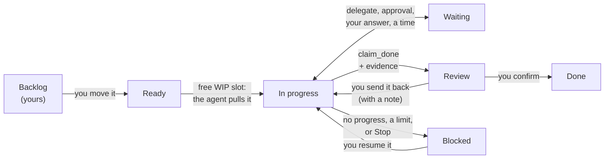
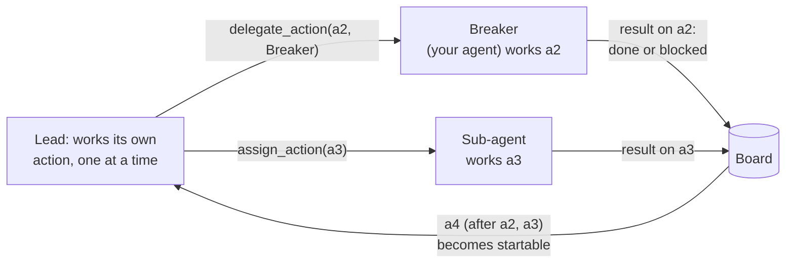

# Working with agents

Huddles, next actions, scheduled tasks, standing goals and teams, sub-agents, and managing agents. Back to the [overview](../README.md).

## Huddles: several agents in one chat

A conversation starts with one agent. **@mention another agent** in a message, or add one with the **+** in the chat header, and it joins: the chat becomes a **huddle** and moves to the sidebar's **Huddles** section, under Conversations, with its history and address unchanged. The sidebar shows each huddle with its members' avatars.

**Who answers:**
- **@mention an agent** to address it. Typing `@` in the message box suggests agents (members first); an agent not in the huddle yet joins when you send.
- **No mention:** the huddle's **lead** answers. That's the agent the chat started with, until you pick another. Click a member's avatar in the header to mention it, make it lead, or remove it.
- **Several mentions** answer one after another in the order you wrote them, so each sees the replies before its own: `@Scarlett find the release notes, then @Snake Eyes check the page`.
- **`@huddle` (or `@all`) asks every member at once.** They work at the same time and each replies as soon as it has an answer, in whatever order they finish, so they don't see each other's answers to that message. Each is told the others are answering too. `@huddle` is the first suggestion when you type `@` in a huddle. If an agent is actually named Huddle or All, its name wins. The header shows everyone who's working.
- **Agents can @mention each other** in their replies, for example to ask another member to check their work. The member they mention answers next. Agents are told to write the @. A member addressed by name at the end of a reply without it also gets the hand-off, since models often write it that way: "Duke, want to weigh in?", "Duke: can you check this?", "What do you think, Duke?". A name used in passing, or earlier in the reply, doesn't count. **Settings → System → Long conversations → Huddles** caps how many turns agents can start that way after one message of yours (3 by default; 0 turns it off), so two agents can't keep passing the floor back and forth. After an `@huddle`, that cap is shared by all the members answering, not counted for each one. The chat notes when the cap stops a hand-off.
- **Reports and events** go to the member they belong to: a background delegation reports to whoever delegated it, a sub-agent decision goes to the agent that asked, and a desktop handback goes to that desktop's agent if it's in the huddle. Otherwise the lead takes them.

**What each agent sees:**
- **Its own model history.** Each member has its own LangGraph checkpoint for the conversation, and turns run one at a time per member rather than per conversation, so different members can work at once (the starting agent keeps the conversation's own key, so chats from before huddles carry on as they were). One agent never sees another's tool calls or thinking as its own, and agents on different providers can share a huddle.
- **A catch-up at the start of its turn:** what you and the others said since it last spoke, as plain text. It's read when the turn runs, so it includes the replies of agents that answered just before. An agent that joins later gets the conversation so far, trimmed from the oldest end to fit its context window.
- **Who's in the huddle,** in its instructions: the other members, who leads, and how mentions work.

**Delegating from a huddle brings the delegate in.** When a member delegates to another agent from the huddle, that agent joins it. It does the work as an ordinary delegated task, then posts its findings in the chat as its own message, under its name and avatar, marked "findings for" the agent that asked. The delegator gets the result as usual, but is told the findings are already posted: it credits them and adds only its own view, instead of passing the work off as its own. This works whether it waits for the result or it comes back later. Work an agent delegates from inside a delegated task stays in the background, and so do sub-agents, which are one-task helpers.

**Unchanged:** each answer is an ordinary turn by that agent. It runs on that agent's model and pool, with its tools, delegation rights, tool approvals and sub-agent limits. Memory recall uses that agent's own scope, plus team memories and the conversation's memories, which every member shares. In Phoenix, each answer is a `turn <agent>` span in the conversation's session. Stop halts whoever is working, and the agents still waiting for their turn.

**Leaving and deleting:** removing a member keeps its earlier replies in the chat, and the chat stays a huddle. If the lead leaves, the next member in join order leads. A huddle always keeps at least one agent. Deleting an agent removes the huddles it started, and takes it out of the huddles it joined. Those stay, along with the other agents' work.

**API:** `POST /api/threads/{id}/members` `{"agent_id"}` adds a member, `DELETE /api/threads/{id}/members/{agent_id}` removes one, and `PUT /api/threads/{id}/lead` `{"agent_id"}` picks the lead. Threads carry `members`, `lead_agent_id` and `huddle`. `GET /api/threads?agent_id=` lists the chats an agent started and the huddles it's in. Posting a message returns the agent that answers first and the thread as it is now.

## Next actions: big requests worked one step at a time

A local model given a big request in one run ("build me a Zork-style text adventure") has to plan, remember and do everything in one growing context, on one budget of model requests. It runs out of requests or loses track, and the fallback model takes over. Given the same request as a standing goal, it does fine, because the board breaks the work into next actions and every turn starts from the card instead of a long transcript. **Next actions** bring that way of working to ordinary requests, with no board and no approval step:

1. **Decide.** A quick planning request on the agent's own model, with no tools and less thinking, answers DIRECT for anything one run handles (a question, a lookup, a small change, a follow-up). For a bigger request it writes a brief of the request, plus 2 to `AHQ_PLAN_MAX_STEPS` (8) next actions, each something one focused run can finish.
2. **Work each step as its own run.** A step starts from just the brief, the plan with earlier steps' results, and its own instructions. It has no chat history and gets a fresh request budget. All steps share the job's [scratch pad](memory-and-knowledge.md#scratch-pads-notes-outside-the-context-window) and see each other's files. Each step hands in a result: done, partial or failed.
3. **Fall back and replan per step.** A step that fails moves to the fallback model for that step only; the next step is back on the main model. A step that ends partial or failed, or that says `PLAN:` in its result, gets a short revise request: keep the plan, stop, or replace the remaining steps. This happens at most `AHQ_PLAN_MAX_REVISIONS` (3) times per request.
4. **Reply from the results.** A last run, with the conversation's history, writes the reply from the steps' results (or the WorkResult, for a delegated task). The conversation's history keeps that, so follow-ups ("make it harder") know what was done.

**What plans:** your messages (in a chat, a huddle, or from Telegram or Discord), scheduled tasks and delegated tasks. **What never plans:** messages under three words (except with Always), goal turns (the board already does this), a goal team member's action, MQTT and webhook events, report-backs and decisions, `@huddle` messages to everyone, sub-agents and test runs. If planning fails, the request runs as one run, as before.

**Per agent** (Settings → Agents → Next actions): **When it helps** (`auto`, the default), **Always** (anything but chit-chat) or **Off**. `AHQ_NEXT_ACTIONS=0` turns it off for every agent.

**In the chat,** the **Next actions** panel on the right, below Outputs, shows each request's steps as they run: pending, running, done, partial, failed or skipped, with each step's result, how many times the plan was replanned, and when it's writing the reply. A delegate's plan sits indented under the plan that delegated to it. The panel opens by itself when a plan starts, and stays shut once you close it until the next one. The live activity log shows each step starting and finishing too.

**Restarts and deploys.** When the worker running a request shuts down mid-plan (a deploy rebuilding the containers) or dies, the plan is left in Valkey marked *interrupted*. The worker that picks the job up again carries on with the same plan: finished steps keep their results, the interrupted step runs again (told that files and notes from its first try may already be there), and nothing is planned again. The chat says where it picked up. A step that can't reach its tool server, for example a workbench being recreated, waits 20 seconds and tries again (twice, waiting longer the second time) instead of failing and replanning. Only Stop ends a plan early.

**Files.** Steps leave their work files where they are (the workbench, the scratch pad) and name them in their results; the reply after the last step sends the finished files once. The reply is told which files the steps already attached, so it doesn't send them again. If an agent does send the same thing twice in one request, the later copy replaces the earlier one (see [File attachments](memory-and-knowledge.md#file-attachments)).

**In Phoenix,** each next action is a trace of its own, named `next action 2/5 Hi-Tech: <step>`, the same way each goal turn is. It shows up as soon as that step finishes, with its model and tool calls inside it, its result as output, and an error status if it failed. Each step trace links back to the turn, has the same `session.id` (so the conversation's session holds the turn and every step), and carries `agent_hq.step`, `agent_hq.steps`, `agent_hq.step_title` and `agent_hq.step_restarts`. Planning, replanning and the final reply stay inside the turn's own trace, which shows once the whole request is done. The plan keeps each step's trace ID (`trace_id`).

**Cost:** one extra short model request per message that's long enough to plan, plus one per replan. Planning requests count on the Activity page and in the usage ledger like any other.

**Plans live in Valkey only,** like scratch pads: kept while the job runs and `AHQ_PAD_TTL_HOURS` (24) hours after it finishes.

**API:** `GET /api/threads/{id}/plans` returns the conversation's plans still kept, oldest first. Live updates come as `plan` events (the whole plan) on the conversation's WebSocket, along with `planning` and `plan_revised`.

## Scheduled tasks

The **Scheduler** (above Settings in the sidebar) gives agents tasks to run on a schedule: every N hours, daily, on chosen days of the week, monthly, or any cron expression.

**Describe it in plain words.** At the top of **When**, type the schedule the way you'd say it, for example `every weekday at 7am`. The editor shows what it understood ("Weekdays at 7:00 AM") and the next five run times in the schedule's time zone. Nothing changes until you click **Use this** (or press Enter). That fills in the usual fields, which you can still adjust before you **Save**. It understands:

| Kind | Examples |
|---|---|
| Hourly and intervals | `hourly`, `every 2 hours`, `every other hour`, `every hour at :15`, `every 4 hours at 15 past`, `every 15 minutes`, `every half hour` |
| Within hours and days | `every 30 minutes between 8am and 6pm on weekdays`, `every hour from 9 to 5 on weekdays`, `every 2 hours on weekends` |
| Daily | `daily at 7am`, `every day at 18:30`, `every evening at 6`, `at noon`, `daily at 9am and 5pm` |
| Days of the week | `every weekday at 7am`, `weekends at 10`, `Mondays and Thursdays at 7:30`, `mon, wed, fri at 9pm`, `Tuesday through Friday at 8am`, `weekly on Friday at 5pm` |
| Monthly | `monthly`, `on the 15th of every month at 9`, `the 1st and 15th at noon`, `last day of the month at 11pm` |
| Nth weekday | `first Monday of the month at 9am`, `second Tuesday of each month at 10:00`, `last Friday of the month at 5pm` |
| Cron | any 5-field cron expression, used as is |

- **No time given:** `every Monday` uses the time already in the editor.
- **Where it lands:** shapes the regular fields can hold become Hourly, Daily, Weekly or Monthly. The rest (the first Monday, a window of hours, several times a day, every 15 minutes) become a **Custom (cron)** expression, such as `0 9 * * 1#1`, and the summary still reads in plain English.
- **What it can't do:** if it can't follow the phrase, it says which words it didn't understand and gives examples. It never guesses. Some things cron can't express, so they're refused with a reason: `every other Tuesday` or `every 3 days` (cron can't count weeks or days between runs), `every 90 minutes`, days 29 to 31, and the fifth weekday of a month.
- **How it works:** a small rule-based parser (`backend/app/schedule_text.py`), not a model. It's instant, needs no GPU or provider, and gives the same answer every time.

- **Time zone:** each schedule has its own (your browser's by default), and daylight-saving changes are handled: "every day at 7:00 AM" stays at 7:00 AM local time.
- **Where results go:** each schedule has its own conversation, `Scheduled: <name>`, which appears in the sidebar like any chat.
- **What a run is:** it posts a short "Scheduled run" note, then gives the agent the task as a turn, exactly as if you'd typed it. Delegation, tools and memory all work as usual, and so do the delegation threads.
- **Editor:** shows the cadence in plain English and the next five run times as you change it. It also lists recent runs with their status (queued, running, done, failed, skipped), and has **Run now** (doesn't move the schedule) and **Open conversation**.

**Reliability:**
- **Which process runs it:** the API process checks for due schedules every 20 seconds. Each run is claimed with a Valkey lock, so it fires exactly once even if you run several API processes.
- **After an outage:** if Agent HQ was down when a run was due, it runs **once** when it comes back, not once per missed slot, and the note says it ran late.
- **Overlapping runs:** with **Skip a run if the previous one is still going** on (the default), a run is skipped rather than piling up behind a slow one.
- **Disabled agent:** if a schedule's agent is disabled, its runs are recorded as skipped.
- **Turning it off:** set `AHQ_SCHEDULER=0` to stop an API process from running schedules.

Monthly schedules can be set for days 1 to 28 only, so they happen every month. For the last day of the month, a weekday such as the first Monday, or anything else unusual, describe it in plain words or use a custom cron expression (`0 9 L * *`, `0 9 * * 1#1`).

## Standing goals (the Board)

A **standing goal** is an outcome with a definition of done, given to one agent: "Every VLAN has a note in the vault", "pve2's backups finish inside the window three nights running". The agent breaks it into **next actions** and keeps working it, one action at a time, across as many turns as it takes, until it can show the done criteria are met. It's Getting Things Done on a Kanban board: the goal is the project, the actions are its next actions, and the **Board** (in the sidebar, above the Scheduler) is the external memory, so the agent never has to hold the original problem in its context window.



**Columns, and who moves cards:**
- **Backlog:** captured, not agreed to. Agents never pull from it.
- **Ready:** you've said "yes, do this". The agent pulls the highest-priority Ready goal (then board order) when it has a free WIP slot.
- **In progress, Waiting, Review:** the agent's and the runner's. Waiting shows what it's waiting on: a background delegation, a tool approval, you on its desktop, your answer, or a check-back time.
- **Blocked** (shown in In progress, flagged red): a guard stopped it, or you pressed Stop in its conversation. **Resume** puts it back.
- **Done** and **Dropped** (shown in Done): finished, or abandoned. **Reopen** sends either back to Ready.

You can drag cards between Backlog, Ready, In progress and Done in the agent's own lane. Errors (a full WIP limit, a proposal not yet approved) show above the board.

**WIP limits.** Each agent has a **goal WIP limit** (Settings → Agents → Standing goals; default 1, 0 = it takes no goals). Goals that are in progress, waiting or blocked all hold a slot, so a blocked goal stops that agent pulling new work until you deal with it, which is the Kanban signal to fix it or move it. Inside a goal, only **one next action** can be in progress at a time; the agent has to finish, block or drop it before starting another. That's the guard against losing track of the original problem.

**The goal runner** runs in the API process and checks the board every `AHQ_GOALS_TICK` seconds (5):
1. **Pull.** For each agent with free slots, move its next Ready goal to In progress. Each goal gets its own conversation, `Goal: <title>`, in the sidebar.
2. **Advance.** For each goal in progress with nothing running in its conversation, queue a **goal turn**. Its prompt is the card itself: the objective, the done criteria, the next actions with their status and results, the last 12 log entries, and your note if you sent a done claim back. The agent doesn't rely on the conversation's history to know where it is, so compaction can't make it lose the thread.
3. **Wait and resume.** A background delegation shows as Waiting and resumes once the delegate's result has been reported in the conversation. Approvals and desktop hand-offs show as Waiting while they're pending. "Wait for the user" resumes when you post in the goal's conversation; "check back in N minutes" resumes when the time comes.
4. **Guard.** A goal is **blocked** when it goes `stall_turns` goal turns in a row without changing anything on the board (default 3), reaches its **turn** limit (40), its **hours** limit (72, wall clock since it started), or its **model requests** limit (400, counted from the usage ledger for everything that ran in its conversation, delegates included). You get a card in Requests → Goals and a `goal_blocked` MQTT notice. Raise a limit on the card (Edit → Limits) before resuming a goal that hit one.

Only one API process should look at a goal at a time; a Valkey lock per goal makes that so, however many API processes run the runner. Set `AHQ_GOALS=0` to stop an API process from running it.

**Agent tools,** given only to the goal's owner, in the goal's own conversation (delegates working there don't get them):

| Tool | What it does |
|---|---|
| `board_view` | The card: objective, done criteria, actions with IDs, recent log |
| `add_action(title, details, after)` | Adds a next action (to do). `after` lists the actions that must be done before it can start |
| `start_action(id)` | Starts one; refused while another of its own is in progress, or while anything in its `after` list isn't done |
| `complete_action(id, result)` | Finishes one, keeping what it found or did on the board |
| `block_action` / `drop_action(id, reason)` | It can't go on as it is / it isn't needed |
| `log_note(text)` | A note on the log; doesn't count as progress |
| `wait_for(kind, reason, minutes)` | `user`: asks you something and waits for your answer. `time`: checks back later (5 minutes to a week) |
| `claim_done(evidence)` | Moves the goal to Review with the evidence; refused while its team is still working |
| `delegate_action(id, agent_name, instructions)` | Agents with a team and agents to delegate to: hands a startable action to one of its existing agents (see below) |
| `assign_action(id, role, why_not_existing_agents, instructions, model, tools)` | Agents with a team allowed sub-agents: hands a startable action to a new sub-agent (see below) |

The agent can't change the objective or the done criteria; only you can (Edit on the card). If it thinks they're wrong, it's told to say so and wait for you.

**Done is your call.** A done claim shows up in the goal's conversation, in **Requests → Goals** (with the sidebar badge) and on MQTT as `goal_review`. **Confirm done** finishes it and frees the slot; **Send back** returns it to In progress with your note, which the agent sees at the top of its next goal turn.

**Agents propose goals.** Every agent (not sub-agents) has `propose_goal(title, objective, done_criteria, reason, agent_name)` for multi-step work it notices but wasn't asked to do. A proposal lands in Backlog, flagged *proposed*, for itself or another agent, with a card in the conversation, in Requests → Goals and on MQTT (`goal_proposal`). It can't leave Backlog until you **Approve to Ready**, **Approve to Backlog** or **Reject** it. At most 5 proposals per agent wait at once.

**Creating goals:** **+ New goal** on the Board, or the flag button under any agent reply ("Make this a goal"), which opens the form with that reply as the objective. Write the done criteria so anyone could check them: they're what the agent works toward and what you'll review against.

**On the card:** the objective and done criteria, the next actions (you can add, start, finish or drop them too), the full log, a box for notes to the agent, and how much of each limit it has used.

**MQTT notices** on `AHQ_MQTT_NOTIFY_TOPIC`: `goal_review`, `goal_proposal`, `goal_question` and `goal_blocked`, each with the goal's ID, title, agent and a link (`AHQ_PUBLIC_URL`).

### Teams: your agents and sub-agents working a goal's actions in parallel

An agent can form a team for a goal: while it works one next action itself, team members work other actions of the same goal in parallel. Team members are **its existing agents** (the ones it may delegate to) and, if it's allowed them, **new sub-agents**. It's swarming, in Kanban terms: the agent's goal WIP stays where it is (one outcome at a time, by default), and the *action* WIP inside that goal grows by its team.



**Turning it on:** Settings → Agents → Standing goals → **Team size** (parallel actions per goal: the agent plus its team members; default 1 = no team). It takes effect when the agent has agents under **Can delegate to**, or sub-agents set to *Ask me first* or *Allowed within limits*, or both. With sub-agents only, *Allowed within limits* caps it by the sub-agent limit **At once** (the editor says so when it is); with agents on the team, that limit still applies to the sub-agents it creates, not to the team size.

**How it works:**
- **Serial stays serial.** When the agent adds an action that needs others' results, or would clash with them, it lists them in `after`. An action is startable, by the agent or its team, only when everything in its `after` list is done (dropped ones don't hold it up). The card shows what each action waits for.
- **Your agents first.** `delegate_action` hands an action to one of the agents the lead may delegate to. That agent works it as a background delegated task with everything it already has: its own model, tools, memory, skills, knowledge and desktop. It shows in the conversation as a delegation card with the action and the lead's instructions. Each agent works one action per goal at a time, and the usual delegation rules apply (no loops back up the chain, the depth limit, *ask first* for work a webhook started). The goal turn's instructions name the lead's agents and tell it to use them before creating sub-agents, and to use `delegate_action` rather than `delegate` for a whole action, so it keeps working while they do.
- **Sub-agents for the rest.** `assign_action` creates a sub-agent through the normal sub-agent path, so everything already set for sub-agents applies: the mode (in *Ask me first*, the agent asks with `request_subagents` first, and your approval covers the goal's conversation), the models and tool servers it may give them (including a cloud model, which matters when the local GPU is busy), minutes and model requests each, how many at once and per day, and the team-wide limits. Sub-agents on a team never get a desktop and can't create sub-agents of their own.
- **No duplicates of your agents.** As with any sub-agent, the lead has to say why none of your existing agents should do the action (`why_not_existing_agents`), and a sub-agent whose role names one of your agents, or whose work is close to one's description, is refused with a pointer to that agent: `delegate_action` when the lead can delegate to it (under an approved *Ask me first* request, only an outright name clash is refused, since the request already showed you any overlap). The comparison uses the role, the action and the lead's instructions for it, not the goal and team context in the briefing, so a long briefing can't water it down.
- **What a team member is told:** the goal and its objective, its one action and the lead's instructions for it, and what the team has found so far (the results of the actions it depends on, and the latest others). It's told not to change anything outside its action.
- **Results land on the board.** A team member's result goes onto its action, before anything else happens when it finishes: *done* completes it with what it found; *partial* or *failed* blocks it with the reason, for the lead to re-plan. There's no report turn per result: the next goal turn's card shows every result, with who did it, marked *your agent* or *sub-agent*.
- **The runner keeps the lead busy.** While its team works, the lead keeps getting goal turns as long as it has something of its own: its action in progress, a blocked action to re-plan, or a startable one to take or hand over. When everything left is either with the team or waiting on it, the goal shows as **Waiting on its team**, and resumes as results come in.
- **Same guards, same review.** The goal's model-request limit counts its team too, a team result counts as progress, `claim_done` is refused while any team member is still working, and you still confirm done. Stop (or dropping the goal) stops the whole team, and their actions go back to to-do.
- **You can step in:** drop an action a team member is working on, and its late result is noted in the log but not applied.

On the board, a card with a team shows **team ×N** while N team members are working, and its action list shows who's working or did each action (tagged *agent* or *sub-agent*), and what each waits for. The goal's detail names who the lead can put on its team.

**Built for incidents next.** The board's rows aren't specific to goals: each work item has a kind, a source and a correlation key, and the same columns, runner, next actions and WIP rules will carry incidents (alerts grouped into one problem to solve) later.

## Sub-agents

Agents can create temporary **sub-agents** for parts of their own task (say, reading twelve feeds in parallel). It's off for every agent until you turn it on, per agent, under **Settings → Agents → Sub-agents**:

- **Off** (the default): the agent has no sub-agent tools at all.
- **Ask me first:** the agent gets `request_subagents`. It sends you a request, like a staffing request: which sub-agents, what each is for, why it needs them, why none of your existing agents fits, which model and tools each needs, and how long. You decide; it can only create them after you approve, and only within what you approve.
- **Allowed within limits:** the agent may create sub-agents itself, within the limits set on it.

**Limits, all enforced in code:**
- **Per agent:** how many at once, per task and per day, minutes each, and model requests each. Also which models sub-agents may use (empty = the agent's own model) and which of its tool servers they may have.
- **Team-wide** (**Settings → Sub-agents**): running at once and created per day across all agents, open requests per agent, and how long an unanswered request stays open.
- **Enforcement:** every spawn is checked under a Valkey lock, so several workers can't race past a limit. A sub-agent's run stops at its request limit (PydanticAI `UsageLimits`) and its time limit, and the sub-agent retires as soon as it reports back. Anything left over (a crashed worker, say) is retired by a sweep when it expires.
- **No nesting:** sub-agents can't delegate or create sub-agents of their own.
- **No desktops:** sub-agents are never given a desktop tool server, since two agents can't drive one desktop.

**No duplicates of agents you've defined.** If an existing agent is meant for the work, the agent should delegate to it instead. This is enforced three ways:
- **A rule** in the agent's instructions, which names your agents.
- **A required explanation:** `why_not_existing_agents` must be filled in.
- **A refusal check:** a sub-agent whose role reuses an agent's name is always refused. With an embedding model set (Settings → Memory), the role and task are also compared with every agent's description, and anything above the similarity setting (Settings → Sub-agents, default 0.78) is refused. The refusal tells the agent which agent to delegate to.

On requests, near misses show up as warnings for you, and approving them is your call.

**Requests.** A request appears in three places:
- **In the conversation:** an approval card with the agent's reasoning and the system's own estimate. The estimate covers, for each sub-agent: the model and its size (from the provider's model list), whether it runs on your hardware or a cloud plan, free provider slots, and the usage ledger's averages for that model. It also gives the total model-minutes and the expected wall time.
- **In the Requests inbox:** under **Requests → Sub-agent requests**, with a badge for pending requests.
- **On MQTT**, if `AHQ_MQTT_URL` is set (see below).

You can approve as asked or change the terms first: the number of sub-agents, how many at once, minutes, model requests, models, tools, and how long the approval lasts. You can also deny it, with or without a note.

An approval is a grant for that agent in that conversation, and it expires. Your decision wakes the conversation:
- **If the conversation is the agent's own,** it carries on with (or without) the sub-agents.
- **If the agent asked while working on a task delegated to it,** the conversation's owner is told and delegates the task again.

**MQTT notifications.** New requests and your decisions are published as JSON to `AHQ_MQTT_NOTIFY_TOPIC` (default `agent-hq/notifications`) on the broker in `AHQ_MQTT_URL`, using a client ID of their own. This is now the **MQTT** channel under Settings → Notifications, where you can turn it off, change its topic or narrow what it gets (see [Notifications](notifications.md#notifications-telegram-discord-and-mqtt)). Set `AHQ_PUBLIC_URL` (for example `http://shockwave:8000`) to include a link to the request.

```json
{"type": "subagent_request", "request_id": "…", "agent": "Duke", "why": "…",
 "subagents": [{"role": "Feed reader", "purpose": "…", "label": "qwen3:14b @ Einstein Ollama", "est_minutes": 5}],
 "total_minutes": 5, "hours": 2, "link": "http://shockwave:8000/requests?id=…", "at": "…"}
{"type": "subagent_decision", "request_id": "…", "agent": "Duke", "status": "approved", "grant": {…}, "note": "…"}
```

**In the chat,** a sub-agent's work shows as a crumb marked *sub-agent*, with its role and model. Expand it for the task, the reason it was created, and its report. Sub-agents never appear in your agent lists, the New chat menu, teams or exports.

### Provider slots and the usage ledger

- **Slots:** each model provider has **Max concurrent requests** (Settings → Model providers; 0 = no limit). It caps how many model calls run against that provider at once, across every worker, so a burst of agents and sub-agents queues instead of swamping a GPU box. Slots are leases in Valkey that are renewed while a call runs, so a crashed worker can't hold one for more than 90 seconds.
- **The ledger:** every agent run (chat turn, delegated task or sub-agent task) is recorded with its model, model requests, tokens and wall-clock time. **Reports → Usage history** totals these by agent (sub-agent runs count under the agent that created them), by model and by day. Request estimates use the same numbers.
- **Budgets:** **Reports → Budgets** splits the ledger by where the work ran (your hardware, a plan, a per-token API), estimates API cost, totals each goal, and warns you when an agent or a provider nears a limit you set. Budgets never stop anything. Agents allowed sub-agents (or with a fallback model) get `check_budget`, and the request card shows the budgets each proposed model would count toward. See [Budgets](budgets.md).

## Disabling and deleting agents

Removing an agent takes two deliberate steps on the **Settings → Agents** page:

1. **Disable** stops the agent: it takes no new work, other agents stop delegating to it, and its conversations stay readable. Tick **Enabled** and save to bring it back.
2. **Delete permanently** appears once the agent is disabled. It shows what will go and asks you to type the agent's name to confirm. It can't be undone.

Deleting an agent removes:

- its conversations: messages, files, jobs, traces and model history, including huddles it started (it leaves the huddles it joined, which stay)
- its schedules and event subscriptions
- its own memories and skills, test cases, proposals, ratings, reflections, tool approvals and sub-agent requests
- its avatar and any sub-agents it made

Some things are kept:

- **Usage ledger:** cost history stays intact.
- **Shared learning:** team memories, team skills and knowledge-library documents stay.
- **Goals it owned:** these go back to your backlog with no owner, and actions it was working go back to Ready.

An agent with work queued or running can't be deleted until that work finishes or you stop it.

**API:** `DELETE /api/agents/{id}` disables. `GET /api/agents/{id}/delete-plan` returns what a delete would remove and whether it's allowed now. `DELETE /api/agents/{id}/permanent` deletes a disabled agent (`409` with the reason otherwise).

## Avatars

Each agent can also have **pronouns** (he/him, she/her, they/them…). Teammates see them in the roster and with delegated results, so a supervisor refers to them correctly.

Give each agent a face on the **Settings → Agents** page: **Upload avatar** accepts a GIF (animated is fine), PNG, JPEG or WebP image up to 3 MB (`AHQ_AVATAR_MAX_BYTES`). Avatars appear in the agent list, the conversation list, the chat header, next to each reply, and on desktop-help banners. Agents without one get their initials on a colour derived from their name.

- **Storage:** images are kept in the database, so every machine serves the same ones, and they're included in agent export and import.
- **Animation:** how animated GIFs behave is a per-browser setting on the **Settings → System** page:
  - *Always animate*
  - *Only while the agent is working*
  - *Never*: shows the first frame; hovering plays the animation.

  Browsers set to reduce motion default to *Never*.
- **Working indicator:** an agent that's currently working also gets a highlighted ring around its avatar.

## The current date and time

Models have no clock: left alone, they take "now" to be about when their training data ends, so "this weekend" can turn into a date months off. Every agent's instructions therefore end with the current date and time in your time zone, which you set with `AHQ_TIMEZONE` (an IANA name such as `America/New_York`; falls back to `TZ`, then UTC). The line goes last because it changes every minute, and providers that cache prompts reuse everything before the first change. Delegated agents and sub-agents get it the same way.
