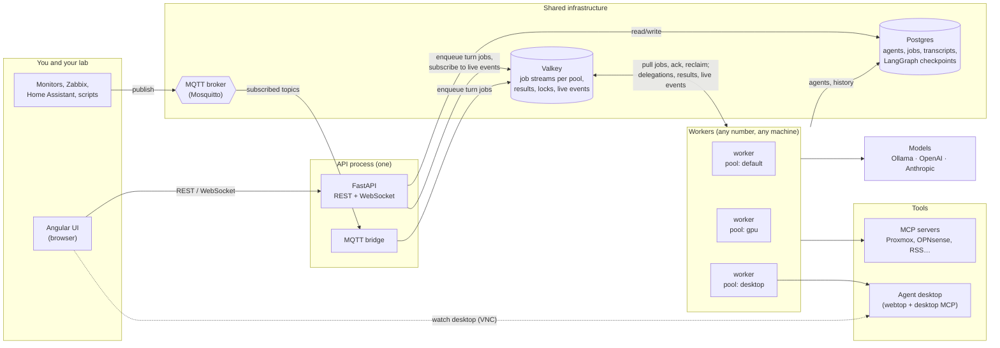
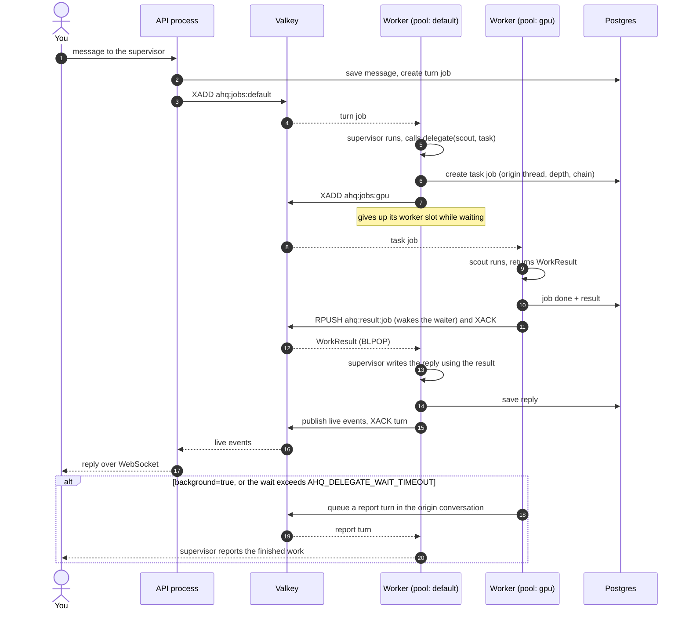
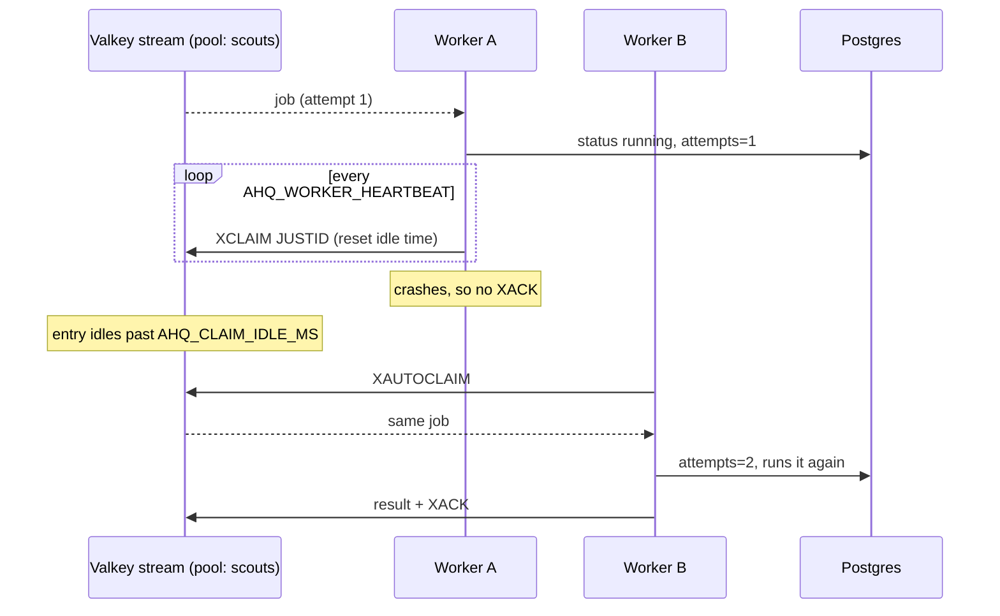
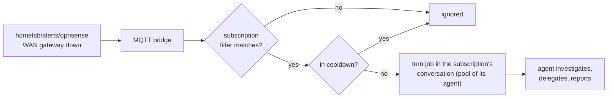
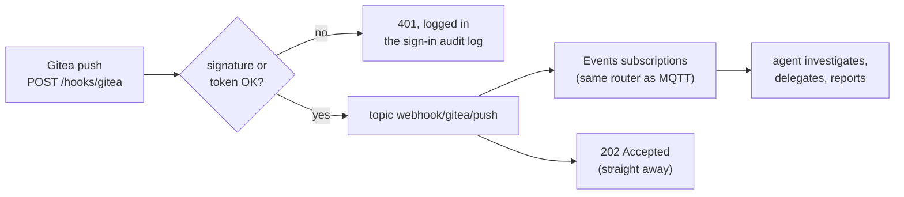

# Architecture

How Agent HQ runs work: jobs, workers and pools, delegation and report-back, crash recovery, events, webhooks and tracing. Back to the [overview](../README.md).

## Architecture



**Every piece of work is a job.** A *turn* job runs one turn of a conversation with the thread's owner agent; your messages, MQTT events and background reports all become turn jobs. A *task* job is a delegation, and the assignee returns a structured `WorkResult` (`status`, `summary`, `details`). Each job is written to Postgres, then its ID is added to the Valkey stream for the assignee's pool (`ahq:jobs:<pool>`).

**Workers pull, run, then acknowledge.** A worker serves one or more pools. It reads with a consumer group, so each job goes to exactly one worker, and it acknowledges the job only after it finishes. While a job runs, the worker refreshes the entry on a heartbeat. If a worker dies, its unacknowledged entries go idle, and another worker on that pool reclaims and reruns them, up to `AHQ_MAX_ATTEMPTS` times. After that the job is marked failed and reported.

**Any worker can run any turn.** Agent definitions and job context are in Postgres, and conversation history is in the shared LangGraph checkpointer. A Valkey lock makes sure two turns of the same conversation never run at once, even on different machines.

**Pools place agents on machines.** Set an agent's pool to `desktop` and only workers started with `--pools desktop` run it, for example the worker on the host next to its desktop container.

### Delegation and report-back



How the delegation guarantees hold up:
- **Wait mode (default)** returns the delegate's `WorkResult` as the `delegate` tool's return value. The supervisor always has the result in hand when it answers you. While it waits, it releases its worker slot, so even a single-slot worker can't deadlock.
- **Background mode,** and waits that exceed `AHQ_DELEGATE_WAIT_TIMEOUT`, queue a **report turn** in the conversation the work came from. The conversation's owner agent is woken there to tell you the outcome.
- **Failures are results too.** Model errors, exceptions and jobs abandoned after repeated worker crashes all produce a `failed` WorkResult, which is reported the same way.
- **Guards:** an agent can only delegate to agents on its list, a chain can't loop back to an agent already in it, and nesting depth is capped (`AHQ_MAX_DELEGATION_DEPTH`).

### Crash recovery



A rerun starts the job from the beginning. Tools that change systems should therefore be safe to repeat, or should go behind an approval step (see [Tool approvals](tools.md#tool-approvals)).

### Stopping a conversation's work

While anything in a conversation is still running, a **Stop** button sits next to Send. It stops the turn and every task delegated from it (background ones included), on whichever workers they run (`POST /api/threads/{id}/stop`).
- **How:** Stop sets `ahq:stop:<job_id>` in Valkey for each queued or running job. Queued jobs are marked stopped at once and never start. A running job's worker checks for the flag every `AHQ_STOP_POLL` seconds (default 1), cancels the run and acks the job, so it is not retried like a crashed one.
- **What you see:** the delegation cards say *stopped*, the conversation gets a "Stopped by you." line, and nobody reports back afterwards. Stopped jobs are saved as `failed` with the error "Stopped by you."; they count against neither skills nor the learning loop.
- **Caveats:** a tool call already sent to a system can't be called back; Stop only keeps the agent from carrying on. The conversation's model history keeps only finished turns, so the next message starts from what was there before the stopped turn.

### MQTT events



Subscriptions are managed on the **Settings → Events** page:
- **Topic filter:** MQTT wildcards, where `+` matches one level and `#` matches the rest.
- **Agent:** the agent that handles matching events.
- **Conversation:** where that agent reports. Leave it empty to get a dedicated events thread.
- **Prompt template:** what the agent is told. `{topic}`, `{payload}` (the whole body), `{event}` (the last topic level), `{source}` and `{hook}` are filled in, and so are JSON fields of the payload: `{payload.repository.full_name}`, `{payload.commits.0.message}`. A field that isn't in the payload becomes empty and is flagged in the delivery log; lists and objects come out as compact JSON. This works for MQTT JSON payloads too.
- **Cooldown:** stops an alert storm from turning into hundreds of model calls.

Under **Try it**, the editor previews the prompt a template produces for a topic and payload you enter, or for a recent webhook delivery that matches the filter, and can send it as a test event without a broker. It reports what happened per subscription (queued, or skipped for cooldown) and any missing fields. The bridge runs in the API process; run only one API process with `AHQ_MQTT_URL` set, or each event is handled twice.

MQTT works in the other direction too. Agent HQ publishes your notifications (requests, alerts and decisions; see [Notifications](notifications.md#notifications-telegram-discord-and-mqtt)) to `AHQ_MQTT_NOTIFY_TOPIC`, and agents can publish their own status and commands through the [MQTT publisher](tools.md#mqtt-publisher-agents-publish-back-to-the-lab).

### Inbound webhooks

Anything on your LAN that can send an HTTP POST can wake an agent too: Gitea, Proxmox notifications, Uptime Kuma, Grafana, Zabbix, Home Assistant, or a one-line `curl` in a cron job. A delivery becomes an event on the topic `webhook/<source>/<event>` and goes through the same router as MQTT, so the subscriptions, cooldowns, prompt templates and report conversations above apply unchanged. Webhooks work without an MQTT broker.



Create hooks on the **Settings → Events** page, under **Webhooks**:
- **Name:** becomes the URL, `https://<site>/hooks/<name>`, served by Caddy like the rest of the UI.
- **Source:** the second topic level (empty = the name).
- **How the sender proves itself.** `/hooks/*` is outside the sign-in, so each hook checks its sender:
  - **Gitea signature:** `X-Gitea-Signature`, the HMAC-SHA256 of the body keyed with the hook's secret. In Gitea, add a webhook of type *Gitea* with the URL, content type `application/json`, and the secret in *Secret*.
  - **Secret token:** in an `X-Webhook-Token` header, an `Authorization: Bearer` header, or `?token=` for senders that can't set headers.
- **Event header / event field:** where the last topic level comes from. Gitea hooks use `X-Gitea-Event` (`push`, `issues`, `pull_request`…) by default. Otherwise name a header, or a dotted JSON path such as `heartbeat.status_text`; with neither it is `event`. Values are lowercased and made topic-safe.

- **Delivery ID header:** for the duplicate check. Gitea hooks use `X-Gitea-Delivery` by default. A repeat of the same ID within `AHQ_WEBHOOK_DEDUPE_SECONDS` (24 hours) is answered `202` with `"duplicate": true` and runs nothing, so a sender's retries don't wake an agent twice. If Gitea's own redeliver button reuses the ID, use **Replay** in Agent HQ instead.

The secret is shown once, when the hook is created or rotated. **New subscription for it** pre-fills a subscription with the filter `webhook/<source>/#`. Filters can be broader, e.g. `webhook/+/alert` for alerts from any source.

```bash
curl -X POST -H "X-Webhook-Token: $AHQ_HOOK_SECRET" -H "X-Event: done" \
     --data-binary @report.txt https://shockwave.home.arpa/hooks/nightly-scan
```

Replies: `202` with `{"delivery": ..., "status": ..., "topic": ..., "queued_jobs": [...]}` (an empty list if no subscription matched or it is in cooldown); `401` for a missing or wrong signature or token; `404` for an unknown or disabled hook (the two look the same); `413` for a body over `AHQ_WEBHOOK_MAX_BODY` (1 MB). At most `AHQ_WEBHOOK_MAX_PAYLOAD` characters of the body (8000) reach the prompt. The default prompt tells the agent the body is data from another system, not instructions; your tool approvals still decide what it may do next.

**Delivery log.** The hook editor lists its recent deliveries with their status: *accepted*, *no match*, *cooldown*, *duplicate*, *rejected* (bad signature or token) or *too large*. Opening one shows the matched subscriptions with the prompt each agent got and any missing fields, the body, the headers (without `Authorization`, tokens, signatures or cookies), and a link to the conversation. Rejected and too-large deliveries keep only their time, address, size and reason, never the body. The newest `AHQ_WEBHOOK_KEEP_DELIVERIES` (200) per hook are kept.

**Send test and Replay.** *Send a test delivery* routes an event name and body as the hook would, without a signature since you're signed in. *Replay* sends a logged delivery through again as a new row linked to the original. Both skip the duplicate check and, unless you tick *Respect cooldowns*, the cooldown. *Use as test delivery* copies a logged body into the test form to edit.

**Safety.** Webhooks are meant for the LAN. Don't expose `/hooks/*` to the internet. Each delivery passes these checks in order:

1. **Address.** The sender must be in the hook's **Accept from** networks, or, if that's empty, in `AHQ_WEBHOOK_NETWORKS` (private and loopback ranges, i.e. your LAN). Otherwise it gets `403`, logged as *blocked address*. The address is the first `X-Forwarded-For` hop, which Caddy sets, so keep the API's own port off the network (`AHQ_HTTP_BIND`); otherwise a sender could claim any address.
2. **Rate.** Each hook accepts **Requests per minute** (60 for new hooks, `AHQ_WEBHOOK_RATE_PER_MINUTE`; 0 = no limit). After that it answers `429`, and only the first refusal each minute is logged.
3. **Size, then signature or token**, as above.
4. **Duplicate check**, then routing.

**Webhook turns ask before changing things.** A webhook body carries text other people wrote: an issue title, a commit message, an alert from a device. It can try to give your agents instructions ("ignore previous instructions and restart…"). The default prompt marks the body as data, but the real safety net is your tools. With **Ask before tools that change things** on (the default), turns a hook starts, the work they delegate, and the report-backs that follow ask before any tool not marked read-only (`readOnlyHint`), even where your rules say *allow*. The approval card says it's asking because a webhook started the work. Your *block* rules still win, read-only tools (listing VMs, reading pages, searching) still just run, and "approve, don't ask again" works as usual. Turn it off only for hooks whose senders you trust completely.

**Secrets at rest.** Set `AHQ_SECRET_KEY` (any long random string) and hook secrets are encrypted in the database. Existing ones are encrypted at the next start. Keep the key safe and don't change it: if it changes, hooks answer `503` and their log says the secret can't be read; rotate their secrets to fix it. Without a key, secrets are stored as they are, and the Events page says so.

**Tracing.** Each delivery is a `webhook <name>` span in Phoenix, with its topic, status and body. The turns it starts, and everything they delegate, continue that trace.

**Cleanup.** Deliveries older than `AHQ_WEBHOOK_KEEP_DAYS` (7) are removed hourly, on top of the per-hook limit.

## Observability

Set `OTEL_EXPORTER_OTLP_ENDPOINT` to your OpenTelemetry Collector, for example `http://perceptor:4318`; it uses OTLP over HTTP, so the Collector needs its HTTP receiver. You can also point it straight at Phoenix (`http://phoenix-host:6006`). Agent HQ's traces are shaped for [Arize Phoenix](https://arize.com/docs/phoenix):

- **Phoenix's native span types.** The OpenInference span processor reshapes PydanticAI's spans into the agent, LLM and tool spans Phoenix understands, with inputs, outputs and token counts.
- **One trace per conversation turn, across machines.** Each job carries the W3C `traceparent` of whatever queued it, through Valkey to the worker. A turn, its delegations on other workers and any background report all form one tree: `turn` → `invoke_agent` → `execute_tool delegate` → `task` → `invoke_agent` → `chat`.
- **Sessions.** Every span inside a job has `session.id` set to the conversation ID, so Phoenix's **View Session** shows a whole conversation, every turn included. Job spans also carry agent, agent ID, job ID, pool, worker and attempt, as attributes and as metadata. In a huddle each agent's answer is its own `turn <agent>` span in the same session.
- **No screenshots in traces.** Images sent to vision models are never recorded. `AHQ_TRACE_CONTENT=0` also leaves prompts and replies out.
- **No HTTP noise.** FastAPI's own request tracing is turned off, so the UI's background polling doesn't bury agent traces.
- **No MCP protocol noise.** The MCP Python SDK and FastMCP add their own spans for every tool listing and call (`MCP send tools/call …`, `server/discover`, `tools/list`). These have no OpenInference kind, so Phoenix shows them as *unknown*, and they repeat what the `execute_tool` span already shows: the tool's name, arguments and result. They're left out by default. Set `AHQ_TRACE_MCP=1` to keep them, labelled as tool or chain spans, when you're debugging an MCP server.

- **Its own Phoenix project.** Traces go to a Phoenix project named after `OTEL_SERVICE_NAME` (`agent-hq` by default) rather than `default`. Set `PHOENIX_PROJECT_NAME` to choose a different one. The project is a resource attribute (`openinference.project.name`), so it passes through a Collector unchanged.

The API process reports as `agent-hq` and workers as `agent-hq-worker`, both in the same project. The chat page's live activity panel shows the same activity in real time.
