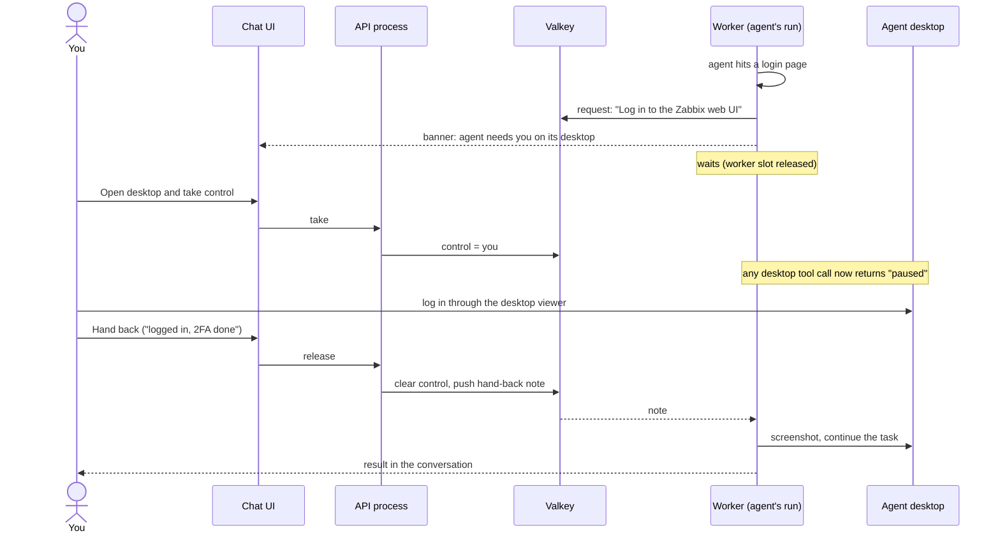

# Desktops and workbenches

Agents' own Python environments and desktops: creating them, scripts with tools, and taking control of a desktop. Back to the [overview](../README.md).

## Workbenches: an agent's own Python environment

A workbench is a small container per agent that gives it somewhere to write and run code. It's like a desktop, but for scripts instead of a browser. Each one (created under **Settings → Desktops & workbenches**) exposes an MCP server on `:8770` with these tools:

| Tool | What it does | Approval suggested |
|---|---|---|
| `run_python` | runs Python in the workbench's own virtual environment | ask |
| `run_shell` | runs a bash command in the workspace | ask |
| `pip_install` | installs packages into the venv (they persist) | ask |
| `run_script` | runs a saved script by name, with JSON arguments | ask |
| `save_script`, `list_scripts` | saves a working script as a named, reusable tool | allow |
| `read_file`, `write_file`, `list_files` | files in the workspace; `read_file` can return a numbered range of lines | allow |
| `edit_file` | replaces one exact piece of a file (or every copy of it), so a small change doesn't mean writing the whole file again | allow |

**Storage.** Everything lives in the workbench's volume (`ahq-<name>`), mounted at `/work`:
- the agent's files, **one folder per chat** at `/work/chats/<chat id>`
- the venv at `/work/.venv`, so installed packages survive restarts and rebuilds
- saved scripts in `/work/scripts`

**Each chat starts with an empty workspace.** Agent HQ names the chat on every workbench call (the `X-AgentHQ-Chat` header), and the workbench makes that chat's folder the workspace: the working directory for code and shell, the root for file paths, and where attachments go in and `send_from_workbench` takes files out. A new chat can't stumble on the last one's project and spend its turn going over that instead of the new task. Files stay with their chat, so coming back to a chat finds its work where it was left, and agents sharing a workbench share a chat's folder when they work in the same chat (a delegated task, say). The venv and saved scripts are shared across chats on purpose: those are meant to carry over. This is about focus, not security: `run_shell` can still `cd` anywhere in the volume. A client that names no chat (your own, or an older Agent HQ) gets all of `/work`, as before. Files from before this change are still at the top of `/work`, out of every chat's sight; delete them from the workbench's shell when you no longer need them.

**Limits.**
- **Runs:** each run has a timeout (default 120 seconds), and the run and any processes it started are killed when it's reached. Output is capped at 20,000 characters.
- **Container:** it runs as an unprivileged user with a read-only root filesystem and no Linux capabilities, capped at 2 CPUs, 2 GB of memory and 512 processes.

**The network is off by default.** A workbench is only on the internal `workbench` network, which has no route to the internet or your LAN. Its one way out is the `egress` proxy (`deploy/egress/egress_proxy.py`). Each workbench signs in to it with its own name and token (its `HTTPS_PROXY`), so the proxy knows whose rules apply:
- **Every workbench** may reach the defaults: PyPI out of the box, so `pip_install` works. Change them under **Settings → Desktops & workbenches → Network**.
- **One workbench** may also reach its own rules, under **Network** on its page.
- **Internet and LAN access**, ticked on a workbench, lets it reach everything directly.

A rule is one of: a host (`pypi.org`, ports 80 and 443), `*.github.com` (the domain and its subdomains), `host:port` (`gitgard.home.arpa:3000`, or `host:*` for any port), an address (`192.168.10.5`), or a network (`192.168.10.0/24:443`; host names that resolve into it count too, and the proxy connects only to those addresses). Rules apply within seconds, without restarting anything: the proxy reads them from Valkey (`AHQ_REDIS_URL`), where `hq` writes them.

**Blocked requests.** The proxy logs what it refuses. Each workbench's page lists its recent ones with an **Allow** button, and the Network page lists all of them with **Allow for <workbench>** and **Allow for all**. So you can let an agent try something, see what it needed, and allow just that.

The proxy carries HTTPS (CONNECT) and plain HTTP, which covers tools that use `HTTPS_PROXY`/`HTTP_PROXY`: pip, git over HTTPS, curl, requests, httpx. Other connections (SSH, database clients, raw TCP) have no way out except **Internet and LAN access**. A workbench whose container predates its token signs in as nobody and gets only the defaults; its page says so, and **Recreate** fixes it (its files are kept).

**Set one up:**
1. Build the image and start the proxy: `docker compose --profile images build` and `docker compose up -d egress`.
2. Under **Settings → Desktops & workbenches**, click **+ Workbench**, or **+ Its own workbench** on the agent's page. See [Desktops and workbenches](#desktops-and-workbenches).
3. Its code tools already ask for approval (see the table above). Change that per tool under its server's **Approvals** on **Settings → Tools**.

## Scripts with tools: many tool calls in one step

Some jobs take many tool calls: list 40 VMs, check each one's backups, summarise. Done call by call, that's 40-odd model requests, and every result piles into the model's context window, which on a small local model means slow turns and trimmed history. With **Scripts with tools** ticked on an agent (Settings → Agents → Desktops & workbenches), the agent can instead write one Python script and run it with `run_with_tools`. The script calls the agent's tools as functions, the loop runs on the workbench, and only what the script prints (plus anything it hands to `tools.result(...)`) comes back to the model.

```python
vms = tools.labtools_proxmox_list_vms()
stale = [v["name"] for v in vms if tools.labtools_backup_status(vm=v["name"])["age_days"] > 7]
print(f"{len(vms)} VMs, {len(stale)} without a backup this week: {', '.join(stale)}")
```

**What the script can call.** The `tools` module has a function for each tool on the agent's tool servers, with the names and arguments the agent already sees (`tools.list_tools()` prints them). Workbench and desktop tools aren't in it: the script runs on the workbench already, so it reads and writes files with plain Python. A call that fails or is denied raises `tools.ToolError`.

**Same rules as a direct call.** Each call from the script goes through Agent HQ exactly as if the agent had made it:
- **Approvals:** a tool set to Ask me raises the usual approval card, and the script waits for your decision. Denied, it gets a `ToolError`.
- **Blocked tools** aren't in the `tools` module, and a call to one is refused.
- **Work started by a webhook** asks before any tool not marked read-only, as usual.
- **The script itself** is code on the workbench, so it follows that workbench's rule for `run_python`: Ask me by default (one approval card for the script), Allow, or Block, which turns scripts off too.
- **Visibility:** every call shows in live activity and the run's trace. In Phoenix, each one is a `script_tool <name>` span under the `run_with_tools` tool span.
- **The network:** the script's own code runs in the workbench container under its network rules (see above); only its tool calls leave it, through Agent HQ.

**How it works.** The workbench has no route to Agent HQ, and doesn't get one. Its script's tool calls wait in a queue on the workbench, and the Agent HQ worker running the turn collects them over the workbench's own MCP connection (`ahq_script_poll`), runs each one through the agent's toolsets, and sends back the result (`ahq_script_reply`). These `ahq_*` tools are hidden from agents.

**Limits.**
- **Run time:** the `timeout` the agent gives (default 120 seconds, up to the workbench's `WORKBENCH_MAX_TIMEOUT`, 1800). It counts only the script's own time, not time spent waiting on tools or on you to approve something. At the limit, the script and its processes are killed and the agent is told.
- **Tool calls per script:** 200 (`WORKBENCH_SCRIPT_MAX_CALLS`). Past that, each call raises `ToolError`.
- **Output:** 20,000 characters (`WORKBENCH_MAX_OUTPUT`), for printed output and for the structured result.
- **Stopping the turn** stops the script. If Agent HQ stops collecting a script's calls for 3 minutes (`WORKBENCH_SCRIPT_ABANDON`), say because a worker died, the workbench kills it. While a call is waiting on you or on a slow tool, Agent HQ keeps pinging the workbench, so a long wait doesn't count.

Scripts can't do anything the agent couldn't do itself. The `ahq_script_*` tools come with the workbench image: a deploy rebuilds it, and each workbench moves to it by itself when idle (see [Automatic recreate](#automatic-recreate-after-a-rebuild)).

## Desktops and workbenches

Desktops and workbenches are **resources**: one container each, plus the tool servers it serves. Package servers from the MCP server catalog are resources too (see [Package servers](tools.md#package-servers)). You create them in the UI and give them to agents. Tools that aren't anyone's in particular, like MQTT or the web reader, stay plain tool servers. Tick **All agents** on one under **Settings → Tools** and every agent gets it without you ticking it on each.

**Create one.** Under **Settings → Desktops & workbenches**, click **+ Desktop** or **+ Workbench**. Or, on an agent's page, click **+ Its own desktop** / **+ Its own workbench**. Agent HQ then:
1. picks the next free name (`desktop-2`, `workbench-3`…);
2. creates and starts the container through the Docker API (a desktop with 1 GB of shared memory; a workbench read-only, without capabilities, on the internal network behind the egress proxy, capped at 2 CPUs, 2 GB and 512 processes) with a named volume `ahq-<name>` for its data;
3. registers its tool servers: a desktop's screen (`:8765`) and browser (`:8931`, Playwright, unprefixed), or a workbench's `:8770`;
4. ticks them on the agents you chose, and sets a desktop's **Desktop viewer URL** to `/desktops/<name>/` (Caddy routes any `desktop-<number>`).

**Dedicated or shared.**
- **Dedicated:** one agent's own. Agent HQ refuses to give it to another agent, whether from the Resources page or by ticking it on the agent's page.
- **Shared:** any number of agents. A shared workbench is shared files. A shared desktop is used by **one conversation at a time**. The first desktop call takes it. Calls from other conversations wait up to `AHQ_DESKTOP_LEASE_WAIT` seconds (600) and then report it busy. It's let go when that run ends, or `AHQ_DESKTOP_LEASE_TTL` seconds (300) after its last desktop call. Agents delegating within the same conversation share it without waiting. **Take control** pauses the desktop for every agent that has it.

On an agent's page, **Desktops & workbenches** lists them all: tick one to give it to the agent (all of its servers go together), and dedicated ones belonging to someone else are greyed out.

**Running them.** The resource's page has **Start**, **Stop**, **Restart**, **Recreate** (a new container from the current image, same data, e.g. after `docker compose --profile images build`) and **Delete**. Delete takes it from its agents and removes its tool servers and container. Its data volume goes only if you say so. Otherwise a new desktop with the same name picks it up again.

### Automatic recreate after a rebuild

A running container keeps the image it was made from, so rebuilding the images (`docker compose --profile images build`, which [auto-deploy](auto-deploy.md) runs when `workbench/`, `desktop/` or `mcp-runner/` change) doesn't change what's running by itself. Agent HQ closes that gap: every minute it compares each running workbench and package server with its image, and recreates the ones on an older image, the same as the **Recreate** button, so files, installed packages and saved scripts stay.
- **Only when idle.** It waits until no agent that has the resource (sub-agents included) has a job queued or running. A turn waiting on your approval is still running, so it waits for that too.
- **No half-made connections.** While a container is being replaced, it's flagged in Valkey, and a turn that starts then waits for the new container instead of failing to connect.
- **Left alone:** stopped containers (you stopped them), ones docker compose runs (take them over first), and desktops, because recreating a desktop closes its browser and you may be using it. Add them with `AHQ_AUTO_RECREATE_KINDS=workbench,package,desktop`.
- **Settings:** `AHQ_AUTO_RECREATE=0` turns it off; `AHQ_AUTO_RECREATE_INTERVAL` (60) sets how often it checks.

**Docker access.** The `docker-proxy` service gives `hq`, and nothing else, a Docker API limited to containers, images, networks and volumes (`AHQ_DOCKER_URL=http://docker-proxy:2375`). The images come from compose: the build-only services `desktop-image` and `workbench-image` (profile `images`, so they never run) build `agent-hq/desktop:latest` and `agent-hq/workbench:latest` (`AHQ_DESKTOP_IMAGE` / `AHQ_WORKBENCH_IMAGE`). Plain `docker compose up --build` skips them: after changing `./desktop` or `./workbench`, run `docker compose --profile images build`, then **Recreate** each desktop or workbench. Containers join `agent-hq_default` (desktops) or `agent-hq_workbench` (workbenches) under their name (`AHQ_RESOURCE_NETWORK` / `AHQ_WORKBENCH_NETWORK`, for another compose project name). Without Docker access, the page still registers tool servers and tracks resources, but you run the containers yourself. Anyone who controls `hq` can start containers on this host, so leave `docker-proxy` out if you'd rather not allow that.

**Desktops you already run in compose.** The page lists `desktop-N` / `workbench-N` it finds (from tool servers pointing at those hosts, and from compose services) under **Import**. Importing makes each one a resource for its existing tool servers and agents. Compose keeps running the container: Start/Stop work, Recreate doesn't. To hand it over, click **Take over**: Agent HQ reads the compose container's data mounts and replaces it with its own container on the same data (bind mounts such as `./desktops/desktop-1` included). Then delete its block from `docker-compose.yml` (and its volume from the `volumes:` list, which keeps the data but stops `docker compose down -v` deleting it) before your next `docker compose up`, which would otherwise start a second one. `docker compose up -d --remove-orphans` cleans up a block you deleted without taking it over first. **Detach** forgets an imported one and leaves its tool servers as plain ones.

**One host.** Resources run on the Docker host next to `hq`. The workers that run their agents must be on that host too (any pool there: compose workers reach both networks).

Agents that use desktop tools need a vision-capable model. Anyone who can open a viewer can use whatever sessions the agent's browser is logged in to. That's why viewers are reachable only through Caddy, signed in to Agent HQ. For local development without Caddy, give the desktop `ports: ["3000:3000"]` and `SUBFOLDER: /`.

## Taking control of a desktop

You can drive an agent's desktop yourself: to log in to a site, solve a CAPTCHA or enter an MFA code. That way the agent works with an authenticated session and never sees your password.



- **When the agent asks.** Agents with a desktop get an `ask_user_to_take_over(reason)` tool and are told to use it, never to ask for passwords in chat. The request appears as a banner in the conversation. The agent waits for up to `AHQ_HANDOFF_TIMEOUT` seconds (30 minutes by default), giving up its worker slot while it waits. When you hand back, it continues with your note.
- **When you step in on your own.** **Take control** on the desktop panel pauses the agent at any time. While you have control, every call to that desktop's tools, screenshots included, is refused. So the agent neither fights you for the mouse nor sends what you're typing to its model provider. If the agent ran into the paused desktop mid-task, **Hand back** wakes it in that conversation to carry on.
- **A forgotten takeover can't block an agent forever.** Control expires after 24 hours.

Credentials typed into chat are stored in the transcript, the conversation history and possibly your traces. Logging in yourself on the desktop keeps them out of all three.
