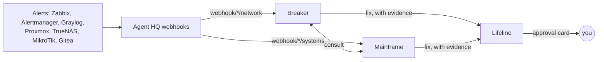

# Example: a homelab crew

One way to build agents from the [lab tools](../labtools.md) and [lab alerts](../lab-alerts.md): two watchers that only read, and one fixer whose every change you approve. It's all data in [examples/homelab-crew.json](../../examples/homelab-crew.json). Agent HQ doesn't know or care about these names or roles, so rename, merge, split or rewrite them to suit your lab.

| Agent | Role | Tool servers | Delegates to |
|---|---|---|---|
| **Breaker** | watches the network: switches, routers, APs, DNS, DHCP | `lab-network`, `lab-monitoring` (read) | Mainframe, Lifeline |
| **Mainframe** | watches the systems: Proxmox, TrueNAS, Gitea Actions | `lab-systems`, `lab-monitoring`, `gitea` (read) | Breaker, Lifeline |
| **Lifeline** | applies one fix at a time, checks it worked, reports | `lab-ops` (write; 16 of its tools **Shown**) | |

How it uses the framework:
- **Instances from `deploy/lab/compose.example.yml`.** The watchers get only read instances, so they can't change anything even if an alert's text talks them into trying. Lifeline gets the write instance, with its own narrow credentials.
- **Shown** trims `lab-ops` (an `all` instance) to the eight write tools plus eight reads for checking state, so Lifeline sees 16 tools instead of 38.
- **Approval rules** set every write tool on `lab-ops` to *Ask*. Write tools suggest that anyway, and webhook-started work asks regardless.
- **Subscriptions** route by domain tag ([lab-alerts.md](../lab-alerts.md)): `webhook/*/network` to Breaker, `systems` and untagged to Mainframe. Proxmox, TrueNAS and Gitea Actions go to Mainframe, MikroTik to Breaker. Each template picks out the useful fields and marks the body as data.
- **Instructions** follow the same shape: check with 2 to 5 targeted tool calls, report only what the tools returned, and use a short report format (*Status / Evidence / Likely cause / Next*). The watchers hand a fix to Lifeline with the evidence and one recommended fix. Lifeline confirms the problem still exists, picks the least disruptive fix, checks before → after, and stops rather than escalating.

## Set it up

1. Run the lab tools instances ([labtools.md](../labtools.md)) and configure the senders ([lab-alerts.md](../lab-alerts.md)).
2. **Settings → Agents → Import** `examples/homelab-crew.json`. It doesn't include a supervisor, because importing replaces an existing agent's tools and delegates.
3. Pick each agent's model. The watchers do well on a good local tool-calling model. For the fixer, use your strongest local model plus a frontier **fallback model**.
4. Add the three to your supervisor's delegates.
5. Create the hooks from [lab-alerts.md](../lab-alerts.md), and add schedules:

| Agent | When | Prompt |
|---|---|---|
| Breaker | hourly | `Hourly network check: device_health for the core devices, dns_status, dhcp_status. Status line only if all OK; full report if anything is WARN or CRIT.` |
| Mainframe | every 4 hours | `Systems check: proxmox_overview, proxmox_storage, truenas_overview, zabbix_problems (severity 3+). Status line only if all OK.` |
| Mainframe | daily 07:40 | `Morning backup and jobs report: proxmox_backups (older than 36 h), proxmox_tasks (24 h, failed), truenas_jobs. Report anything stale or failed.` |

## Try it

- On each hook, **Send a test delivery** with a realistic body and check the delivery log for the matched subscription and prompt.
- Ask Breaker *"How is crs-core doing?"*, and Mainframe *"Any guests without a recent backup?"*
- Ask Lifeline to restart a harmless allow-listed test container. You should get an approval card with the reason, then a before → after report.
