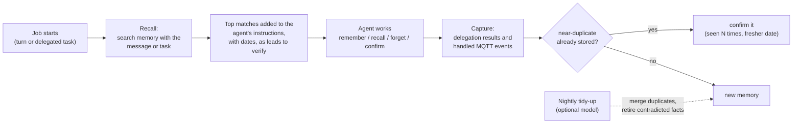

# Memory and knowledge

Long-term memory, scratch pads, file attachments and the knowledge library. Back to the [overview](../README.md).

## Long-term memory

Agents remember across conversations: how your lab is set up, what went wrong before and what fixed it, and how you like things done. Memory lives in your Postgres (pgvector for meaning-based search, plus Postgres full-text search) and uses an embedding model from your providers. A small model such as `nomic-embed-text` on Ollama runs fine on CPU.

- **Recall is automatic.** Before every job, the runtime searches memory with the incoming message or task and gives the agent the best matches, with their dates. Small local models don't have to remember to look things up. Search blends meaning (embeddings), exact keywords (identifiers like `pve1` or an IP address count) and recency.
- **Capture is automatic, and doesn't need an extra model call.** Delegation results and handled MQTT events are already concise summaries, so they're stored as **incident** memories as they happen. If a near-duplicate already exists, it's confirmed (fresher date, higher count) rather than stored twice.
- **Agents have tools:** `remember` (with *team* or *agent* scope, and optionally which memory it replaces), `recall`, `forget` and `confirm`.
- **Nothing is silently overwritten.** Outdated memories are *retired*, with a reason and a pointer to whatever replaced them, so history stays searchable ("show retired"), and a retired memory can be restored.
- **Tidy-up** (on demand, or nightly at a set hour) merges duplicates. With a *tidy-up model* configured, it also merges related memories and retires ones a newer memory contradicts.
- **Scopes:** *team* (every agent), *agent* (only one agent), or *conversation* (only one thread). Each agent has a **Long-term memory** switch.

On the **Settings → Memory** page you can:
- search, add and edit memories;
- confirm, retire, restore or delete them;
- choose the embedding model;
- tune recall (how many memories per job, and a minimum match score);
- turn automatic capture on or off;
- set up the tidy-up.

Changing the embedding model re-embeds existing memories in the background.

- **On Postgres:** the infrastructure compose file uses the `pgvector/pgvector:pg17` image, and Agent HQ enables the extension, adds the vector column and creates the full-text index on startup.
- **On SQLite (single-machine dev):** search runs in Python instead. It's fine for thousands of memories.

## Scratch pads: notes outside the context window

Long research runs used to lose their early findings. As tool results piled up they were trimmed to fit the window, and a final report too long for what was left got cut off. Now every job, whether a turn or a delegated task, has a **scratch pad**: notes the agent keeps outside its context window.

- **`note(text)`** writes one finding as soon as the agent has it, with its source: title, date, link, or the command and host it came from. Agents are told to note anything they'll need later, because older tool results get shortened.
- **`read_notes(offset)`** reads the pad back, numbered, a page at a time. When the agent has finished gathering, it reads its notes and writes its answer from them.
- **Delegators can read a delegate's notes.** The delegate's result says how many notes it kept, and `read_notes(job_id="…")` gives the delegator the evidence behind a short summary. This also works when the result comes back later as a report. Any agent in the same conversation can read a pad, but not one from another conversation.
- **On the delegation card,** the pad fills live as the delegate works, and stays readable afterwards until it expires. **Keep as file** saves it as a Markdown file on the card.
- **A cut-off reply no longer takes the work with it.** The notes stay on the pad, and the retry tells the agent to write its answer again from them.

**Pads live in Valkey only,** not in Postgres, so they don't grow the database. A pad is kept while its job runs, then `AHQ_PAD_TTL_HOURS` (24) hours after it finishes, and then it expires. It holds at most `AHQ_PAD_MAX_BYTES` (64 KB). When it's full, the agent is told to read its notes and answer. Keep as file is the only way a pad reaches the database. A pad survives a worker crash, since the job and its notes are picked up on another worker, but not a Valkey restart unless Valkey keeps its data on disk.

**API:** `GET /api/jobs/{id}/notes` returns a job's notes and how long they're kept (`gone: true` once they've expired). `POST /api/jobs/{id}/notes/keep` saves them as a file (`410` once they've expired).

## File attachments

Attach files in the chat: the 📎 button, drag and drop onto the conversation, or paste (a pasted screenshot becomes `pasted-<time>.png`). They upload as soon as you pick them, show as chips above the message box (✕ removes one), and go with your message when you send it. A message can be just files.

**Code in replies:** every code block an agent writes has a bar with its language and **Copy** / **Save** buttons. Save downloads the code as a file, named the way the reply names it ("save it as `dungeon_rpg.py`"), or from a `# file: x.py` first line, else `snippet.<ext>` from the language.

**Storage:** files live in the database (Postgres `bytea`), like avatars, so a worker on any machine reads the same bytes; no shared folder needed. Text is pulled out once, on upload: PDF, Word, PowerPoint, Excel, HTML and EPUB through `markitdown`, plus Markdown, CSV, JSON, logs and code as they are. Scanned PDFs are read with OCR (see *Scanned PDFs* under the knowledge library). Limits: `AHQ_ATTACHMENT_MAX_BYTES` (25 MB) per file and `AHQ_ATTACHMENT_MAX_FILES` (10) per message.

**What the agent gets:** the turn starts with a manifest: each file's ID (`att_…`), name, kind and size, and the first lines of each document. Its tools:

| Tool | What it does |
|---|---|
| `read_attachment` | A document's text, in pages (`next_offset` to continue) |
| `look_at_attachment` | A question about an image, answered by the agent's **vision model** (the same one that looks at its desktop) |
| `list_attachments` | Every file in the conversation, the user's and the agents' |
| `attachment_to_workbench` | Copies a file to the agent's workbench (`inbox/<name>` by default) so scripts can work on it |
| `create_file` | Gives you a file it wrote (a report, CSV, JSON, a script) |
| `send_from_workbench` | Gives you a file from its workbench (a chart a script made, an export) |
| `attachment_to_desktop` | Copies a file onto the agent's desktop, into `~/Uploads`, and returns its path there, so it can upload it to a website |
| `list_desktop_files` | The newest files the desktop downloaded (`~/Downloads` and the browser's download folder) |
| `send_from_desktop` | Gives you a file from the desktop, e.g. an invoice the browser downloaded |

The reading tools only appear once a conversation has files; `create_file` is always there. The workbench tools appear for agents with a workbench, and the desktop tools for agents with a desktop.

**Uploading to a website:** the agent copies the file to its desktop, clicks the page's upload button or file field, then calls Playwright MCP's `browser_file_upload` with the path while the file chooser waits, so there's no dialog to click through. Playwright MCP only reads files inside its working folder; the desktop image starts it in `/config` (the desktop's home), which covers `~/Uploads`. Without the browser tools, the agent types the path into the file dialog. The file is also there for you in `~/Uploads` when you take over the desktop.

**Getting downloads back:** pages the browser downloads land in `~/Downloads` or the Playwright MCP output folder (`/tmp/playwright-mcp`). `list_desktop_files` shows the newest of both, and `send_from_desktop` puts one in the chat. Desktop files can only be read from the desktop's home folder and that output folder.

**Images, two ways** (Settings → Agents, under *Vision model*):
- **Vision tool (the default):** the agent's own model never sees pixels. It asks its vision model with `look_at_attachment`, as it does with its desktop, so a text-only model on Ollama can still "see" a photo.
- **Model sees images:** for an agent on a multimodal model (qwen3-vl, gpt-4.1, Claude…), image attachments go straight into its turn. They're taken out of the saved history afterwards (a placeholder stays), so a conversation doesn't carry megabytes of pictures; it can look again with `look_at_attachment`.

With neither, the agent can read documents but tells you it can't view images.

**Delegation:** every agent working in a conversation can read its files, so a supervisor passes your file on by ID: `delegate(agent_name=…, task=…, attachment_ids=["att_…"])`. The delegate gets the manifest with its task; the file shows on the delegation card. Files a delegate makes appear on its card and are listed in its result, so the supervisor can use them too.

**Files agents send back** collect in the **Outputs** panel beside the chat, newest first; images also show as thumbnails under the reply (or on the delegation card for a delegate's files). Text files (code, config, Markdown, CSV, logs…) get a **view →** chip under the reply: it opens the file in Outputs, as does clicking the file there. An open file shows its contents with **Copy** and **Download**, and the panel widens while any file is open; click the file again, or **Collapse all**, to close it and narrow the panel. Archives and other binaries stay a download, with an **in Outputs →** chip under the reply that points at them.

**One copy per request:** when an agent sends a file again in the same run (a turn, a delegated task, or every step of a planned request), the new one replaces the earlier one, which is deleted: the same name, the same bytes, or another archive of the same thing (`game.zip` after `game.tar.gz`). The agent's tool result says what it replaced. Only files that aren't on a message yet are replaced; anything you've already seen stays.

**After updating:** rebuild the workbench and desktop images. The file transfers use hidden `ahq_*` tools in them.

**Safety:** downloads are served with `Content-Security-Policy: sandbox` and `nosniff`, and only real images (PNG, JPEG, GIF, WebP, BMP, checked by decoding them) open in the browser. An uploaded HTML or SVG file always downloads; it never runs on Agent HQ's origin. Workbench and desktop transfers go through internal `ahq_put_file` / `ahq_get_file` (and, on desktops, `ahq_list_files`) tools on those servers. Agents never see them; they use the tools in the table above. Agents on cloud models send the attachments they read to that provider.

**API:** `POST /api/threads/{id}/attachments` (multipart `files`), then `POST /api/threads/{id}/messages` with `{"content": "…", "attachment_ids": ["…"]}`. `GET /api/attachments/{id}` returns the file (`?download=1` forces a download), `GET /api/attachments/{id}/text` its text, `GET /api/threads/{id}/attachments` the list. `DELETE /api/attachments/{id}` removes a file that hasn't been sent.

## Knowledge library

**Settings → Knowledge** makes your own documents and notes searchable by agents, with citations. Documents live in **collections**, and each collection says which agents may read it (none ticked means every agent; sub-agents read what their parent can).

**Sources:**
- **Obsidian vault (Git):**
  - **Sync:** push the vault to your Gitea with the Obsidian Git community plugin, set to auto commit and push every 10 minutes or so, with `.obsidian/` in `.gitignore`. Agent HQ clones the repo read-only and checks for changes on a schedule (every 15 minutes by default). Only notes that changed are re-read, and deleted notes leave the library.
  - **Notes are read the Obsidian way:** frontmatter titles, aliases and tags, inline `#tags`, `[[wikilinks]]` (kept as links, shown as text), `%%comments%%` dropped.
  - **Citations** open the note in Obsidian (`obsidian://`).
  - **Skipped folders:** `.obsidian`, `.trash` and `.git` always; add your own excludes (`Journal/**`).
  - **Access:** use a dedicated Gitea user with **Read** access to just that repo, and a token with *repository: Read*. Tokens are never sent back to the browser, and errors are shown with the token redacted.
- **Git repository:** the same for any repo of runbooks or docs. Citations link to the file in Gitea.
- **Network share (SMB / NFS):** a share on your NAS (TrueNAS, a Windows server, Samba), read in place and never written to.
  - **SMB:** give the share as `smb://truenas.home.arpa/docs/Runbooks` or `\\truenas\docs\Runbooks` (a folder inside the share is fine), with a user and password. Agent HQ reads it over the network with `smbprotocol`, so the container needs no mount and no extra privileges. On TrueNAS, make a dedicated user (say `agent-hq`) and give it read-only access to the dataset. The password is never sent back to the browser, and errors are shown with it redacted.
  - **NFS:** mount the export into the `hq` container under `/shares` (`AHQ_SHARES_DIR`) and give that path, e.g. `/shares/docs`. `docker-compose.yml` has a commented-out example that has Docker mount it read-only. Paths outside `/shares` are refused, so a source can't read the app's own data. Symlinks aren't followed. A local folder bind-mounted under `/shares` works the same way.
  - **Reads:** Markdown, text, PDF, Word, PowerPoint, Excel and HTML by default (change the include patterns under Edit). Only files whose size or modified time changed are read again, and deleted files leave the library.
  - **Skipped:** ZFS snapshot folders (`.zfs`), recycle bins (`#recycle`, `.recycle`, `$RECYCLE.BIN`), Office lock files (`~$…`), macOS and Windows clutter, `.obsidian`, `.trash` and `.git`; add your own excludes (`Archive/**`). A source stops with an error past 20,000 matching files: point it at a narrower folder.
  - **Obsidian vault:** tick it for a vault kept on the share (synced there with Syncthing, say). Notes are read the Obsidian way and citations open in Obsidian.
- **Web page:** fetched, turned into text, and re-checked on a schedule if you like.
- **Uploaded files:** PDF, Word, PowerPoint, Excel, HTML, Markdown and text (converted with `markitdown`).

**Scanned PDFs:** pages that are an image with next to no text layer are read with Tesseract OCR, wherever a PDF comes from: uploads, Git, shares, web pages and chat attachments. A PDF with no such pages is converted as before. Otherwise its text is rebuilt page by page under `## Page N` headings (the text layer where a page has one, OCR where it doesn't), so search sections and citations follow the pages. The image installs Tesseract with English.
  - **Settings:** `AHQ_OCR` (`auto`, the default, is on when Tesseract is installed; `on`; `off`), `AHQ_OCR_LANGUAGES` (`eng`; Tesseract codes joined with `+`, e.g. `eng+deu`), `AHQ_OCR_DPI` (300) and `AHQ_OCR_MAX_PAGES` (200 scanned pages per file; the rest are skipped with a warning in the log).
  - **Other languages:** build with `--build-arg OCR_LANGS="deu fra"` (Debian's `tesseract-ocr-<lang>` packages) and set `AHQ_OCR_LANGUAGES=eng+deu+fra`.
  - **Speed:** about a second or two per page on a modern CPU, run in the background. Large scans take a while to show up in the library.
  - **Without OCR:** a fully scanned PDF is refused with the reason (upload) or skipped and logged (Git, shares), rather than stored empty.

**How it's indexed:** documents are cut into sections at their headings and embedded with the embedding model from Settings → Memory. Search is hybrid (meaning plus keywords, with full-text search on Postgres); without an embedding model it matches keywords only.

**What agents get:**
- matching excerpts automatically, like memories (per collection, with a threshold);
- `search_knowledge` and `read_document` tools;
- instructions to say which document and section they used.

**The page itself** also has:
- a test search, run as any agent, showing scores and what would come up by itself;
- a document viewer that shows each document's sections;
- **Propose skills,** which turns a runbook's procedures into skill proposals.

Agents on cloud models send the excerpts they read to that provider. Keep private collections to agents on local models.

### Documents agents suggest

Agents can suggest additions to the library: a runbook they worked out, research findings, a summary of a long investigation. **Nothing goes in until you approve it.**

**Where suggestions go:**
- **Agent Findings,** a collection made for this and open to every agent. Suggestions go here unless an agent is asked to use another collection.
- **Your own collections** only take suggestions when you allow it in the collection's settings. Under *Agents may suggest documents*, pick **No** (the default), **Any agent that can read it**, or **These agents**. An agent can also only suggest for collections it can read.

**How they're made:**
- An agent calls `suggest_knowledge` with a title, a reason, and either Markdown text or a file from the conversation (`attachment_id`). `knowledge_targets` lists the collections it may use.
- A reflection can also suggest one document after a job that produced reference material: not a procedure (that's a skill), not a short fact (that's a lesson).
- Agents get these tools when their learning mode isn't **off**. **Settings → Knowledge → Agents may suggest documents** turns them off for everyone.

**Deciding:** a card appears in the conversation and in **Requests → Knowledge**, plus a `knowledge_proposal` MQTT notice with a link. You can approve or reject from either place:
- **Edit** the title and text first.
- **Move** it to any collection. Yours to choose, whatever the agent was allowed.
- **Replace** a near-copy. If the document looks like one already in that collection, the card says so; when that one also came from an agent, you can replace it instead of adding a second.
- **Reject** with a note. The agent is told your note if it suggests the same thing again.

**Limits:** at most 5 suggestions waiting per agent, and at most 60,000 characters each.

**What's stored:** approved documents go into the collection's **Suggested by agents** source. Each is tagged with the agent's name (`agent/scarlett`), and its citation links back to the conversation it came from. You can delete them like uploads.

**Kept separate from your own sources:** suggestions are never written to your Obsidian vault or Git sources.
