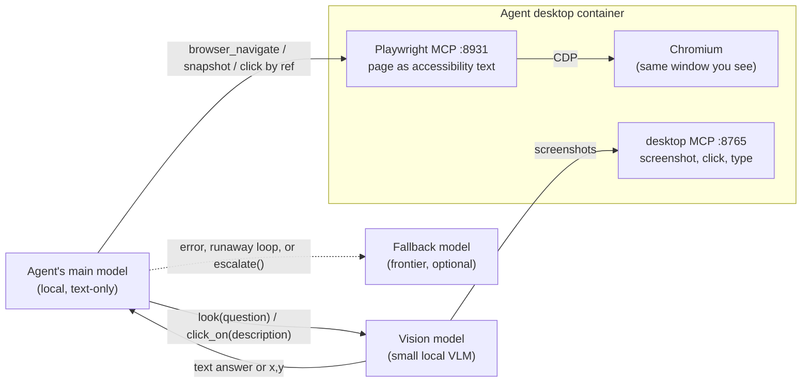

# Models

Model providers and plans, thinking levels, long conversations and getting the most out of local models. Back to the [overview](../README.md).

## Model providers

Providers live on the **Settings → Model providers** page; nothing about servers or model names is hardcoded. Add a provider once, and its models become choices in every agent's **Model** picker. Different agents can use different models from the same provider: one on `qwen3:14b`, another on `gpt-oss:20b`.

| Kind | Base URL | Model list comes from | API key |
|---|---|---|---|
| **Ollama** | `http://host:11434` (with or without `/v1`) | `GET /api/tags`, with size and quantization | usually none |
| **OpenAI** | optional override | `GET /v1/models` | stored, or `OPENAI_API_KEY` on the workers |
| **OpenAI-compatible** (vLLM, LM Studio, LiteLLM, llama.cpp server…) | required, the server's `/v1` URL | `GET /v1/models` | only if the server needs one |
| **Anthropic** | optional override | `GET /v1/models` | stored, or `ANTHROPIC_API_KEY` on the workers |
| **ChatGPT plan** (Plus/Pro) | none | `GET /v1/models` on your plan | none: **Sign in with ChatGPT** instead |
| **Grok plan** (SuperGrok / X Premium+) | none | `GET /v1/models` on api.x.ai (chat models only) | none: **Sign in with xAI** instead |

You can register several providers of the same kind, for example two Ollama servers on different GPUs.

- **Picking a model:** the agent editor lists the provider's current models. You can still type a name the provider doesn't list yet, such as a model you're about to pull.
- **API keys are write-only.** They're stored in the database and used by the workers, but the API never returns them and exports never include them. To keep keys out of the database entirely, leave the field blank and set the provider's usual environment variable on the workers instead.
- **Disabling and deleting:** disabling a provider stops its agents with a clear error in their conversations. A provider can't be deleted while agents still use it.
- **Advanced:** with the provider set to *Custom model spec*, the Model field takes a raw PydanticAI spec such as `openai:gpt-4.1`, or `test` for a no-LLM test model.

Agents that use desktop tools need a vision-capable model.

### Thinking levels

Each agent has two settings under its model (Settings → Agents): **Thinking** (*Model default*, *Off* or *On*) and, when thinking is on, a **Reasoning level** (*Provider default*, *Minimal*, *Low*, *Medium*, *High*, *Extra high* or *Max*). The level box is greyed out for models that only turn thinking on or off, such as Qwen on Ollama. Both are stored as the agent's one `thinking` value (`""`, `off`, `on`, or the level). It controls how much the model reasons before it answers. It's sent to the model as a request setting, not written into the instructions: telling a model to "think hard" in its prompt doesn't change how much it actually reasons. Use the instructions to say *what* the agent should be careful about, and this setting for *how much* it thinks.

- **OpenAI, the ChatGPT plan, the Grok plan and Anthropic** get PydanticAI's unified `thinking` setting, which it turns into each provider's own (reasoning effort, thinking budgets, adaptive thinking). Levels a model doesn't offer use the closest one it does.
- **Ollama** gets `reasoning_effort` on its OpenAI-compatible endpoint (`none` for Off), because PydanticAI doesn't translate the setting for Ollama. It's only sent to models whose `/api/show` lists the `thinking` capability, so a model that can't think isn't sent a setting it would reject. gpt-oss always thinks a little (Off gives it its lowest effort); Qwen3-style models only do on and off, so every level just turns thinking on.
- **OpenAI-compatible servers** get the unified setting too, but PydanticAI only acts on it for model names it recognises; for others the setting is ignored and the model keeps its default.
- The editor checks the chosen model and says under the settings whether thinking reaches it and whether it takes levels.
- The **fallback model** uses the same level, translated for its own provider, and **sub-agents** inherit the level of the agent that created them. *Model default* sends nothing at all.

Higher levels help on hard, multi-step tasks but are slower, and on local models they cost GPU time; a supervisor that mostly routes work is usually fine on Low or Off.

### Your ChatGPT plan instead of an API key

A **ChatGPT plan** provider runs agents on your ChatGPT Plus or Pro subscription, using OpenAI's [Sign in with ChatGPT](https://developers.openai.com/siwc/token-sharing-open-source) for open-source and self-hosted apps. There's no API key and no per-token bill: requests count against your plan's usage instead.

**Signing in.** On the **Settings → Model providers** page, add a provider of kind *ChatGPT plan*, save it, and choose **Sign in with ChatGPT**. Then:
1. Approve Agent HQ in the OpenAI tab that opens, including permission to use your plan.
2. OpenAI only ever redirects to `http://127.0.0.1:1455/auth/callback`, which is the computer running your browser, not the server running Agent HQ. So that tab ends on a "can't connect" page. That's expected.
3. Copy the whole address from that tab's address bar, paste it into Agent HQ, and choose **Finish sign-in**.

The server started the sign-in and holds its PKCE verifier, so the pasted address is only useful to this Agent HQ, and only once, within 15 minutes.

**How it works:**
- The tokens are stored on the provider in the database, so every worker on every machine uses the one sign-in. Like API keys, they're never returned by the API or included in exports.
- Access tokens last an hour and are refreshed automatically. OpenAI's refresh tokens are single-use, so refreshes are serialized across all workers with a Valkey lock: two workers never spend the same refresh token, which could get the sign-in revoked.
- **Disconnect** forgets the tokens. To revoke access entirely, also disconnect Agent HQ in your ChatGPT settings, where you can also cap how much of your plan it may use.

**Things to know:**
- **Limits:** on Plus, a five-hour usage window is shared with every app connected to your plan, and there's a weekly allowance. Give agents on this provider a **fallback model** on your Ollama server: when the plan is exhausted, the request fails and the agent switches to its fallback.
- **Not supported here:** embeddings (use Ollama for memory), and settings like temperature or max output tokens, which OpenAI doesn't accept on plan usage. PydanticAI drops those automatically.
- **Eligibility:** OpenAI offers this self-serve to open-source apps and personal projects that run locally or self-hosted, which is what Agent HQ is. A paid or hosted service would need OpenAI's approval first.

### Your Grok plan instead of an API key

A **Grok plan** provider runs agents on your SuperGrok subscription (or X Premium+, on an X account linked to your xAI account). xAI lets agent tools such as Hermes Agent, OpenCode, Kilo Code and Warp sign in to your xAI account and call the regular API at `https://api.x.ai/v1` on your subscription, with no API key and no per-token bill. Agent HQ does this itself: there's no proxy or extra service to run.

**Signing in.** On the **Settings → Model providers** page, add a provider of kind *Grok plan*, save it, and choose **Sign in with xAI**. A tab opens on xAI's site showing a short code, which Agent HQ shows too. Sign in with the account that has your subscription, check the codes match, and approve. The Models page notices by itself and finishes the sign-in: nothing to copy or paste. The code is good for about ten minutes.

This is OAuth's device flow, so it works even though Agent HQ runs on a different machine from your browser. Agent HQ asks xAI at most once per the interval xAI sets while it waits, however often the page checks.

**How it works:**
- The tokens are stored on the provider in the database, so every worker on every machine uses the one sign-in. Like API keys, they're never returned by the API or included in exports.
- Access tokens last about six hours and are refreshed half an hour early. xAI rotates the refresh token on every refresh, so refreshes are serialized across all workers with a Valkey lock, as for the ChatGPT plan.
- Requests go through the OpenAI-compatible Chat Completions API with Grok's model profile, so each agent's thinking level becomes the `reasoning_effort` that model accepts (Grok 4.3 can turn thinking off; Grok 4.5 and later always think a little).
- **Disconnect** forgets the tokens. To revoke access entirely, also remove the app from your xAI account.

**Things to know:**
- **The client ID.** xAI only accepts these sign-ins from apps it has allowlisted, and doesn't let apps register their own. Like the other tools, Agent HQ uses the public client ID of xAI's Grok CLI (a public identifier, not a secret), so xAI's approval page may call it *Grok CLI* or *Grok Build*. Set `AHQ_GROK_CLIENT_ID` on the server and workers to use a different one. Because it borrows that client ID, xAI could change or withdraw it at any time.
- **Limits:** usage comes out of your subscription's allowance, shared with Grok Build and every other app you've signed in. Give agents on this provider a **fallback model** on your Ollama server.
- **Refused accounts:** xAI has been seen to refuse OAuth API access for some subscription tiers (HTTP 403) even while the subscription is active. Agent HQ says so plainly. If it happens, use an xAI API key on an *OpenAI-compatible* provider with base URL `https://api.x.ai/v1` instead.
- **Not supported here:** embeddings (use Ollama for memory), and image, video and voice models, which are left out of the model list.

## Long conversations

Every model call has to fit the agent's **context window**, and Ollama silently drops whatever doesn't. Agent HQ works out each agent's window and fits the conversation into it.

**The window comes from, in order:**
1. the agent's own **Context window** setting (Settings → Agents);
2. what the provider reports: for Ollama, the loaded model's context (`/api/ps`), else a Modelfile's `num_ctx` (`/api/show`); for vLLM-style servers, `max_model_len`;
3. a default: 4,096 for Ollama (the smallest it picks), 128K for cloud models.

The agent editor shows the window it's using, where the number came from, how many tokens the agent's instructions take, and how much room that leaves for the conversation.

**Ollama's window is set on the Ollama server, not per request.** The OpenAI-compatible endpoint Agent HQ uses can't change it. Set `OLLAMA_CONTEXT_LENGTH` on the server, or bake `num_ctx` into a Modelfile; otherwise Ollama picks 4K, 32K or 256K depending on GPU memory. Then set the same number on the agent if Agent HQ can't read it.

**What happens as a conversation grows:**
- **Compaction, between turns.** When the history, the agent's instructions and the new message would take more than 75% of the window, the older turns are summarised and replaced by the summary, and the recent turns stay word for word.
  - **Who writes the summary:** the agent's own model, unless you pick a summary model.
  - **Contents:** what you want, decisions and results, open work, and facts found with tools, with exact hostnames, IDs and paths.
  - **In the conversation:** a note says what was summarised, with the summary itself one click away.
  - **If the summary can't be written,** the older turns are dropped instead, and the agent is told.
- **Trimming, within a turn.** During a long run of tool calls, older tool results are shortened, harder as the run nears the window. The size estimate is self-correcting: each model response reports how many tokens its request really took (tool definitions included, and models such as Qwen count code and JSON at about 3 characters a token, not 3.5), so the trimmer compares that with its own estimate and trims to the real figure. Without this, a long coding run could look 24k tokens to Agent HQ while the model received 32k, and the next tool call came back cut off.
- **A warning,** once a day per conversation, when an agent's instructions alone don't fit its window. The instructions include its prompt, your profile, skills, memories, knowledge excerpts and tools. When that happens, Ollama is already cutting them.

The thresholds, the summary length, the room kept for tools and the reply, and the default windows are under **Settings → System → Long conversations**.

## Local-first models

Three features let local models do most of the work, so frontier models are only used when needed.

### 1. Read web pages as text (Playwright MCP)

Each desktop container now runs a Chromium window (kept on the desktop, with its profile in `/config/agent-browser`) and a [Playwright MCP](https://playwright.dev/mcp/snapshots) server attached to it over the DevTools Protocol. Agents read pages as an accessibility snapshot, a text tree in which every element has a ref, and click or type by ref. That brings some big advantages:
- Any text model can browse; no vision model is involved.
- Clicks are exact rather than guessed coordinates.
- It costs far fewer tokens than screenshots.
- It works in the same browser you see, so a login you do through take-control stays in place for the agent.

Every desktop made under **Settings → Desktops & workbenches** registers it for you as `desktop-N-browser` (`http://desktop-N:8931/mcp`, **Controls an agent desktop** ticked, *Prefix tool names* unticked, since its tools are already called `browser_*`). Agents should call `browser_snapshot` after navigating to read the page.

### 2. Vision as a tool (per-agent vision model)

Set a **Vision model** on an agent, for example `qwen3-vl:8b` from your Ollama provider. The agent's main model then never sees screenshots, so its context stays small and it can be a text-only model. Instead it gets three tools:
- `look(question)`: a text answer about what's on screen, such as "CPU peaked at 87% at 14:20".
- `locate(description)`: the x/y position of something described in words.
- `click_on(description)`: locate it, then click.

The vision model does the looking. Screenshot tools on that agent's desktop servers are hidden from the main model.

Two settings tune it for the vision model you pick:
- **Coordinates:** *0–1000 scale* for the Qwen-VL family and Holo models; *pixels* for UI-TARS.
- **Zoom in to double-check clicks:** after a first guess, the area around it is cropped, enlarged and checked again. That takes one more vision call, but small local models land much more accurately with it.

Good local choices are `qwen3-vl:4b` or `qwen3-vl:8b` (in Ollama) for reading screens and graphs, and Holo2 or UI-TARS-1.5 for precise clicking. The last two are served through vLLM or llama.cpp as an *OpenAI-compatible* provider. With 16 GB of VRAM, keep in mind that the main model and the vision model each need to load; a 14B text model plus a 4B vision model fit more comfortably than gpt-oss:20b plus an 8B.

### 3. Fallback model

Set a **Fallback model** on an agent, for example `gpt-4.1` from OpenAI. The turn is rerun on it when any of these happens:
- the main model errors, for instance because the Ollama server is down;
- it runs away, hitting the per-run request limit while looping on tool calls;
- it calls `escalate(reason)` itself. Agents with a fallback are told to do this when a task is beyond them.

The switch shows up in the conversation and the live activity panel. The fallback can't escalate again. It doesn't start the turn over: it gets everything the main model did up to its last complete step (its tool calls and their results), with a note to take over from there and finish the task, so work already done isn't repeated.

**Guardrails for the main model.** Two settings on an agent (Settings → Agents) make a stuck local model fail in minutes instead of running on:
- **Max output tokens**: the most one model response may generate, thinking included. A model that thinks without end stops here instead of filling the context window. Leave room for the biggest file the agent writes in one call: 16,384 is a reasonable start for a coding agent.

  When a tool call is cut off at this limit, Ollama can't read it and answers with a server error (500) instead of saying the model ran out of room. The client would quietly send the request again, and on a local GPU each try can take 5 minutes (8,192 tokens at 25 a second). So when this limit is set, Agent HQ makes a single attempt per request. On a 500, how long the request ran tells the two causes apart, using the model's measured speed:
  - **Cut off** (it had written close to the limit): Agent HQ says so in the chat and tries once more on the same model, telling it to keep each tool call well under the limit by writing big files in parts (`write_file`, then `write_file` with `append=true`). If that fails too, the fallback takes over as usual.
  - **Unreadable** (well under the limit: the model got the call's JSON wrong, usually quotes in a shell command with code inside): it tries again on the same model up to 3 times in a turn, naming the tool in the note, and from the second slip on telling the model to keep code out of shell commands. Only a fourth goes to the fallback, since redoing one step costs far less than the local model's whole run. The workbench's `run_shell` description already steers models away from heredocs, towards `write_file` and `run_python`.
- **Request time limit**: a deadline in seconds for one model request, every client retry included. Without it, a request can wait for the client's 10-minute timeout and then be retried twice.
- **Model requests per run**: the most model requests one run may make, 50 if left blank. It stops a model looping on tool calls, but a coding agent working through a big task (write, run, read, edit, run again) can need more: 150 is a reasonable start. The retry with less thinking and the fallback each get that many again.

**Side jobs follow the same settings.** When no separate summary, reflection or judge model is set, Agent HQ names chats, writes compaction summaries, reflects on finished work and grades test runs with the agent's own model. Those calls now carry the agent's thinking level, max output tokens and request time limit too. Before, they got the model's defaults, which on Qwen3.8 is the highest reasoning effort with no cap and no deadline: one reflection could hold a single-GPU server for many minutes while the agent's own requests queued behind it.

**A failing tool call doesn't end the run.** When a tool server reports an error (edit_file can't find the text, a command fails), the model gets it back as a failed tool result and carries on. PydanticAI's default would count it as a retry, and the fourth miss on the same tool in a row ended the whole run with no reply. Repeated failures are still bounded by **Model requests per run**.

When the main model hits either one, it gets one more try on the same model with less thinking (low effort, or thinking off for Ollama models that only have on/off), carrying on from where it stopped. If that fails too, the fallback takes over. The guardrails don't apply to the fallback.

**Keeping a turn going.** Small models often say what they'll do next ("I'll now write the world files…") and stop. A reply whose last paragraph only announces work is sent back with a nudge to do it with tool calls, at most twice per reply. Replies that were cut off at the output limit, and replies that link to files by path (`sandbox:/…`, `/work/…`, `attachment:…`) instead of sending them, are sent back the same way; when the file was already sent, the agent is told to take out the link and not to send it again. So is a reply after the agent changed code (`write_file`, `edit_file`, `save_script`) without running anything since: it's told to run the code or its tests first, unless the reply says plainly that it couldn't test.
