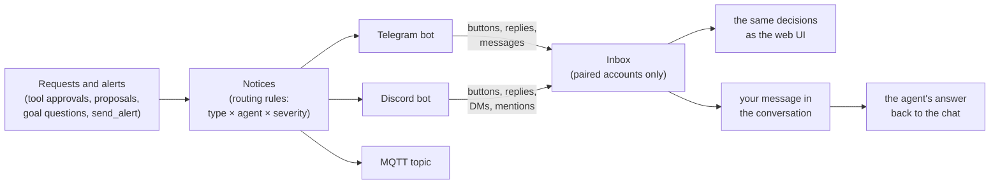

# Notifications

Requests and alerts on Telegram, Discord and MQTT, and answering agents from your phone. Back to the [overview](../README.md).

## Notifications: Telegram, Discord and MQTT

Everything that waits for you shows up in the **Requests** inbox: tool approvals, sub-agent requests, skill, profile and knowledge proposals, done claims, proposed goals, goal questions and desktop take-overs. **Notification channels** (Settings → Notifications) send these to you as well, together with agents' **alerts**. Chat channels also take your answers, so you can handle most of them from your phone.

- **Channels:** **MQTT** publishes each notice's event JSON on a topic, as before (it's set up for you from `AHQ_MQTT_URL` and the old Settings → Sub-agents switch). **Telegram** and **Discord** use a bot of your own. Both are drivers on one framework (`app/channels/`): what to send, who may answer and what an answer does are shared, so they behave the same.
- **Routing rules:** each channel has one or more rules. A rule picks notice types (none = all), agents (none = all) and, for alerts, the lowest severity it takes. A notice goes to a channel when any of its rules match, so "tool approvals and goal questions from everyone, plus Breaker's and Mainframe's critical alerts" is two rules.
- **No inbound access needed.** Agent HQ reads a Telegram bot's messages by long polling (`getUpdates`), and keeps a Gateway websocket open to Discord (resuming it after a drop, so nothing is missed). Nothing on the internet has to reach Agent HQ. The listeners run in the API process (`AHQ_CHANNELS=1`, the default); a Valkey lock keeps a second API process from reading the same bot.

**Setting up Telegram:**
1. Create a bot with @BotFather (`/newbot`) and copy its token.
2. Under **Settings → Notifications**, choose **+ New… → Telegram bot**, paste the token and save. Agent HQ checks it with Telegram (`getMe`) and stores it encrypted when `AHQ_SECRET_KEY` is set; it's never shown again.
3. **Pair an account:** this makes a one-time code that's valid for 10 minutes. Open the `t.me` link it shows and tap **Start**, or send the bot `/start <code>`. Only paired accounts get notices and can answer. Anyone else who finds the bot is ignored without a reply, and logged under **Recent activity**.
4. **Send a test** to check it arrives.

**Setting up Discord:**
1. In the [Discord Developer Portal](https://discord.com/developers/applications), create an application. On its **Bot** page, **Reset Token** and copy it.
2. Under **Settings → Notifications**, choose **+ New… → Discord bot**, paste the token and save. Agent HQ checks it with Discord and stores it the same way as a Telegram token.
3. Use the channel's **invite link** to add the bot to a server you're in. Discord only lets you DM a bot you share a server with.
4. **Pair an account:**
   - **In a DM:** send the bot `!start <code>`, and notices come to your DMs.
   - **In a server channel:** post `@YourBot !start <code>` there, and notices go to that channel. Only paired accounts can press its buttons or talk to the bot; everyone else in the channel is ignored.
5. **Send a test.**

Commands start with `!` on Discord (`!new`, `!help`), since Discord keeps `/` for its own commands.

Discord only shows a bot the text of some messages unless it has the privileged **Message Content** intent:
- **Always visible:** DMs, messages that @mention the bot, and replies to its messages (with *ping on reply* on, which is Discord's default).
- **Without the intent:** that's everything above needs, so leave it off.
- **With it:** tick **Message Content** on the channel to talk in a paired server channel without mentioning the bot. Turn it on for the bot in the Developer Portal as well (**Bot → Privileged Gateway Intents**), or Discord refuses the connection, and the channel shows that error.

On Discord, notices are embeds coloured by kind (alerts by severity), and agents' answers are plain messages, so their Markdown renders. A button press is answered only to the person who pressed it.

**Answering from the chat:**
- **Buttons decide the request** with the same code the web UI uses: ✅ Approve / ❌ Deny for tool approvals, sub-agent requests (as asked; change the terms in Agent HQ) and proposals; ✅ Confirm done / ↩️ Send back for done claims; To Ready / To Backlog / Reject for proposed goals.
- **A reply that starts with approve/yes or deny/no** decides it too, and the rest becomes your note: "no, not on a Friday".
- **Any other reply to a notice** (a goal question, an alert, an agent's answer) goes to that notice's conversation as your message.
- **A message that isn't a reply** goes to the channel's **default agent**, in a conversation of the channel's own. `/new` (`!new` on Discord) starts a fresh one, and `/help` (`!help`) lists the commands.
- **Answers come back:**
  - The agent's answer to a turn you started from the chat is sent back to the chat.
  - So is anything in the channel's own conversation.
  - After you answer from the chat, that conversation's background reports and follow-ups go there too, for **Follow-ups for** minutes (default 30). Goal turns, events and schedules don't follow you there.
- **Every copy is settled:** whichever way a request is decided (web UI, Telegram, Discord, another paired account), each message about it is edited to show the outcome ("✅ Approved via Phone (Mike)") and loses its buttons. Tapping a stale button says what already happened.

**Decide from the chat** can be turned off per channel. Requests then arrive with a link only, and you decide them in Agent HQ, behind its sign-in and two-factor. Every decision, reply, chat, pairing and refusal on a channel is logged under its **Recent activity**, with the sender.

**Alerts.** Tick **Alerts** on an agent (Settings → Agents) to give it `send_alert(message, severity)`. It's for things you should know about now, such as an outage or a failure that needs you, not for routine results. The alert goes to the channels whose rules take `agent_alert` at that severity (info, warning or critical). Replying to it continues the agent's conversation. Each agent may send at most **Alerts per agent per hour** (Settings → Notifications, default 10); beyond that, the tool refuses.

**Budget warnings.** A budget (Reports → Budgets) sends a *warning* at its early-warning point and a *critical* notice at 100%, once each per period, to the channels whose rules take `budget_warning`. They only inform; nothing is stopped. New chat channels take them; tick **Budget warnings** on an existing channel's rule. See [Budgets](budgets.md).
